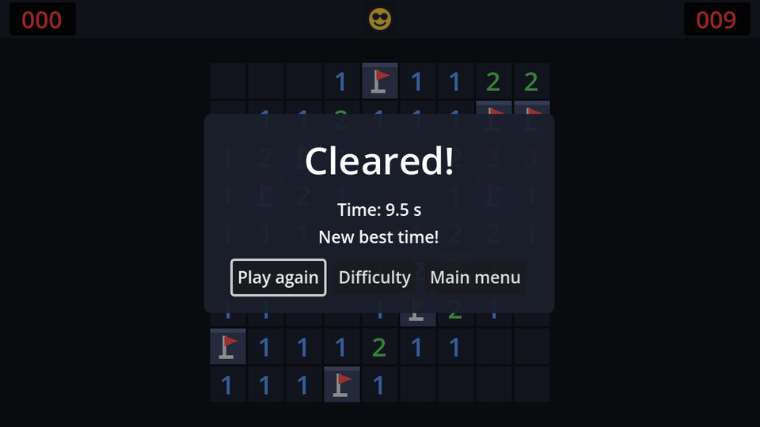
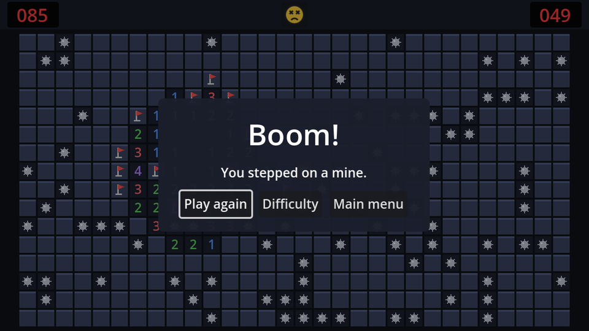

When a game ends, the player wants two things, in this order: a moment to look at the board (*where* was that mine?), then a clear result and a choice of what to do next.

## The scene

The result screen is a `CanvasLayer` on layer 10, like the pause menu, but this time the board should stay visible, so the dim is light:

```text
ResultScreen (CanvasLayer, layer 10)
└── Dim (ColorRect, Full Rect)          # black at 40% alpha
    └── CenterContainer (Full Rect)
        └── Panel (PanelContainer)      # rounded dark StyleBoxFlat, padding 24×16
            └── VBoxContainer           # separation 10
                ├── TitleLabel (Label, %)        # font size 32, centred
                ├── DetailLabel (Label, %)       # centred
                └── Buttons (HBoxContainer)      # separation 8
                    ├── PlayAgainButton (Button, %)   # "Play again"
                    ├── NewGameButton (Button)        # "Difficulty"
                    └── MainMenuButton (Button)       # "Main menu"
```

Unlike the pause menu, everything here is a child of `Dim`. That makes `Dim` the one node that represents "the whole screen", which we'll use to fade it all in during the polish chapter. A `ColorRect` can have children like any other `Control`.

Give `Panel` a **Theme Overrides → Styles → Panel** of a new `StyleBoxFlat`: background `#1b1f2c` at 95% alpha, corner radius 6, content margins 24 left/right and 16 top/bottom.

```gdscript title="result_screen.gd"
extends CanvasLayer
## Shown a moment after the game ends: the result, the time, and what to do next.

@onready var title_label: Label = %TitleLabel
@onready var detail_label: Label = %DetailLabel
@onready var play_again_button: Button = %PlayAgainButton


func _ready() -> void:
	hide()


func show_win(seconds: float, best: float, new_record: bool) -> void:
	title_label.text = "Cleared!"
	var details := "Time: " + Records.format_time(seconds)
	if new_record:
		details += "\nNew best time!"
	elif best >= 0.0:
		details += "\nBest: " + Records.format_time(best)
	else:
		details += "\nCustom boards don't keep records."
	detail_label.text = details
	_open()


func show_loss() -> void:
	title_label.text = "Boom!"
	detail_label.text = "You stepped on a mine."
	_open()


func _open() -> void:
	show()
	play_again_button.grab_focus()


func _on_play_again_button_pressed() -> void:
	get_tree().reload_current_scene()


func _on_new_game_button_pressed() -> void:
	get_tree().change_scene_to_file("res://difficulty_menu.tscn")


func _on_main_menu_button_pressed() -> void:
	get_tree().change_scene_to_file("res://main_menu.tscn")
```

`"\n"` in a string is a line break, so the detail label shows the time on one line and the record on the next. There are three cases for the second line: a new record, an existing record to beat, or a custom board with no record at all (`best` is -1).

**Play again** reloads the game scene, which keeps the same difficulty because `Settings.difficulty` lives in the autoload. **Difficulty** goes back to the difficulty screen.

## A moment to look

Add a `Timer` named `ResultTimer` to `game.tscn`: **Wait Time** `1.2`, **One Shot** on. Connect its `timeout` signal to `Game`. Instance `result_screen.tscn` in `game.tscn` too.

Why a `Timer` node rather than `await get_tree().create_timer(1.2).timeout`? The node lives inside the game scene: it pauses with the game, and it disappears if the player restarts during the delay. A tree timer from `create_timer` belongs to the `SceneTree`, not to the scene: it ignores pause by default, keeps running across a restart, and then resumes code in a game that has already been thrown away.

## Wiring it up

Here's the complete `game.gd` for this chapter:

```gdscript title="game.gd" del={72} ins={9-10,15-17,50-53,67,73-74,77-81}
extends Node
## Runs one game: builds the board, keeps time, and reacts to the board's signals.

## Small boards stop growing at this cell size.
const MAX_CELL_SIZE := 32

var model: BoardModel
var elapsed := 0.0
var _won := false
var _new_record := false

@onready var board: Control = %Board
@onready var board_area: CenterContainer = %BoardArea
@onready var hud: CanvasLayer = $HUD
@onready var pause_menu: CanvasLayer = $PauseMenu
@onready var result_screen: CanvasLayer = $ResultScreen
@onready var result_timer: Timer = $ResultTimer


func _ready() -> void:
	var config := Settings.board_config()
	model = BoardModel.new(config.width, config.height, config.mines)
	board.setup(model, fit_cell_size(board_area.size, model.width, model.height))
	hud.set_mines_left(model.flags_left())
	hud.set_time(0.0)


func _process(delta: float) -> void:
	if model.state == BoardModel.GameState.PLAYING:
		elapsed += delta
		hud.set_time(elapsed)


func _unhandled_input(event: InputEvent) -> void:
	if event.is_action_pressed("restart"):
		get_viewport().set_input_as_handled() # Before restarting: that frees this node.
		restart()


## The biggest whole-pixel cell size at which the board fits in `area`.
static func fit_cell_size(area: Vector2, columns: int, rows: int) -> int:
	var fit := floori(minf(area.x / columns, area.y / rows))
	return mini(fit, MAX_CELL_SIZE)


func restart() -> void:
	get_tree().reload_current_scene()


func _end_game(won: bool) -> void:
	_won = won
	pause_menu.set_process_unhandled_input(false)
	result_timer.start() # A moment to look at the board before the result screen.


func _on_board_flags_changed(flags_left: int) -> void:
	hud.set_mines_left(flags_left)


func _on_board_held_changed(held: bool) -> void:
	if not model.is_finished():
		hud.set_face(SmileyButton.Face.WORRIED if held else SmileyButton.Face.SMILE)


func _on_board_game_lost(_cell: Vector2i) -> void:
	hud.set_face(SmileyButton.Face.DEAD)
	_end_game(false)


func _on_board_game_won() -> void:
	hud.set_face(SmileyButton.Face.COOL)
	Records.submit(Settings.difficulty, elapsed)
	_new_record = Records.submit(Settings.difficulty, elapsed)
	_end_game(true)


func _on_result_timer_timeout() -> void:
	if _won:
		result_screen.show_win(elapsed, Records.get_best(Settings.difficulty), _new_record)
	else:
		result_screen.show_loss()
```

- Both endings go through `_end_game`, which remembers the outcome and starts the timer. When it fires, `_on_result_timer_timeout` shows the right version of the screen.
- `pause_menu.set_process_unhandled_input(false)` switches off the pause menu's <kbd>Esc</kbd> handling: pausing on top of the result screen would just stack two menus.
- `_new_record` stores what `submit` returned, so the result screen can say "New best time!" instead of showing a best time equal to the time you just played.

Connect the result screen's three buttons, and play: win a game, lose a game, and try every button.



```quiz
question: Why does the game wait 1.2 seconds before showing the result screen?
options:
  - Godot needs time to save the record
  - So the player can see the final board, like where the mines were, before a panel covers it
  - Scene changes need a delay
answer: 1
explain: The board is the story of the game. A short pause lets the player take it in.
```

```quiz
question: Why is `ResultTimer` a node in the game scene instead of `get_tree().create_timer(1.2)`?
options:
  - Timer nodes are more accurate
  - The node pauses with the game and is freed if the scene restarts during the delay
  - create_timer doesn't exist in Godot 4
answer: 1
explain: A tree timer ignores pause by default and outlives the scene, so it could fire into a game that no longer exists.
```

```quiz
question: Why does `show_win` receive `new_record` instead of comparing `seconds` and `best` itself?
options:
  - After a new record, best already equals seconds, so the comparison can't tell a new record from a tie
  - Floats can't be compared
  - To make the function shorter
answer: 0
explain: By the time the screen opens, `submit` has already stored the new time as the best. The game remembers what `submit` said instead.
```
