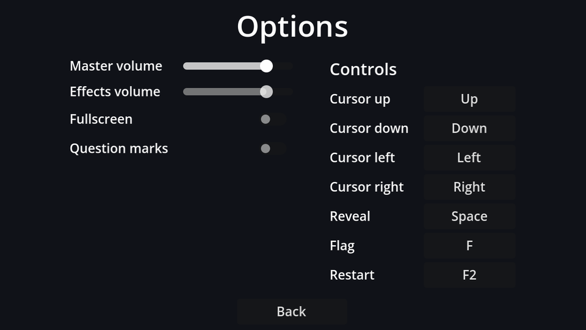

## Layout

New scene, `Control` root (Full Rect) named `OptionsMenu`, saved as `options_menu.tscn`. Settings go in a two-column `GridContainer` (labels left, controls right), with the key bindings in a second column next to it:

```text
OptionsMenu (Control, Full Rect)
├── CenterContainer (Full Rect)
│   └── VBoxContainer                          # separation 12
│       ├── Title (Label)                      # "Options", size 32
│       ├── Columns (HBoxContainer)            # separation 40
│       │   ├── SettingsGrid (GridContainer)   # columns 2, Vertical: Shrink Begin
│       │   │   ├── Label "Master volume"   ├── MasterSlider (HSlider, %)
│       │   │   ├── Label "Effects volume"  ├── SfxSlider (HSlider, %)
│       │   │   ├── Label "Fullscreen"      ├── FullscreenCheck (CheckButton, %)
│       │   │   └── Label "Question marks"  └── QuestionCheck (CheckButton, %)
│       │   └── Controls (VBoxContainer)       # separation 6
│       │       ├── ControlsTitle (Label)      # "Controls", size 18
│       │       └── ControlsGrid (GridContainer, %)   # columns 2, filled from code
│       └── BackButton (Button)                # min width 120, Horizontal: Shrink Center
└── TestSound (AudioStreamPlayer)              # Bus: SFX
```

| Node | Properties |
| --- | --- |
| `MasterSlider`, `SfxSlider` | Max Value `1`, Step `0.05`, Vertical: Shrink Center. Custom Minimum Size x `120` on the first one; the grid column makes the second just as wide. |
| `SettingsGrid` | h_separation 16, v_separation 8 |
| `ControlsGrid` | h_separation 16, v_separation 4 (seven rows have to fit in 360 pixels) |

A `GridContainer` fills row by row, so add children in label, control, label, control... order.

## The script

Connect each control's change signal to `OptionsMenu`: `value_changed` for the sliders, `toggled` for the CheckButtons, and `pressed` for Back.

```gdscript title="options_menu.gd"
extends Control

@onready var master_slider: HSlider = %MasterSlider
@onready var sfx_slider: HSlider = %SfxSlider
@onready var fullscreen_check: CheckButton = %FullscreenCheck
@onready var question_check: CheckButton = %QuestionCheck


func _ready() -> void:
	# The *_no_signal setters avoid triggering our change handlers (and the test sound).
	master_slider.set_value_no_signal(Settings.master_volume)
	sfx_slider.set_value_no_signal(Settings.sfx_volume)
	fullscreen_check.set_pressed_no_signal(Settings.fullscreen)
	question_check.set_pressed_no_signal(Settings.question_marks)
	master_slider.grab_focus()


func _on_master_slider_value_changed(value: float) -> void:
	Settings.master_volume = value
	Settings.apply()


func _on_sfx_slider_value_changed(value: float) -> void:
	Settings.sfx_volume = value
	Settings.apply()
	$TestSound.play() # Let the player hear the new volume.


func _on_fullscreen_check_toggled(toggled_on: bool) -> void:
	Settings.fullscreen = toggled_on
	Settings.apply()


func _on_question_check_toggled(toggled_on: bool) -> void:
	Settings.question_marks = toggled_on


func _on_back_button_pressed() -> void:
	Settings.save_settings()
	get_tree().change_scene_to_file("res://main_menu.tscn")
```

Changes apply **immediately** (you hear the volume change as you drag), and are **saved** when you leave the screen. Saving on every slider tick would write the file dozens of times per second.

:::warning[The `_no_signal` setters]
Setting `slider.value = x` emits `value_changed` just like dragging does. In `_ready` that would run every handler and play the test sound as soon as the screen opens. `set_value_no_signal` and `set_pressed_no_signal` update the control quietly.
:::

`TestSound` needs a sound to play; we add sound files in the polish chapter. Until then, it plays silence.

## Question marks

Some players like a third right-click state: a `?` that means "not sure yet". Unlike a flag, it doesn't protect the cell and doesn't count towards the mine counter; it's just a note. It annoys other players (one more right-click to clear a flag), which is why it's an option, off by default.

The cycle becomes:

```text
without question marks:  hidden → flag → hidden
with question marks:     hidden → flag → ? → hidden
```

That's a change to the rules, so it goes in the model. `toggle_flag` gets a parameter:

```gdscript title="board_model.gd" del={1-2,13} ins={3-4,14,16-17}
## Flag a hidden cell, or unflag a flagged one.
func toggle_flag(pos: Vector2i) -> bool:
## Cycle a covered cell: hidden → flagged → question mark (optional) → hidden.
func toggle_flag(pos: Vector2i, use_question_marks: bool) -> bool:
	if is_finished():
		return false
	var cell := get_cell(pos)
	match cell.state:
		CellState.HIDDEN:
			cell.state = CellState.FLAGGED
			flags_placed += 1
		CellState.FLAGGED:
			cell.state = CellState.HIDDEN
			cell.state = CellState.QUESTIONED if use_question_marks else CellState.HIDDEN
			flags_placed -= 1
		CellState.QUESTIONED:
			cell.state = CellState.HIDDEN
		_:
			return false # Revealed cells can't be flagged.
	return true
```

Why a parameter, rather than the model reading `Settings.question_marks` itself? The model has never known about nodes, autoloads or files, and that's what makes it easy to reason about and to test. Whoever calls it passes the setting in.

That caller is the board, which also has to draw the `?`:

```gdscript title="board.gd" del={4} ins={5}
func _toggle_flag(pos: Vector2i) -> void:
	if pos == NO_CELL:
		return
	if model.toggle_flag(pos):
	if model.toggle_flag(pos, Settings.question_marks):
		flags_changed.emit(model.flags_left())
		queue_redraw()
```

```gdscript title="board.gd" ins={7-8}
	if not face_up:
		_draw_covered(rect)
		if cell.state == BoardModel.CellState.FLAGGED:
			_draw_flag(rect)
			if lost and not cell.is_mine:
				_draw_cross(rect) # This flag was wrong.
		elif cell.state == BoardModel.CellState.QUESTIONED:
			_draw_text(rect, "?", COLOR_POLE)
		return
```

`can_reveal()` has allowed question-marked cells since the very first chapter, and the flood fill and chording already use it, so nothing else needs to change. When the option is switched off, existing question marks keep working: they're cleared by the next right-click.

Run the game, open **Options** from the main menu, change things, go back, and quit. Start the game again and open **Options**: everything is as you left it.

```quiz
question: In _ready, why use `set_value_no_signal` instead of assigning `value`?
options:
  - Assigning value is deprecated
  - Assigning value emits value_changed, which would run the handlers and play the test sound
  - set_value_no_signal is faster
answer: 1
```

```quiz
question: With question marks on, a cell is flagged. What does one right-click do?
options:
  - Removes the flag
  - Turns it into a question mark, and the mine counter goes up by one
  - Reveals it
answer: 1
explain: Flagged → questioned. A question mark isn't a flag, so `flags_placed` drops and the counter shows one more mine left.
```

```quiz
question: Why does `toggle_flag` take `use_question_marks` as a parameter instead of reading `Settings.question_marks`?
options:
  - Autoloads can't be read from RefCounted objects
  - The model stays independent of nodes and autoloads, so it can be used and tested on its own
  - Parameters are faster than global variables
answer: 1
explain: The board passes the setting in. The model only knows the rules.
```
