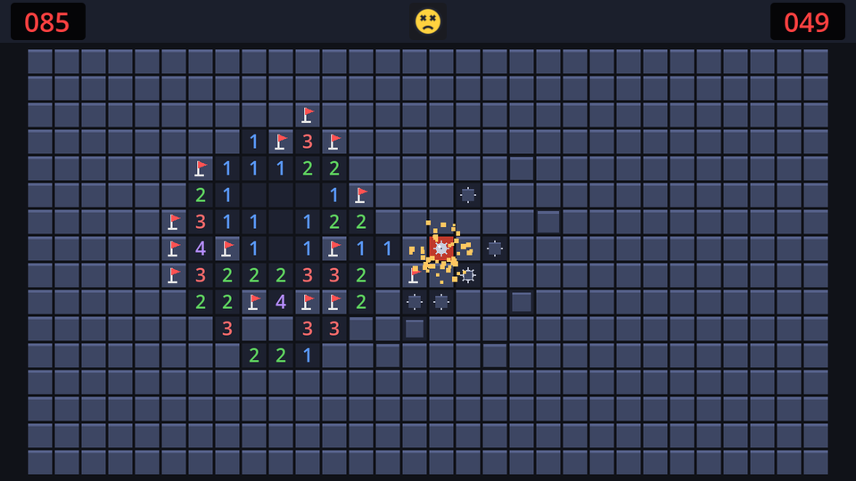

A mine going off deserves more than a red square. A burst of sparks flying out and falling down sells it, and Godot's particle nodes make it a few properties and three lines of code.

## CPU or GPU particles?

Godot has two 2D particle nodes with almost the same settings:

| Node | Simulated on | Good for |
| --- | --- | --- |
| `GPUParticles2D` | The graphics card | Thousands of particles, complex effects |
| `CPUParticles2D` | The processor | Small effects; works the same on every renderer and platform |

A burst of 48 sparks is tiny, and `CPUParticles2D` needs no extra resources (no `ParticleProcessMaterial`), so we use that. You can convert between them later from the toolbar's **CPUParticles2D → Convert to GPUParticles2D** menu.

## The node

Add a `CPUParticles2D` named `Explosion` as a **child of `Board`** in `game.tscn`, and mark it **Access as Unique Name**. Being a child of the board means its position is in the board's coordinates, the same coordinates the board uses for cells.

| Property | Value | Why |
| --- | --- | --- |
| Emitting | off | Only when we say so |
| Amount | `48` | Number of sparks |
| Lifetime | `0.9` | Seconds each spark lives |
| One Shot | on | One burst, not a fountain |
| Explosiveness | `1` | All sparks at once instead of spread over the lifetime |
| Direction → Spread | `180` | All directions |
| Gravity | `(0, 250)` | Sparks fall down |
| Initial Velocity Min / Max | `60` / `180` | Some sparks fly further |
| Damping Min / Max | `40` / `80` | They slow down in the air |
| Scale Amount Min / Max | `2` / `4` | Without a texture, each particle is a 1px square; scaling makes chunky pixels |
| Color Ramp | new `Gradient`: pale yellow → orange → transparent dark red | Hot, then cooling and fading out |

For the colour ramp, click the empty **Color Ramp** property, choose **New Gradient**, and edit its points: `#fff299` at the start, `#ff8c1a` at about a third, and dark red with alpha 0 at the end. Each spark's colour runs along the gradient over its lifetime.

## Fire it

The board can tell us where a cell is; add a small helper to `board.gd`, after `setup`:

```gdscript title="board.gd"
## The centre of a cell in the board's own coordinates.
func cell_center(pos: Vector2i) -> Vector2:
	return (Vector2(pos) + Vector2(0.5, 0.5)) * cell_size
```

Then in `game.gd`, move the particles to the mine and restart them. The handler's parameter finally gets used, so it loses its underscore:

```gdscript title="game.gd" ins={1,7,10-11} del={6}
@onready var explosion: CPUParticles2D = %Explosion

# ...


func _on_board_game_lost(_cell: Vector2i) -> void:
func _on_board_game_lost(cell: Vector2i) -> void:
	hud.set_face(SmileyButton.Face.DEAD)
	$Sounds/Boom.play()
	explosion.position = board.cell_center(cell)
	explosion.restart()
	_end_game(false)
```

`restart()` starts a fresh burst even if the node has emitted before. Add the `@onready` line next to the others.

Because the game wasn't paused and nothing waits for the particles, they fly while the mines ripple out and the result timer counts down. Sound, sparks and ripple together make losing almost fun.

## The final game script

Here's the finished `game.gd`, for reference:

```gdscript title="game.gd"
extends Node
## Runs one game: builds the board, keeps time, and reacts to the board's signals.

## Small boards stop growing at this cell size.
const MAX_CELL_SIZE := 32

var model: BoardModel
var elapsed := 0.0
var _won := false
var _new_record := false

@onready var board: Control = %Board
@onready var board_area: CenterContainer = %BoardArea
@onready var explosion: CPUParticles2D = %Explosion
@onready var hud: CanvasLayer = $HUD
@onready var pause_menu: CanvasLayer = $PauseMenu
@onready var result_screen: CanvasLayer = $ResultScreen
@onready var result_timer: Timer = $ResultTimer


func _ready() -> void:
	var config := Settings.board_config()
	model = BoardModel.new(config.width, config.height, config.mines)
	board.setup(model, fit_cell_size(board_area.size, model.width, model.height))
	hud.set_mines_left(model.flags_left())
	hud.set_time(0.0)


func _process(delta: float) -> void:
	if model.state == BoardModel.GameState.PLAYING:
		elapsed += delta
		hud.set_time(elapsed)


func _unhandled_input(event: InputEvent) -> void:
	if event.is_action_pressed("restart"):
		get_viewport().set_input_as_handled() # Before restarting: that frees this node.
		restart()


## The biggest whole-pixel cell size at which the board fits in `area`.
static func fit_cell_size(area: Vector2, columns: int, rows: int) -> int:
	var fit := floori(minf(area.x / columns, area.y / rows))
	return mini(fit, MAX_CELL_SIZE)


func restart() -> void:
	get_tree().reload_current_scene()


func _end_game(won: bool) -> void:
	_won = won
	pause_menu.set_process_unhandled_input(false)
	result_timer.start() # A moment to look at the board before the result screen.


func _on_board_cells_revealed(count: int) -> void:
	if count > 1:
		$Sounds/Cascade.play()
	else:
		$Sounds/Reveal.play()


func _on_board_flags_changed(flags_left: int) -> void:
	hud.set_mines_left(flags_left)
	if not model.is_finished():
		$Sounds/Flag.play()


func _on_board_held_changed(held: bool) -> void:
	if not model.is_finished():
		hud.set_face(SmileyButton.Face.WORRIED if held else SmileyButton.Face.SMILE)


func _on_board_game_lost(cell: Vector2i) -> void:
	hud.set_face(SmileyButton.Face.DEAD)
	$Sounds/Boom.play()
	explosion.position = board.cell_center(cell)
	explosion.restart()
	_end_game(false)


func _on_board_game_won() -> void:
	hud.set_face(SmileyButton.Face.COOL)
	$Sounds/Win.play()
	_new_record = Records.submit(Settings.difficulty, elapsed)
	_end_game(true)


func _on_result_timer_timeout() -> void:
	if _won:
		result_screen.show_win(elapsed, Records.get_best(Settings.difficulty), _new_record)
	else:
		result_screen.show_loss()
```

```quiz
question: Which CPUParticles2D property makes all particles appear at the same moment?
type: text
answer: [explosiveness, Explosiveness]
explain: Explosiveness 1 emits the whole amount at once; 0 spreads emission evenly over the lifetime.
```

```quiz
question: Why is the Explosion node a child of the Board?
options:
  - Particles must be children of a Control
  - Its position is then in the board's coordinates, so `cell_center()` can be used directly
  - So the particles are hidden when the board is hidden
answer: 1
explain: A child's position is relative to its parent. The board's cell coordinates and the particles' position share the same origin.
```

```quiz
question: What would happen without One Shot enabled?
options:
  - Nothing different
  - The node would keep emitting sparks continuously, like a fountain
  - The particles would never appear
answer: 1
explain: One Shot emits a single cycle of particles and stops. Without it, emission repeats every lifetime.
```
