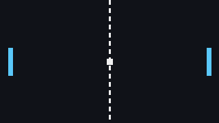
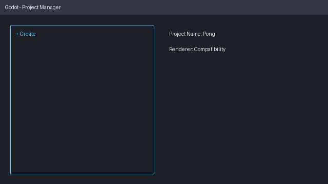

By the end of this tutorial you'll have a working two-player Pong:



## Download

Grab the **standard** (non-.NET) build of Godot 4 from the official site. It is a single executable with no installer.

:::tip
On macOS, drag Godot into `/Applications` so Spotlight can find it.
:::

## The project manager

When you start Godot you land in the *project manager*. This is where you create, import and open projects.



```quiz
question: Which Godot build do you need for GDScript-only projects?
options:
  - The .NET build
  - The standard build
  - Either; they are identical
answer: 1
explain: The .NET build adds C# support. For GDScript the **standard** build is smaller and simpler.
```
