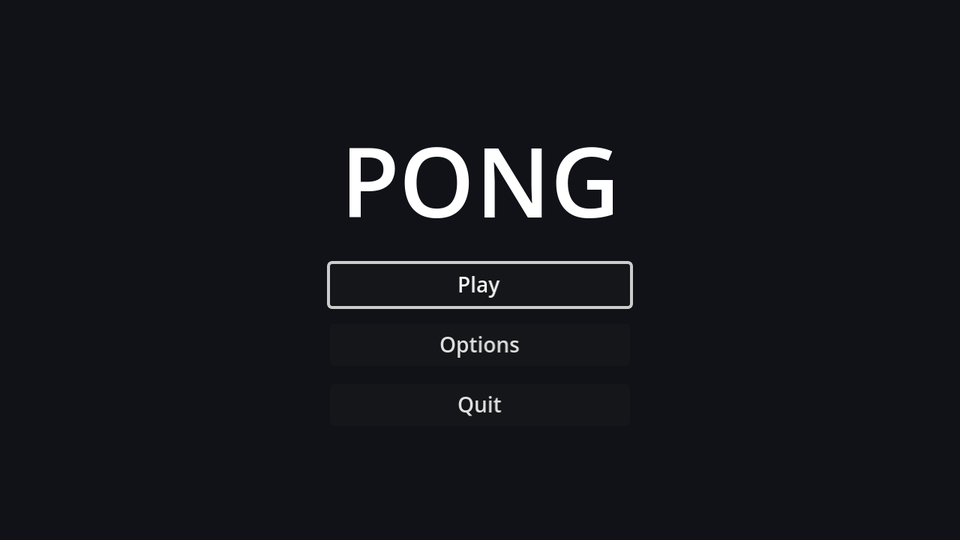

## Layout

Create a scene with a `Control` root named `MainMenu` and save it as `main_menu.tscn`. In the toolbar's **Anchor preset** menu, choose **Full Rect** so it covers the whole screen.

```text
MainMenu (Control, Full Rect)
└── CenterContainer (Full Rect)
    └── VBoxContainer          # min size 200×0, separation 12
        ├── Title (Label)      # "PONG", font size 64, centred
        ├── PlayButton (Button)
        ├── OptionsButton (Button)
        └── QuitButton (Button)
```

The `VBoxContainer`'s minimum width makes all buttons the same width; the `CenterContainer` keeps the whole stack centred at any window size.

Right-click `PlayButton` and `QuitButton` and choose **Access as Unique Name**. A `%` appears next to them, and scripts can now find them with `%PlayButton` wherever they are in the tree. Rearranging the layout later won't break any paths.

## A project theme

Default Godot UI text is tiny at 640×360. Rather than overriding the font size on every control, create a **Theme**: in the FileSystem dock, **New Resource → Theme**, save it as `theme.tres`, and set **Default Font Size** to `14`. Then set it as the project-wide theme in **Project Settings → GUI → Theme → Custom**.

Every `Control` in the game now uses it. Individual nodes (like the title) can still override it.

## The script

Connect each button's `pressed` signal to `MainMenu` (Node dock → Signals), then fill in the methods:

```gdscript title="main_menu.gd"
extends Control

@onready var play_button: Button = %PlayButton
@onready var quit_button: Button = %QuitButton


func _ready() -> void:
	# Browsers can't close the tab for us, so hide Quit in web builds.
	quit_button.visible = not OS.has_feature("web")
	play_button.grab_focus()


func _on_play_button_pressed() -> void:
	get_tree().change_scene_to_file("res://game.tscn")


func _on_options_button_pressed() -> void:
	get_tree().change_scene_to_file("res://options_menu.tscn")


func _on_quit_button_pressed() -> void:
	get_tree().quit()
```

`grab_focus()` matters more than it looks. With a focused button, the menu works entirely from the keyboard or a gamepad: arrow keys move between buttons and <kbd>Enter</kbd> or <kbd>Space</kbd> presses them. Godot works out the focus order from the layout.

:::warning
`options_menu.tscn` doesn't exist yet. Clicking Options will print an error until the next chapter.
:::

## Make it the main scene

Open **Project Settings → Application → Run** and set **Main Scene** to `res://main_menu.tscn`. <kbd>F5</kbd> now starts at the menu, while <kbd>F6</kbd> still runs whatever scene is open, which is handy for testing the game directly.

```quiz
question: What does marking a node "Access as Unique Name" let you write in a script?
type: text
answer: ["%PlayButton", "$%PlayButton"]
hint: It's a single symbol followed by the node's name.
explain: '`%PlayButton` finds the node by name anywhere in the same scene, so moving it around the tree does not break the script.'
```
