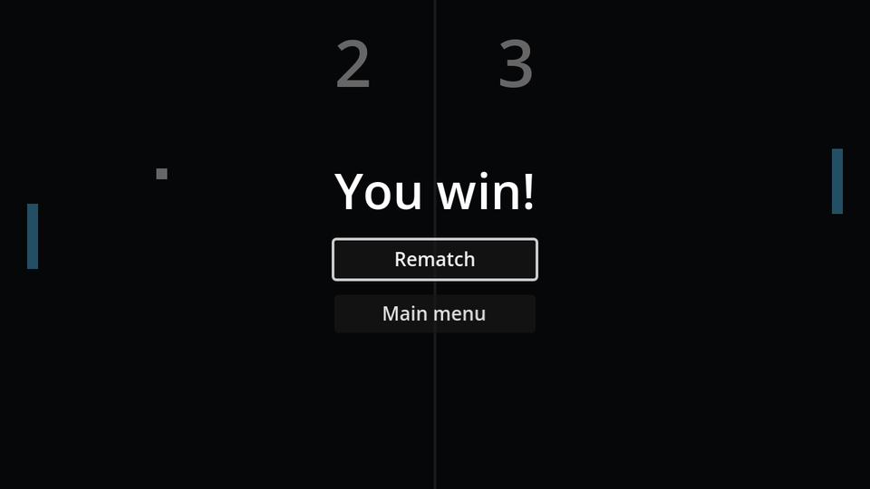

## The screen

The game over screen is built just like the pause menu: a `CanvasLayer` (layer 10) named `GameOver` with a dim background and a centred `VBoxContainer`. Give the label and the first button unique names:

```text
GameOver (CanvasLayer, layer 10)
├── Dim (ColorRect)
└── CenterContainer
    └── VBoxContainer
        ├── WinnerLabel (Label, %)     # font size 36
        ├── RematchButton (Button, %)
        └── MainMenuButton (Button)
```

```gdscript title="game_over.gd"
extends CanvasLayer

@onready var winner_label: Label = %WinnerLabel
@onready var rematch_button: Button = %RematchButton


func _ready() -> void:
	hide()


func show_winner(player: int, vs_cpu: bool) -> void:
	if vs_cpu:
		winner_label.text = "You win!" if player == 0 else "The CPU wins"
	else:
		winner_label.text = "Left player wins!" if player == 0 else "Right player wins!"
	show()
	rematch_button.grab_focus()


func _on_rematch_button_pressed() -> void:
	get_tree().reload_current_scene()


func _on_main_menu_button_pressed() -> void:
	get_tree().change_scene_to_file("res://main_menu.tscn")
```

`reload_current_scene()` throws away the whole game scene and loads a fresh one, so the scores, ball and timers all reset for free. No reset code needed.

The `vs_cpu` parameter is for the CPU opponent we add later; for now pass `false`.

## The win condition

Instance `game_over.tscn` in `game.tscn` and check for a winner after every point:

```gdscript title="game.gd" ins={1,3-4,11-14}
const WINNING_SCORE := 5

@onready var pause_menu: CanvasLayer = $PauseMenu
@onready var game_over: CanvasLayer = $GameOver


func _score(player: int) -> void:
	scores[player] += 1
	hud.update_scores(scores[0], scores[1])
	ball.reset.call_deferred()
	if scores[player] >= WINNING_SCORE:
		pause_menu.set_process_unhandled_input(false)
		game_over.show_winner(player, false)
		return
	serve_direction = -1.0 if player == 1 else 1.0
	serve_timer.start()
```

`set_process_unhandled_input(false)` switches off the pause menu's <kbd>Esc</kbd> handling: pausing on the game over screen would just stack two menus.

:::note
`WINNING_SCORE` is a constant for now. In the next chapter it moves into the options screen.
:::

```quiz
question: Why does Rematch not need to reset the scores, ball or timer?
options:
  - reload_current_scene creates fresh instances of every node in the scene
  - Godot remembers the initial values of all variables
  - It does need to; that's a bug
answer: 0
```
