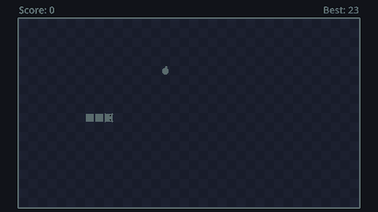

This tutorial builds a complete Snake, step by step, from an empty folder:

- a snake that moves across a grid, one cell at a time
- controls that remember quick key presses, so tight turns feel fair
- food, growing, a score, and a snake that speeds up as it grows
- crashing into walls or yourself, plus an optional wrap-around mode
- a main menu, a pause menu and a game over screen with a saved high score
- an options screen with volume, fullscreen, game settings and key rebinding
- sound effects, little animations, and finally an exported game you can share



No previous Godot or programming experience is needed. When something new shows up, the tutorial explains it right there. Every chapter ends with a game that runs, so you can stop at any point.

## How the pages work

- **Code blocks** have the file name on top. Lines with a green background are new, red ones are removed. A line like `# ...` means "the code you already have stays here".
- **Quizzes** at the end of most pages check the one idea that matters most. They are not graded; they are there to make sure nothing slipped past.
- Stuck? Each chapter's last page links to the next step, and chapter 1 ends with a downloadable checkpoint project.

## Download Godot

Grab the **standard** build of Godot 4 from the official website (not the .NET build, which adds C# support we don't need). It is a single program with no installer: unzip it and run it. This tutorial was written with Godot 4.7, but any version from 4.3 up works.

:::tip
On macOS, drag Godot into `/Applications` so Spotlight finds it. On Windows, put it somewhere permanent (like `C:\Godot`) and pin it to the taskbar.
:::

## The project manager

When Godot starts, it opens the **project manager**: a list of your projects, with buttons to create, import or open one. Opening a project takes you into the **editor**, where you build the game itself.

```quiz
question: Which Godot download do you need for this tutorial?
options:
  - The .NET build
  - The standard build
  - Both
answer: 1
explain: The .NET build adds C# support. This tutorial uses GDScript, Godot's own language, which the **standard** build includes.
```
