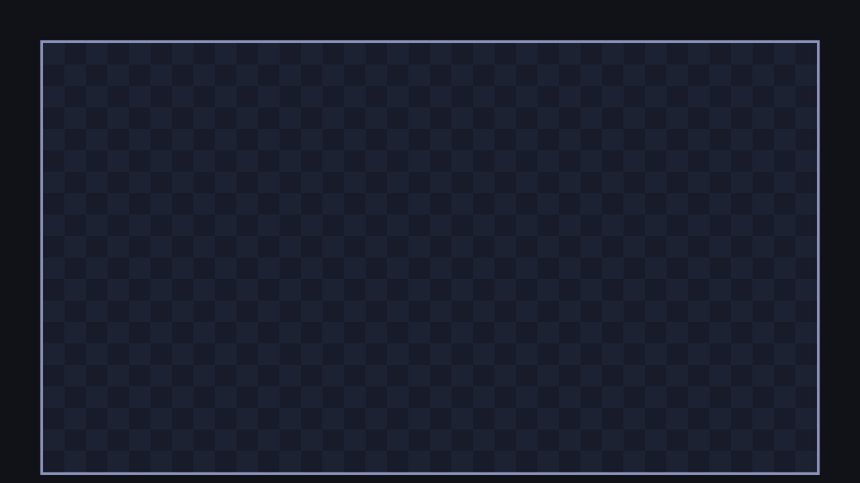

Godot could build the board out of 720 coloured rectangle nodes, but that would be a lot of clicking. Any `Node2D` can also **draw itself from code**: write a function called `_draw()` and use drawing commands inside it.

## Drawing commands

A few `draw_*` functions cover everything in this game:

| Function | Draws |
| --- | --- |
| `draw_rect(rect, color)` | A filled rectangle |
| `draw_rect(rect, color, false, width)` | Just the outline of a rectangle |
| `draw_circle(center, radius, color)` | A filled circle |
| `draw_line(from, to, color, width)` | A line |

Positions are relative to the node doing the drawing, so the board draws in board coordinates.

## A checkerboard

Add three colours and a `_draw()` function to `board.gd`:

```gdscript title="board.gd" ins={10-21}
class_name Board
extends Node2D
## The playing field. Knows the size of the grid and how grid cells map to pixels.

## The size of one cell, in pixels.
const CELL_SIZE := 16
## Number of columns (x) and rows (y).
const GRID_SIZE := Vector2i(36, 20)

const LIGHT_COLOR := Color("1d2233")
const DARK_COLOR := Color("181c2a")
const WALL_COLOR := Color("8a93b8")


func _draw() -> void:
	# A checkerboard makes it easy to see the cells.
	for x in GRID_SIZE.x:
		for y in GRID_SIZE.y:
			var color := LIGHT_COLOR if (x + y) % 2 == 0 else DARK_COLOR
			draw_rect(cell_rect(Vector2i(x, y)), color)
	draw_rect(Rect2(Vector2.ZERO, Vector2(GRID_SIZE * CELL_SIZE)).grow(1), WALL_COLOR, false, 2.0)


## The pixel rectangle covered by a cell, relative to the board.
static func cell_rect(cell: Vector2i) -> Rect2:
	return Rect2(Vector2(cell * CELL_SIZE), Vector2(CELL_SIZE, CELL_SIZE))


## The pixel position of a cell's centre, relative to the board.
static func cell_center(cell: Vector2i) -> Vector2:
	return cell_rect(cell).get_center()
```

Run it:



### What's going on

- `Color("1d2233")` makes a colour from a hex code, the same kind you'd use on a website or in a paint program.
- `-> void` means the function returns nothing.
- `for x in GRID_SIZE.x:` is a **loop**: the indented lines run 36 times, with `x` being 0, 1, 2, ... 35. Inside it, a second loop runs 20 times for `y`. Together they visit all 36 × 20 = 720 cells.
- `var color := ...` declares a **variable**: a named value that, unlike a constant, can change. This one only exists inside the loop.
- `A if condition else B` picks one of two values. `(x + y) % 2` is the remainder after dividing by 2, so it's 0 for every other cell, like the squares on a chessboard.
- The last line draws the border: a rectangle around the whole board, `grow(1)` makes it one pixel bigger on every side so the outline sits just outside the cells, `false` means "outline only" and `2.0` is the line width.

:::note[When does `_draw()` run?]
Not every frame. Godot calls `_draw()` once, remembers the result, and keeps showing it. When something changes, a node calls `queue_redraw()` to ask for a fresh `_draw()`. The board never changes (well, almost: see chapter 5), but the snake will redraw itself every time it moves.
:::

:::tip[What about TileMaps?]
Godot has a `TileMapLayer` node for painting levels out of tiles, which is great for platformers and maze games. Our board is a plain checkerboard that never changes, so a dozen lines of `_draw()` are simpler.
:::

```quiz
question: When does Godot call a node's `_draw()` function?
options:
  - Every frame
  - Once, and again whenever the node calls `queue_redraw()`
  - Only in the editor
answer: 1
explain: Godot caches what `_draw()` drew. Calling `queue_redraw()` asks for a fresh drawing on the next frame.
```

```quiz
question: Which cells get `LIGHT_COLOR`?
options:
  - Cells where x + y is even, like (0, 0), (1, 1) and (2, 0)
  - Cells where x is even
  - The cells along the border
answer: 0
explain: '`(x + y) % 2 == 0` is true when x + y is even. Moving one cell in any direction changes x + y by one, so neighbours always differ: a checkerboard.'
```
