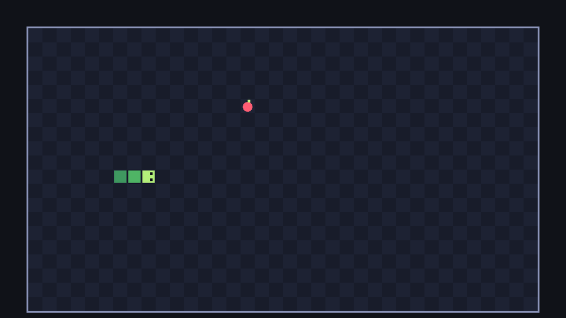

## The Food node

Add another `Node2D` under `Board`, named `Food`. Drag it **above** `Snake` in the Scene dock: nodes are drawn in tree order, top to bottom, so the snake is drawn over the food.

```text
Game (Node2D)
├── Board (Node2D)
│   ├── Food (Node2D)
│   └── Snake (Node2D)
└── MoveTimer (Timer)
```

Attach `food.gd`:

```gdscript title="food.gd"
class_name Food
extends Node2D
## The food the snake is after. Sits in one grid cell.

const COLOR := Color("ff5d73")
const LEAF_COLOR := Color("b4f07a")

## The grid cell the food is in.
var cell := Vector2i.ZERO


func place(new_cell: Vector2i) -> void:
	cell = new_cell
	position = Board.cell_center(cell)


func _draw() -> void:
	# Drawn around (0, 0): the node's position is the centre of the cell.
	draw_circle(Vector2(0, 1), 5.5, COLOR)
	draw_rect(Rect2(0, -7, 3, 3), LEAF_COLOR)
```

The food works differently from the snake. The snake draws all its cells at their board positions and never moves its node. The food is a single thing, so `place` moves the **whole node** to the centre of its cell, and `_draw` draws a little apple (a circle and a leaf) around the node's own (0, 0). Since the drawing never changes, the food never needs `queue_redraw()`. Both approaches are fine; we'll see a nice benefit of this one in the polish chapter.

The game rules only look at `cell`. The pixel `position` is just for show.

## A random free cell

Where should food appear? Anywhere, as long as it's not under the snake. The obvious approach is "pick random cells until you find a free one". That works at the start, but when the snake fills most of the board, it can take a long time to get lucky, and when the board is completely full it never stops.

A better approach: make a list of every free cell, then pick one from the list. Add this to the end of `board.gd`:

```gdscript title="board.gd"
## Every cell on the board that isn't in `taken`.
static func free_cells(taken: Array[Vector2i]) -> Array[Vector2i]:
	var cells: Array[Vector2i] = []
	for x in GRID_SIZE.x:
		for y in GRID_SIZE.y:
			var cell := Vector2i(x, y)
			if not taken.has(cell):
				cells.append(cell)
	return cells
```

The same two loops as the checkerboard visit every cell; `has` checks whether the array contains a value. Then in `game.gd`:

```gdscript title="game.gd" ins={2,8,15-19}
@onready var snake: Snake = $Board/Snake
@onready var food: Food = $Board/Food
@onready var move_timer: Timer = $MoveTimer


func _ready() -> void:
	snake.reset(START_CELL, START_LENGTH)
	_place_food()
	move_timer.start()


func _on_move_timer_timeout() -> void:
	var head := snake.next_head()
	snake.move_to(head, false)


func _place_food() -> void:
	var cells := Board.free_cells(snake.body)
	food.place(cells.pick_random())
```

`pick_random()` returns a random element of the array. The leading underscore in `_place_food` marks it as private to the game script.

Run the game a few times: the food appears somewhere new every time.



The snake passes straight over the food, though. Eating is next.

```quiz
question: Why make a list of free cells instead of trying random cells until one is free?
options:
  - Lists are always faster than random numbers
  - Trying random cells gets slow when the snake is long, and never ends when the board is full
  - pick_random only works on lists
answer: 1
explain: With 715 of 720 cells taken, random guessing fails over 99% of the time. The list approach takes the same time whatever the board looks like, and an empty list tells us the board is full.
```
