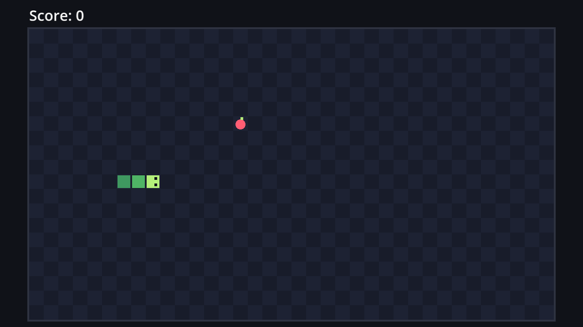

Many Snake games have a mode without deadly walls: leave the board on the right, come back on the left. Let's add it as an option.

## An exported variable

Add this to `game.gd`, below the constants:

```gdscript title="game.gd" ins={3-5}
const START_CELL := Vector2i(8, 10)

## Leave the board on one side to come back on the other, instead of crashing.
@export var wrap_around := false

var score := 0
```

`@export` shows a variable in the **Inspector**. Select `Game` in `game.tscn` and you'll find a **Wrap Around** checkbox, with the doc comment as its tooltip. Exported variables are a great way to tweak a game without editing code. (In chapter 8, this setting moves to the options screen.)

## Wrapping a cell

When the head leaves the board at x = 36, it should come back at x = 0; at x = -1, it should come back at x = 35. That's what the remainder of a division does: 36 % 36 = 0. But there's a catch with negative numbers:

| Expression | Result | |
| --- | --- | --- |
| `36 % 36` | 0 | ✓ |
| `-1 % 36` | -1 | ✗ still outside |
| `posmod(-1, 36)` | 35 | ✓ |
| `posmod(36, 36)` | 0 | ✓ |

`%` keeps the sign of the left side, while `posmod` ("positive modulo") always gives a result between 0 and 35. Add a `wrap` function to `board.gd`, after `is_inside`:

```gdscript title="board.gd" ins={3-7}
static func is_inside(cell: Vector2i) -> bool:
	return Rect2i(Vector2i.ZERO, GRID_SIZE).has_point(cell)


## Brings a cell that left the board back in on the opposite side.
static func wrap(cell: Vector2i) -> Vector2i:
	return Vector2i(posmod(cell.x, GRID_SIZE.x), posmod(cell.y, GRID_SIZE.y))
```

In the game, wrap the head instead of crashing when the mode is on:

```gdscript title="game.gd" ins={4-6} del={3}
func _on_move_timer_timeout() -> void:
	var head := snake.next_head()
	if not Board.is_inside(head):
	if wrap_around:
		head = Board.wrap(head)
	elif not Board.is_inside(head):
		_game_over()
		return
```

`elif` means "else, if": the wall check only runs when wrap-around is off. Everything after it (eating, biting yourself) works unchanged, because `wrap` always returns a normal cell on the board.

## Showing it on the board

Players should be able to see that the walls are harmless. Fade the border in wrap-around mode, with a new variable in `board.gd`:

```gdscript title="board.gd" ins={3-8,17-18} del={16}
const WALL_COLOR := Color("8a93b8")

## Solid walls are drawn bright. In wrap-around mode they fade, since they don't hurt.
var walls_solid := true:
	set(value):
		walls_solid = value
		queue_redraw()


func _draw() -> void:
	# A checkerboard makes it easy to see the cells.
	for x in GRID_SIZE.x:
		for y in GRID_SIZE.y:
			var color := LIGHT_COLOR if (x + y) % 2 == 0 else DARK_COLOR
			draw_rect(cell_rect(Vector2i(x, y)), color)
	draw_rect(Rect2(Vector2.ZERO, Vector2(GRID_SIZE * CELL_SIZE)).grow(1), WALL_COLOR, false, 2.0)
	var wall_color := WALL_COLOR if walls_solid else Color(WALL_COLOR, 0.25)
	draw_rect(Rect2(Vector2.ZERO, Vector2(GRID_SIZE * CELL_SIZE)).grow(1), wall_color, false, 2.0)
```

- The indented `set(value):` block is a **setter**: code that runs every time someone assigns to `walls_solid`. It stores the value and asks for a redraw, so the board can never show an outdated border.
- `Color(WALL_COLOR, 0.25)` is the same colour at 25% opacity.

Finally, tell the board which mode we're in. Add an `@onready` line for it and set it first thing in `_ready`:

```gdscript title="game.gd" ins={1}
@onready var board: Board = $Board
@onready var snake: Snake = $Board/Snake
```

```gdscript title="game.gd" ins={2}
func _ready() -> void:
	board.walls_solid = not wrap_around
	snake.reset(START_CELL, START_LENGTH)
```

Tick **Wrap Around** in the Inspector and run the game. The border is faint, and the snake glides through one side and out the other.



```quiz
type: text
question: What does `Board.wrap(Vector2i(-1, 20))` return? Answer like (x, y).
answer: ["(35, 0)", "(35,0)", "35, 0", "Vector2i(35, 0)"]
hint: The board is 36 × 20. Wrap x and y separately.
explain: posmod(-1, 36) = 35 and posmod(20, 20) = 0.
```

```quiz
question: Why does `walls_solid` have a setter?
options:
  - Exported variables need setters
  - So the board redraws itself whenever the value changes
  - Setters make variables read-only
answer: 1
explain: '`_draw()` results are cached. Without `queue_redraw()`, changing `walls_solid` would have no visible effect.'
```
