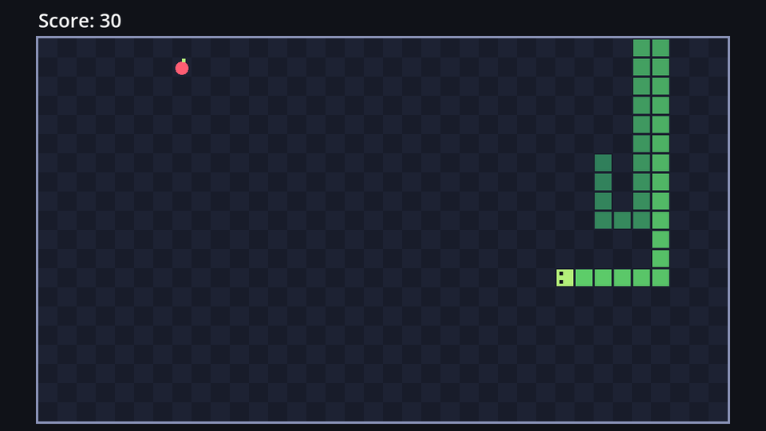

## Speed as moves per second

The `MoveTimer`'s wait time is *seconds per move*, which is awkward to think about: a *smaller* number means a *faster* snake. People think in **moves per second** instead, and converting is one division:

| Moves per second | Wait time (1 ÷ speed) |
| --- | --- |
| 5 | 0.2 s |
| 7 | ≈ 0.143 s |
| 10 | 0.1 s |
| 18 | ≈ 0.056 s |

The plan: start at 7 moves per second, and add a little speed for every piece of food, up to a maximum.

## The code

Add two constants and an exported starting speed to `game.gd`:

```gdscript title="game.gd" ins={3-6,12-13}
extends Node2D

## Extra moves per second for every piece of food eaten.
const SPEED_STEP := 0.35
## The fastest the snake will ever go, in moves per second.
const MAX_SPEED := 18.0
const START_LENGTH := 3
const START_CELL := Vector2i(8, 10)

## Leave the board on one side to come back on the other, instead of crashing.
@export var wrap_around := false
## Moves per second at the start of a game.
@export var start_speed := 7.0
```

Then a function that sets the timer from the current score, called when the game starts and after every bite:

```gdscript title="game.gd" ins={6}
func _ready() -> void:
	board.walls_solid = not wrap_around
	snake.reset(START_CELL, START_LENGTH)
	hud.update_score(score)
	_place_food()
	_update_speed()
	move_timer.start()
```

```gdscript title="game.gd" ins={4}
func _eat() -> void:
	score += 1
	hud.update_score(score)
	_update_speed()
	_place_food()
```

```gdscript title="game.gd" ins={4-8}
	food.place(cells.pick_random())


func _update_speed() -> void:
	var speed := minf(start_speed + score * SPEED_STEP, MAX_SPEED)
	move_timer.wait_time = 1.0 / speed


func _game_over() -> void:
```

- `minf(a, b)` returns the smaller of two decimal numbers. However high the score, the speed never goes past `MAX_SPEED`.
- Changing `wait_time` while the timer runs doesn't disturb the current countdown; the new value is used from the next tick on.
- We write `1.0 / speed`, not `1 / speed`: `speed` is a `float` already so either works here, but writing `1.0` makes the intent clear, and protects you from whole-number division if `speed` ever becomes an `int`.
- The Wait Time set in the Inspector (0.15) no longer matters: `_ready` overrides it before the timer starts.

Here's how it ramps up:

| Score | Moves per second |
| --- | --- |
| 0 | 7 |
| 10 | 10.5 |
| 20 | 14 |
| 30 | 17.5 |
| 32 and up | 18 (the maximum) |

Play a round. The first few bites feel relaxed; by 20 points you'll be concentrating hard.



:::tip[Tuning]
These numbers are a starting point, not a rule. Try `SPEED_STEP := 0.5` for a game that gets tough quickly, or a lower `MAX_SPEED` for younger players. Tuning numbers like these is a big part of making a game feel good.
:::

```quiz
type: text
question: Starting at 7 moves per second with SPEED_STEP 0.35, how many pieces of food until the snake reaches MAX_SPEED (18)?
answer: ["32", "thirty-two"]
hint: You need 11 extra moves per second. How many steps of 0.35 is that?
explain: 11 ÷ 0.35 ≈ 31.4, so after 31 bites the snake is at 17.85, and the 32nd bite caps it at 18.
```
