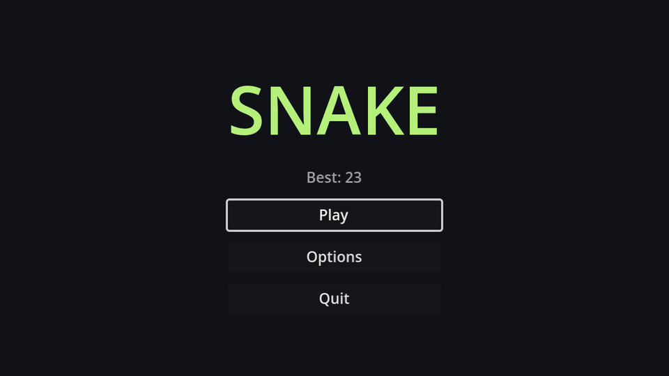

## Layout

Create a new scene with a `Control` root named `MainMenu` and save it as `main_menu.tscn`. With `MainMenu` selected, open the **Anchor preset** menu in the toolbar above the viewport (the icon with a green square) and choose **Full Rect**, so it covers the whole screen. Then build this tree:

```text
MainMenu (Control, Full Rect)
└── CenterContainer (Full Rect)
    └── VBoxContainer          # custom minimum size 200×0, separation 12
        ├── Title (Label)      # "SNAKE"
        ├── PlayButton (Button)
        ├── OptionsButton (Button)
        └── QuitButton (Button)
```

| Node | Properties |
| --- | --- |
| `CenterContainer` | Anchor preset **Full Rect** |
| `VBoxContainer` | Custom Minimum Size (200, 0); Theme Overrides → Constants → Separation `12` |
| `Title` | Text `SNAKE`, Horizontal Alignment **Center**, Theme Overrides → Colors → Font Color `#b4f07a`, Font Size `64` |
| Buttons | Text `Play`, `Options` and `Quit` |

The `CenterContainer` keeps everything in the middle of the screen. The `VBoxContainer` stacks the title and buttons, and its minimum width makes all buttons equally wide.

Right-click `PlayButton` and `QuitButton` and choose **Access as Unique Name**, like the score label.

## A project theme

Godot's default text is quite small at 640×360. Rather than changing the font size on every control, make a **theme**: in the FileSystem dock, right-click → **Create New → Resource → Theme**, and save it as `theme.tres`. Select it and set **Default Font Size** to `14` in the Inspector. Then make it the theme for the whole project in **Project Settings → GUI → Theme → Custom**.

Every `Control` in the game now uses it. A node can still override it, like the big title does.

## The script

Attach `main_menu.gd` to `MainMenu`. Connect each button's `pressed` signal to `MainMenu` (Node dock → Signals, like the timer) and fill in the functions:

```gdscript title="main_menu.gd"
extends Control

@onready var play_button: Button = %PlayButton
@onready var quit_button: Button = %QuitButton


func _ready() -> void:
	# Browsers can't close the tab for us, so hide Quit in web builds.
	quit_button.visible = not OS.has_feature("web")
	play_button.grab_focus()


func _on_play_button_pressed() -> void:
	get_tree().change_scene_to_file("res://game.tscn")


func _on_options_button_pressed() -> void:
	get_tree().change_scene_to_file("res://options_menu.tscn")


func _on_quit_button_pressed() -> void:
	get_tree().quit()
```

- `change_scene_to_file` swaps the current scene for another one. `res://` is your project folder.
- `grab_focus()` gives the Play button the **keyboard focus** (the highlighted outline). With focus, the menu works without a mouse: the arrow keys move between buttons, and <kbd>Enter</kbd> or <kbd>Space</kbd> presses one. Godot works out which button is "below" another from the layout.
- `OS.has_feature("web")` is true in a browser build, where quitting makes no sense.

:::warning
`options_menu.tscn` doesn't exist until chapter 8. Clicking Options prints an error in the Output panel until then.
:::

## Start at the menu

Open **Project Settings → Application → Run** and change **Main Scene** to `main_menu.tscn`. Now <kbd>F5</kbd> starts at the menu. To test the game scene directly, open it and press <kbd>F6</kbd> (**Run Current Scene**).

```quiz
question: Why call `play_button.grab_focus()` when the menu opens?
options:
  - It makes the button bigger
  - So the menu can be used with the keyboard right away
  - Buttons don't work without it
answer: 1
explain: Without a focused control, arrow keys and Enter do nothing until the player clicks something with the mouse.
```
