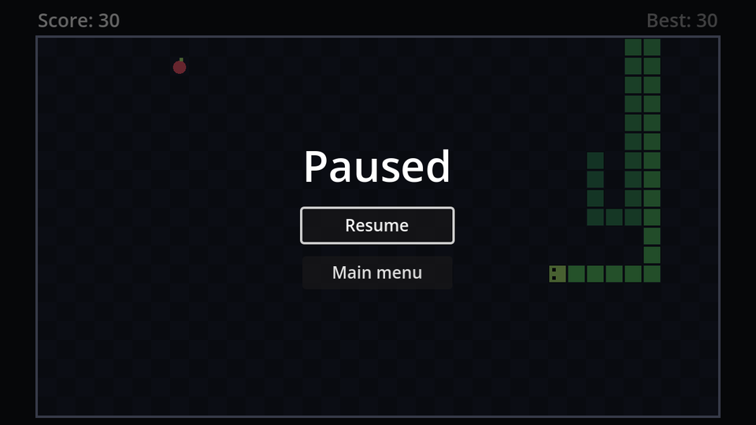

## How pausing works

`get_tree().paused = true` pauses the whole game: `_process`, timers, tweens, and input functions like `_unhandled_input` all stop. Each node's **Process → Mode** property (in the Inspector) decides how it reacts:

| Mode | While the game is paused |
| --- | --- |
| Inherit (default) | Does what its parent does; the top of the tree is *Pausable* |
| Pausable | Stops |
| When Paused | Runs *only* while paused |
| Always | Keeps running |
| Disabled | Never runs |

That gives us a lot for free. `MoveTimer` stops counting, so the snake freezes. The snake's `_unhandled_input` stops too, so arrow keys pressed during the pause don't queue up surprise turns. The only node that must keep working is the pause menu itself, or you could never unpause.

## The scene

New scene with a `CanvasLayer` root named `PauseMenu`. Set its **Layer** to `10` so it's drawn above the HUD (layer 1), and its **Process → Mode** to **Always**. Save it as `pause_menu.tscn`.

```text
PauseMenu (CanvasLayer, layer 10, process mode Always)
├── Dim (ColorRect, Full Rect)    # black at 60% opacity
└── CenterContainer (Full Rect)
    └── VBoxContainer             # separation 12
        ├── Title (Label)         # "Paused", font size 36
        ├── ResumeButton (Button) # unique name
        └── MainMenuButton (Button)
```

The `Dim` rectangle darkens the game behind the menu. It also catches mouse clicks, so they can't reach anything underneath.

Attach `pause_menu.gd` and connect both buttons' `pressed` signals:

```gdscript title="pause_menu.gd"
extends CanvasLayer

@onready var resume_button: Button = %ResumeButton


func _ready() -> void:
	hide()


func _unhandled_input(event: InputEvent) -> void:
	if event.is_action_pressed("pause"):
		set_paused(not get_tree().paused)
		get_viewport().set_input_as_handled()


func set_paused(paused: bool) -> void:
	get_tree().paused = paused
	visible = paused
	if paused:
		resume_button.grab_focus()


func _on_resume_button_pressed() -> void:
	set_paused(false)


func _on_main_menu_button_pressed() -> void:
	get_tree().paused = false # The pause state outlives the scene!
	get_tree().change_scene_to_file("res://main_menu.tscn")
```

- `hide()` in `_ready` makes the menu start invisible. `visible = paused` shows it exactly while the game is paused.
- `not get_tree().paused` flips the current state, so the same key both pauses and unpauses.
- `set_input_as_handled()` marks the key press as used, so nothing else reacts to the same <kbd>Esc</kbd>.

:::danger[Unpause before leaving]
`paused` belongs to the SceneTree, not to the game scene. If you change scenes while paused, the main menu loads... paused, and its buttons stop working. Always unpause first.
:::

Instance `pause_menu.tscn` in `game.tscn` (drag it onto `Game`), run the game, and press <kbd>Esc</kbd> or <kbd>P</kbd>.

```quiz
question: Why does the pause menu need the process mode **Always**, rather than **When Paused**?
options:
  - When Paused nodes can't show buttons
  - With When Paused, its `_unhandled_input` wouldn't run during the game, so Esc could never open the menu
  - Always is faster
answer: 1
explain: The menu has to hear the pause key while the game is running *and* work while it's paused. Only Always covers both.
```
