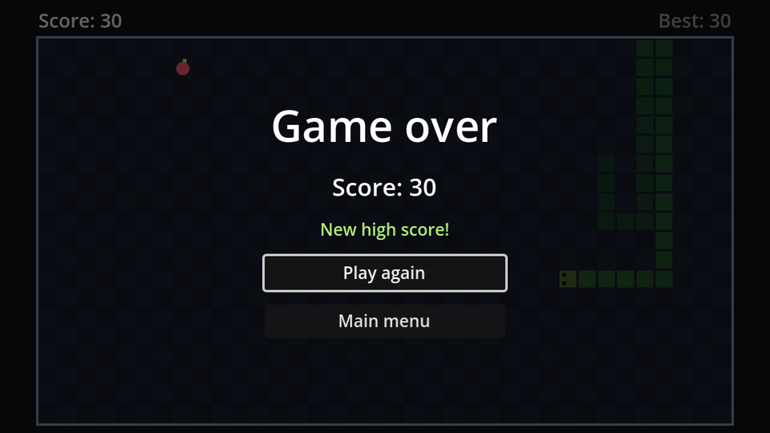

A high score has two problems a normal variable can't solve:

1. **It must survive scene changes.** When the game scene reloads, every variable in it starts over.
2. **It must survive quitting.** Next week, the game should still remember.

## Autoloads

An **autoload** is a script (or scene) that Godot creates once when the game starts and keeps alive the whole time, alongside whatever scene is showing. Its name becomes a global: any script can write `HighScore.best`.

Create a new script that's not attached to any node: in the FileSystem dock, right-click → **Create New → Script**, name it `high_score.gd`, and make it extend `Node`:

```gdscript title="high_score.gd"
extends Node
## Remembers the best score between sessions. Registered as the "HighScore" autoload.

const SAVE_PATH := "user://high_score.cfg"

var best := 0


func _ready() -> void:
	var config := ConfigFile.new()
	if config.load(SAVE_PATH) == OK:
		best = config.get_value("scores", "best", 0)


## Record a finished game. Returns true if the score is a new high score.
func submit(score: int) -> bool:
	if score <= best:
		return false
	best = score
	var config := ConfigFile.new()
	config.set_value("scores", "best", best)
	config.save(SAVE_PATH)
	return true
```

Register it: **Project Settings → Globals → Autoload**, pick `high_score.gd` with the folder icon, make sure the name is `HighScore`, and click **Add**.

### Saving files

- **`user://`** is a folder Godot gives every game for its own files, somewhere in the player's user folder (on Windows `%APPDATA%\Godot\app_userdata\Snake`, on macOS `~/Library/Application Support/Godot/app_userdata/Snake`). `res://`, your project folder, becomes read-only once the game is exported, so never save there.
- **`ConfigFile`** reads and writes simple text files with `[sections]` and `key=value` lines. `set_value(section, key, value)` stores a value, `save` writes the file.
- `config.load` returns `OK` if the file was read. On the very first launch there's no file yet, so `best` stays 0.
- `get_value`'s third argument is a **default**, returned if the key is missing.

After a good game, the file looks like this:

```ini title="high_score.cfg"
[scores]

best=31
```

## Using it

The game reports the score when it ends. `submit` answers whether it's a new record, which the game over screen will celebrate:

```gdscript title="game.gd" ins={5,8} del={7}
func _game_over() -> void:
	move_timer.stop()
	snake.set_process_unhandled_input(false)
	pause_menu.set_process_unhandled_input(false)
	var new_best := HighScore.submit(score)
	await get_tree().create_timer(1.0).timeout
	game_over.show_result(score)
	game_over.show_result(score, HighScore.best, new_best)
```

Add a `BestLabel` (unique name, centred, font colour `#b4f07a`) to `game_over.tscn`, between `ScoreLabel` and `PlayAgainButton`, and show it:

```gdscript title="game_over.gd" ins={2,11,13} del={10}
@onready var score_label: Label = %ScoreLabel
@onready var best_label: Label = %BestLabel
@onready var play_again_button: Button = %PlayAgainButton


func _ready() -> void:
	hide()


func show_result(score: int) -> void:
func show_result(score: int, best: int, new_best: bool) -> void:
	score_label.text = "Score: %d" % score
	best_label.text = "New high score!" if new_best else "Best: %d" % best
	show()
	play_again_button.grab_focus()
```

The main menu shows the record too. Add a `BestLabel` (unique name, centred) between `Title` and `PlayButton` in `main_menu.tscn`, and set its **Visibility → Modulate** to white at 60% opacity, so it's a bit quieter than the buttons:

```gdscript title="main_menu.gd" ins={3,9}
@onready var play_button: Button = %PlayButton
@onready var quit_button: Button = %QuitButton
@onready var best_label: Label = %BestLabel


func _ready() -> void:
	# Browsers can't close the tab for us, so hide Quit in web builds.
	quit_button.visible = not OS.has_feature("web")
	best_label.text = "Best: %d" % HighScore.best
	play_button.grab_focus()
```

And finally the HUD. Add a second label to `hud.tscn`: `BestLabel`, unique name, position (408, 5), size (200, 22), font size 16, **Horizontal Alignment** Right, and the same 60% modulate. It sits at the right edge of the strip above the board:

```gdscript title="hud.gd" ins={2,7}
@onready var score_label: Label = %ScoreLabel
@onready var best_label: Label = %BestLabel


func update_score(score: int) -> void:
	score_label.text = "Score: %d" % score
	best_label.text = "Best: %d" % maxi(score, HighScore.best)
```

`maxi` returns the larger of two whole numbers, so the HUD's best climbs along with your score the moment you beat the record.

Play a few rounds, quit, and start the game again: the menu still knows your best.

:::tip[Starting over]
To reset the high score while testing, delete `high_score.cfg` from the `user://` folder. **Project → Open User Data Folder** opens it for you.
:::

```quiz
question: Why must the high score be saved to `user://` and not `res://`?
options:
  - user:// is faster
  - res:// is read-only in an exported game
  - ConfigFile can only write to user://
answer: 1
explain: An exported game packs `res://` into a read-only archive. `user://` is always a writable folder that belongs to the player.
```

```quiz
question: The best score is 12. What does `HighScore.submit(12)` return?
options:
  - "true"
  - "false"
answer: 1
explain: '`score <= best` is true for 12 <= 12, so it returns false: matching the record is not beating it.'
```
