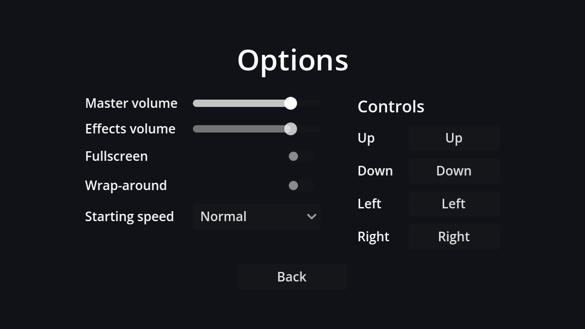

## Layout

New scene, `Control` root (Full Rect) named `OptionsMenu`, saved as `options_menu.tscn`. The settings go in a two-column `GridContainer` (label on the left, control on the right), with the key bindings in a second column next to it:

```text
OptionsMenu (Control, Full Rect)
├── CenterContainer (Full Rect)
│   └── VBoxContainer                          # separation 16
│       ├── Title (Label)                      # "Options", font size 32
│       ├── Columns (HBoxContainer)            # separation 40
│       │   ├── SettingsGrid (GridContainer)   # columns 2
│       │   │   ├── Label "Master volume"   ├── MasterSlider (HSlider)
│       │   │   ├── Label "Effects volume"  ├── SfxSlider (HSlider)
│       │   │   ├── Label "Fullscreen"      ├── FullscreenCheck (CheckButton)
│       │   │   ├── Label "Wrap-around"     ├── WrapCheck (CheckButton)
│       │   │   └── Label "Starting speed"  └── SpeedOption (OptionButton)
│       │   └── Controls (VBoxContainer)
│       │       ├── ControlsTitle (Label)      # "Controls", font size 18
│       │       └── ControlsGrid (GridContainer)   # columns 2, filled from code
│       └── BackButton (Button)                # "Back"
└── TestSound (AudioStreamPlayer)              # bus: SFX
```

A `GridContainer` fills its cells row by row, so add the children in label, control, label, control... order. Give every control on the right, and `ControlsGrid`, a unique name.

| Node | Properties |
| --- | --- |
| `MasterSlider`, `SfxSlider` | Max Value `1`, Step `0.05`; Custom Minimum Size x `140` on the first (the column takes the widest) |
| `SpeedOption` | Items: `Slow`, `Normal`, `Fast` (in that order: they match `START_SPEEDS`) |
| `BackButton` | Custom Minimum Size x `120`, Container Sizing → Horizontal **Shrink Center** |
| `TestSound` | Bus `SFX` (the sound itself comes in the polish chapter) |

`HSlider` is a horizontal slider, `CheckButton` an on/off switch, and `OptionButton` a dropdown.

## The script

Connect each control's change signal to `OptionsMenu`: `value_changed` for the sliders, `toggled` for the CheckButtons, `item_selected` for the OptionButton, and `pressed` for Back. Then attach `options_menu.gd`:

```gdscript title="options_menu.gd"
extends Control

@onready var master_slider: HSlider = %MasterSlider
@onready var sfx_slider: HSlider = %SfxSlider
@onready var fullscreen_check: CheckButton = %FullscreenCheck
@onready var wrap_check: CheckButton = %WrapCheck
@onready var speed_option: OptionButton = %SpeedOption


func _ready() -> void:
	# The *_no_signal setters avoid triggering our change handlers (and the test sound).
	master_slider.set_value_no_signal(Settings.master_volume)
	sfx_slider.set_value_no_signal(Settings.sfx_volume)
	fullscreen_check.set_pressed_no_signal(Settings.fullscreen)
	wrap_check.set_pressed_no_signal(Settings.wrap_around)
	speed_option.selected = Settings.speed_level
	master_slider.grab_focus()


func _on_master_slider_value_changed(value: float) -> void:
	Settings.master_volume = value
	Settings.apply()


func _on_sfx_slider_value_changed(value: float) -> void:
	Settings.sfx_volume = value
	Settings.apply()
	$TestSound.play() # Let the player hear the new volume.


func _on_fullscreen_check_toggled(toggled_on: bool) -> void:
	Settings.fullscreen = toggled_on
	Settings.apply()


func _on_wrap_check_toggled(toggled_on: bool) -> void:
	Settings.wrap_around = toggled_on


func _on_speed_option_item_selected(index: int) -> void:
	Settings.speed_level = index


func _on_back_button_pressed() -> void:
	Settings.save_settings()
	get_tree().change_scene_to_file("res://main_menu.tscn")
```

The pattern is the same for every control: show the current setting when the screen opens, and update `Settings` when the player changes it.

- Volume and fullscreen **apply immediately**: you hear the volume change while dragging. Wrap-around and speed simply take effect at the start of the next game.
- Everything is **saved** when you leave the screen. Saving on every slider movement would write the file dozens of times per second.
- Setting `selected` on an OptionButton never emits `item_selected`, so it doesn't need a `_no_signal` version.

:::warning[The `_no_signal` setters]
Setting `slider.value = x` emits `value_changed`, just as if the player dragged it. In `_ready`, that would run the handler and play the test sound the moment the screen opens. `set_value_no_signal` and `set_pressed_no_signal` update the control quietly.
:::

The main menu's **Options** button finally has somewhere to go. Run the game, switch on wrap-around, pick Fast, go back and play: both settings are active. Quit and restart: they're still there.

```quiz
question: In `_ready`, why use `set_value_no_signal` instead of `master_slider.value = ...`?
options:
  - Assigning value is deprecated
  - Assigning value emits value_changed, which runs the handler (and plays the test sound for the effects slider)
  - set_value_no_signal is faster
answer: 1
```
