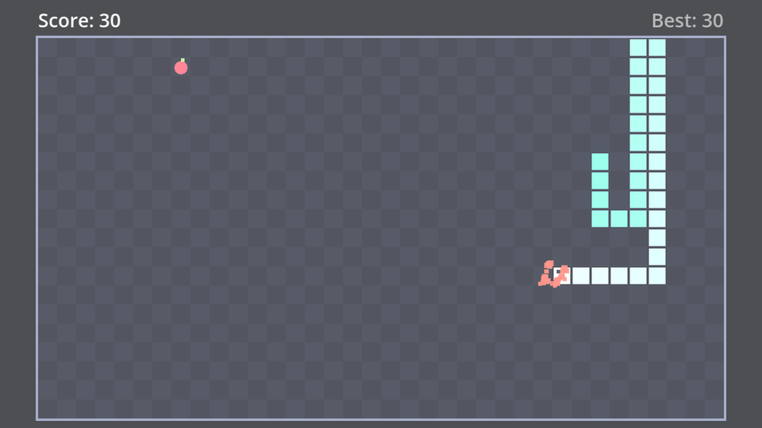

A crash should feel like an impact, not like the game simply stopping. Three quick effects, all at once:

1. The **snake flashes** white, then fades to grey: it's out.
2. **Particles burst** from the point of impact.
3. The **screen flashes** for a split second.

## The nodes

Add two nodes to `game.tscn`:

```text
Game (Node2D)
├── Board (Node2D)
│   ├── Food (Node2D)
│   ├── Snake (Node2D)
│   └── CrashParticles (CPUParticles2D)
├── Flash (ColorRect)
├── MoveTimer (Timer)
...
```

`CrashParticles` goes under `Board`, after `Snake`, so it uses board coordinates and is drawn on top of the snake. A particle node spawns lots of tiny squares that fly off and fade; its Inspector has many properties, but you only need these:

| Property | Value | Why |
| --- | --- | --- |
| Emitting | off | Only when we say so |
| Amount | `40` | Number of particles |
| Time → Lifetime | `0.7` | Seconds each particle lives |
| Time → One Shot | on | One burst, not a fountain |
| Time → Explosiveness | `1` | All particles at once |
| Direction → Spread | `180` | In every direction |
| Gravity | (0, 0) | Top-down game: nothing falls |
| Initial Velocity → Min / Max | `60` / `160` | Pixels per second |
| Damping → Min / Max | `120` / `180` | Slow down quickly, like debris |
| Scale → Amount Min / Max | `3` / `5` | Particle size in pixels |
| Color | `#ff7366` | A warm red |
| Color → Color Ramp | new Gradient, white to transparent white | Fade out over the lifetime |

:::note[CPU or GPU particles?]
Godot has `CPUParticles2D` and `GPUParticles2D`. GPU particles can handle many thousands at once; CPU particles are simpler to set up and behave the same on every computer and in web browsers. Forty particles is nothing for the CPU.
:::

`Flash` is a `ColorRect` directly under `Game`, below `Board` in the tree so it's drawn over the board:

| Property | Value |
| --- | --- |
| Layout → Size | (640, 360), the whole screen |
| Color | white |
| Visibility → Modulate | white with **alpha 0** (invisible) |
| Mouse → Filter | **Ignore**, so it never blocks clicks |

## The code

```gdscript title="game.gd" ins={2-3}
@onready var food: Food = $Board/Food
@onready var crash_particles: CPUParticles2D = $Board/CrashParticles
@onready var flash: ColorRect = $Flash
@onready var move_timer: Timer = $MoveTimer
```

```gdscript title="game.gd" ins={6,10-20}
func _game_over() -> void:
	move_timer.stop()
	snake.set_process_unhandled_input(false)
	pause_menu.set_process_unhandled_input(false)
	$Sounds/Crash.play()
	_crash_effects()
	var new_best := HighScore.submit(score)
	await get_tree().create_timer(1.0).timeout
	game_over.show_result(score, HighScore.best, new_best)


func _crash_effects() -> void:
	# Flash the snake white, then fade it to grey.
	snake.modulate = Color(3, 3, 3)
	create_tween().tween_property(snake, "modulate", Color(0.45, 0.45, 0.45), 0.4)
	# Burst where the head hit: the edge between its cell and the next one.
	crash_particles.position = Board.cell_center(snake.body[0]) + Vector2(snake.direction) * Board.CELL_SIZE / 2
	crash_particles.restart()
	flash.modulate.a = 0.35
	create_tween().tween_property(flash, "modulate:a", 0.0, 0.3)
```

- **`modulate`** multiplies a node's colours (and its children's). `Color.WHITE` (1, 1, 1) changes nothing, values above 1 brighten, values below 1 darken. Starting at 3 makes the snake glow white, and tweening down to 0.45 leaves it a dim grey.
- **Where did it crash?** `snake.direction` is the direction of the move that failed: `next_head` already applied the queued turn. The centre of the head plus half a cell in that direction is the edge the head ran into, whether that's a wall or its own body.
- **`restart()`** starts a one-shot burst from the beginning.
- **`"modulate:a"`** is a property path: only the alpha (opacity) part of `modulate`. The flash appears at 35% white and fades out in 0.3 seconds.

The effects play during the one-second pause before the game over screen. That pause now has a purpose: it's the moment the player watches their snake go down.

```quiz
question: What does `snake.modulate = Color(3, 3, 3)` do?
options:
  - Makes the snake three times bigger
  - Makes the snake's colours much brighter, nearly white
  - Makes the snake transparent
answer: 1
explain: modulate multiplies every colour channel. Multiplying by 3 pushes the green snake's colours towards white.
```

```quiz
type: text
question: Which property path tweens only the opacity of `modulate`?
answer: ['"modulate:a"', "modulate:a"]
```
