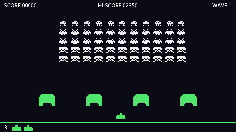

This tutorial builds a complete Space Invaders: a laser cannon that fires one shot at a time, a formation of 55 invaders that marches faster as you thin it out, bunkers that crumble pixel by pixel, the mystery ship, lives, waves and a saved high score. Around the game you'll build a main menu, a pause menu, an options screen with key rebinding, sound effects with the famous four-note marching beat, and finally an exported game you can share.



Every chapter ends in a game that runs, so you can stop at any point and still have something to play.

:::note[New to Godot?]
This tutorial explains everything it uses, but it moves at a steady pace. If you've never opened Godot before, the sibling **Pong in Godot 4** tutorial is a gentler first project. Space Invaders reuses its ideas (input actions, signals, menus, settings) and adds code-built scenes, timers, image editing and particles.
:::

## Download

Grab the **standard** (non-.NET) build of Godot 4 from the official site. It is a single executable with no installer. This tutorial was written against Godot 4.7, but anything from 4.3 up works.

:::tip
On macOS, drag Godot into `/Applications` so Spotlight can find it.
:::

## The project manager

When you start Godot you land in the *project manager*, where you create, import and open projects. Everything else (scenes, scripts, settings) happens in the *editor* that opens once you pick a project.

## How the game fits together

Here's the plan, so the pieces make sense as they appear:

| Piece | Built in chapter | Job |
| --- | --- | --- |
| Player | 2 | Moves along the bottom, fires one shot at a time |
| Invader and formation | 3 | 55 invaders that step, drop, reverse and speed up |
| Shots and explosions | 4 | One shot script for both sides, plus invaders firing back |
| Bunkers | 5 | Shields that lose pixels where they're hit |
| Mystery ship | 6 | Crosses the top now and then, worth a random bonus |
| HUD, lives, waves | 7 | The rules of the game, and a high score on disk |
| Menus and options | 8, 9 | Everything around the game |
| Sound and juice | 10 | The marching beat, particles, screen shake |

```quiz
question: Which Godot build do you need for a GDScript-only project?
options:
  - The .NET build
  - The standard build
  - Either; they are identical
answer: 1
explain: The .NET build adds C# support. For GDScript the **standard** build is smaller and simpler.
```
