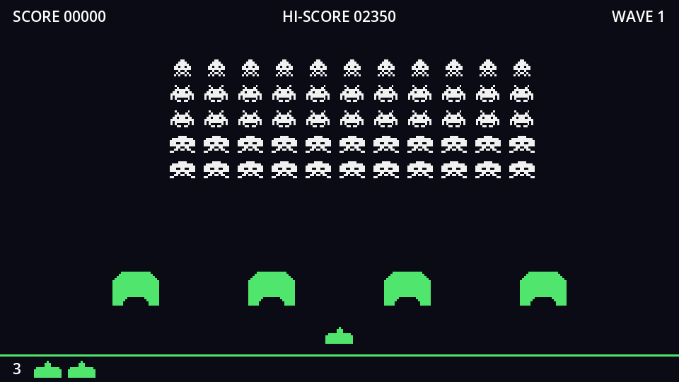

## A step timer

The formation doesn't glide, it **steps**: a jump of a few pixels, a pause, another jump. A `Timer` node is the natural fit. Add one under `Formation`, name it `StepTimer`, set **Wait Time** to `0.6` and leave **One Shot** and **Autostart** off. Then connect its `timeout` signal to `Formation` (Node dock → Signals → double-click `timeout`).

## New constants and variables

```gdscript title="formation.gd" ins={3,5-6,8-11,15,17}
const SPACING := Vector2(32, 24)
const TOP := 64.0
const STEP := 6.0
const DROP := 12.0
## How close an invader's centre may get to the screen edge.
const MARGIN := 24.0

## Seconds between steps with a full formation...
@export var slowest_step := 0.6
## ...and with a single invader left.
@export var fastest_step := 0.03

var _invaders: Array[Invader] = []
var _total := 0
var _direction := 1.0

@onready var step_timer: Timer = $StepTimer
```

`_direction` is `1.0` while marching right and `-1.0` while marching left. A fresh formation always starts off to the right, so `build` resets it, and it also sets the first step speed:

```gdscript title="formation.gd" ins={6,9}
func build(wave: int) -> void:
	for invader in _invaders:
		invader.queue_free()
	_invaders.clear()
	position = Vector2.ZERO
	_direction = 1.0
	# ...
	_total = _invaders.size()
	_update_speed()
```

## Stepping

Add these functions:

```gdscript title="formation.gd"
func start() -> void:
	step_timer.start()


func stop() -> void:
	step_timer.stop()


func _on_step_timer_timeout() -> void:
	# Measure the formation using only the invaders still alive.
	var left := INF
	var right := -INF
	for invader in _invaders:
		left = minf(left, invader.global_position.x)
		right = maxf(right, invader.global_position.x)
	var next_left := left + STEP * _direction
	var next_right := right + STEP * _direction
	if next_left < MARGIN or next_right > get_viewport_rect().size.x - MARGIN:
		# The next step would cross the edge: drop down and turn around instead.
		position.y += DROP
		_direction = -_direction
	else:
		position.x += STEP * _direction
	for invader in _invaders:
		invader.step()


## The fewer invaders are left, the shorter the wait between steps.
func _update_speed() -> void:
	# 1.0 with a full formation, 0.0 with one invader left.
	var fraction := float(_invaders.size() - 1) / maxf(_total - 1, 1)
	step_timer.wait_time = lerpf(fastest_step, slowest_step, fraction)
```

- **The edges come from the survivors.** Each step we find the leftmost and rightmost *living* invader. Shoot out the outer columns and the formation travels further before turning, just like the arcade.
- `global_position` is the invader's position on screen. Its plain `position` is relative to `Formation`, which has moved since it was built.
- **Drop or step, never both.** When a step would cross the margin, the formation drops 12 pixels and flips `_direction` instead of moving sideways.
- After every step, each invader flips its animation frame. That's why the legs move in time with the march.
- `start()` and `stop()` wrap the timer, so the game never needs to know there *is* a timer.

## Speeding up

`_update_speed` maps the number of survivors to a step interval with `lerpf` (linear interpolation): `fraction` is 1.0 for a full formation, giving `slowest_step`, and 0.0 for the last invader, giving `fastest_step`:

| Invaders left | Seconds per step |
| --- | --- |
| 55 | 0.600 |
| 40 | 0.442 |
| 20 | 0.231 |
| 10 | 0.125 |
| 1 | 0.030 |

The last invader steps twenty times as often as the full formation. Changing `wait_time` on a running timer takes effect from the next step, which is exactly what we want. Right now nothing can kill an invader, so the speed stays put; in the next chapter, every kill calls `_update_speed()`.

`maxf(_total - 1, 1)` avoids a division by zero if you ever build a formation of one.

:::note[An accident made famous]
In the 1978 arcade machine, the speed-up was never designed. The hardware moved and redrew the invaders one at a time, roughly one per frame, so a full formation needed about 55 frames to complete a step while the last survivor moved every frame. Players loved the panic, and it became the game's signature.
:::

## Start marching

```gdscript title="game.gd" ins={3}
func _ready() -> void:
	formation.build(1)
	formation.start()
```

Run the game and watch the formation step, legs twitching, until it reaches the edge, drops and heads back. Without anything to stop it, it marches straight through the ground. We'll fix that in chapter 7.

```quiz
question: The formation is moving right, and the rightmost living invader is at x = 612. What happens on the next step (STEP 6, MARGIN 24, screen width 640)?
options:
  - It steps right to 618
  - It drops 12 pixels and starts moving left
  - It steps right to 616 exactly
answer: 1
explain: 612 + 6 = 618, which is beyond 640 − 24 = 616, so the formation drops and reverses instead.
```

```quiz
question: How many seconds per step with 28 invaders left (slowest 0.6, fastest 0.03, 55 total)?
type: text
answer: ["0.315", ".315", "0.315s"]
hint: fraction = (28 − 1) / (55 − 1), then lerp from 0.03 to 0.6.
explain: fraction = 27 / 54 = 0.5, and halfway between 0.03 and 0.6 is 0.315.
```
