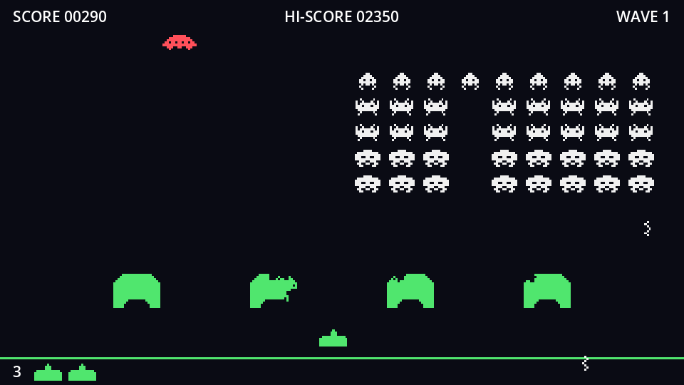

Every physics tick, a shot overlapping a bunker calls its `hit()`. The bunker answers by looking at its own pixels:

1. Find the pixels under the shot.
2. Walk along the shot, from its tail to its tip, looking for a solid pixel.
3. Found one? Blast a hole there and return `true`: the shot is used up.
4. Only empty pixels? Return `false`, and the shot flies on through the hole.

## The code

Add to `bunker.gd`:

```gdscript title="bunker.gd" ins={4-7}
extends Area2D
## A destructible shield. Hits erase pixels from the bunker's own copy of its image.

## How far above and below a shot's centre to look for solid pixels.
const SHOT_REACH := 5
## Radius of the hole a hit blasts, in pixels.
const BLAST_RADIUS := 6
```

```gdscript title="bunker.gd"
## Called by every shot that overlaps the bunker, every physics tick.
func hit(shot: Area2D) -> bool:
	# Walk along the shot from its tail to its tip; the first solid pixel is where it struck.
	var forward := int(signf(shot.speed))
	var centre := _to_pixel(shot.global_position)
	for i in range(-SHOT_REACH, SHOT_REACH + 1):
		var pixel := centre + Vector2i(0, i * forward)
		if _is_solid(pixel):
			_blast(pixel)
			return true
	return false # Only empty pixels: let the shot fly on.


## The image pixel under a global position. The sprite is centred on the bunker.
func _to_pixel(global_point: Vector2) -> Vector2i:
	return Vector2i((to_local(global_point) + sprite.texture.get_size() / 2).floor())


func _is_solid(pixel: Vector2i) -> bool:
	var bounds := Rect2i(Vector2i.ZERO, _image.get_size())
	return bounds.has_point(pixel) and _image.get_pixelv(pixel).a > 0.5


## Erase a ragged, roughly round hole.
func _blast(centre: Vector2i) -> void:
	# Work in 2×2 blocks so the holes match the chunky art pixels.
	for y in range(-BLAST_RADIUS, BLAST_RADIUS + 1, 2):
		for x in range(-BLAST_RADIUS, BLAST_RADIUS + 1, 2):
			var distance := Vector2(x, y).length()
			# Always clear the middle; towards the edge, only some blocks.
			if distance < 3.0 or (distance <= BLAST_RADIUS and randf() < 0.5):
				var block := (centre + Vector2i(x, y)).snapped(Vector2i(2, 2))
				_image.fill_rect(Rect2i(block, Vector2i(2, 2)), Color.TRANSPARENT)
	_texture.update(_image)
```

### From screen to pixels

`to_local()` turns a screen position into one relative to the bunker's centre, from (-22, -16) to (22, 16). The image's pixel (0, 0) is its *top-left* corner, so we add half the image size. `floor()` and `Vector2i` turn the result into whole pixel coordinates.

### Tail to tip

`forward` is `-1` for the player's shot (moving up) and `1` for an invader shot (moving down). The loop runs `i` from -5 to 5, so the first pixel checked is 5 pixels *behind* the shot's centre and the last is 5 pixels ahead. Checking from the tail means we find the first solid pixel the shot ran into, not one deeper inside the bunker. That's how a shot from below chips the bottom edge, and one from above chips the top.

### A ragged hole

`_blast` visits a grid around the hit point in steps of 2: the art was drawn at 2× scale, so erasing 2×2 blocks keeps the holes as chunky as the art. The middle always goes; around the edge, a coin flip (`randf() < 0.5`) decides each block. No two holes look alike.

- `fill_rect` with `Color.TRANSPARENT` erases. It clips the rectangle to the image, so blocks hanging over the edge are fine.
- `snapped(Vector2i(2, 2))` rounds to the nearest multiple of 2, lining the blocks up with the art's pixel grid.
- `_texture.update(_image)` uploads the changed pixels once, after the whole hole is erased.

## Invaders grind through

When the formation marches low enough to touch a bunker, it eats through it. The bunker's mask contains only `invaders`, so every area it overlaps is an invader:

```gdscript title="bunker.gd"
func _physics_process(_delta: float) -> void:
	# Our mask only sees invaders. Any invader marching through grinds the bunker away.
	for invader in get_overlapping_areas():
		var top_left := _to_pixel(invader.global_position) - Vector2i(12, 8)
		_image.fill_rect(Rect2i(top_left, Vector2i(24, 16)), Color.TRANSPARENT)
		_texture.update(_image)
```

Each invader wipes out a 24×16 patch (the largest invader's size) around itself.

Run the game. Bunkers crumble under the invaders' fire, and your own shots dig tunnels from below. Shots fly straight through the holes they've made, because `hit()` returns `false` when there's nothing left to hit.

:::tip[Test faster]
Lower **Slowest Step** on `Formation` in the Inspector to `0.1` to watch the invaders reach the bunkers quickly. Remember to set it back.
:::

```quiz
question: A player shot (moving up) has its centre over image pixel (20, 30). Which pixel does `hit()` check first?
options:
  - (20, 25), five pixels above
  - (20, 35), five pixels below, at the shot's tail
  - (20, 30), the centre
answer: 1
explain: '`forward` is -1, and `i` starts at -5: 30 + (-5 × -1) = 35. For a shot moving up, below is behind.'
```

```quiz
question: Why does `hit()` return false when it finds only empty pixels?
options:
  - To tell the shot it hasn't hit anything, so it keeps flying through the hole
  - Because the bunker is destroyed
  - To ask the shot to try again next frame with a bigger reach
answer: 0
```
