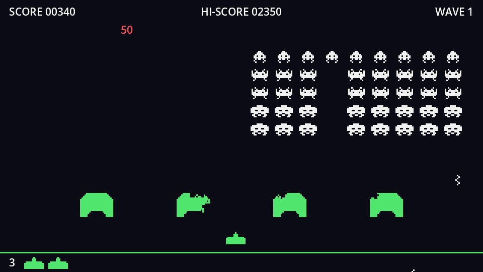

Every so often a red saucer glides across the top of the screen. Hit it and it's worth a mystery bonus: 50, 100, 150 or 300 points.

## Nodes

New scene, `Area2D` root named `Ufo`:

```text
Ufo (Area2D)
├── Sprite2D           # sprites/ufo.png
├── CollisionShape2D   # RectangleShape2D, 32×14
├── ScoreLabel (Label) # hidden, centred, red
└── RemoveTimer (Timer)  # Wait Time 1, One Shot
```

- Collision: **Layer** `ufo`, **Mask** none. The player's shot already has `ufo` in its mask.
- `ScoreLabel` is a Label inside a 2D scene. Set its offsets to left -30, top -10, right 30, bottom 10: a 60×20 box centred on the ship. Turn **Visible** off, set **Horizontal** and **Vertical Alignment** to **Center**, and give it a red **Font Color** override (`#ff505a`).
- Connect `RemoveTimer`'s `timeout` to `Ufo` → `queue_free()`, using **Pick** as you did for the explosion.

## The script

```gdscript title="ufo.gd"
extends Area2D
## The mystery ship. Crosses the top of the screen once and is worth a random bonus.

signal destroyed(points: int)

const POINTS: Array[int] = [50, 100, 150, 300]

@export var speed := 80.0

## 1 flies left to right, -1 right to left. Set it before adding the UFO to the tree.
var direction := 1.0
var _dead := false

@onready var sprite: Sprite2D = $Sprite2D
@onready var score_label: Label = $ScoreLabel
@onready var remove_timer: Timer = $RemoveTimer


func _ready() -> void:
	# Start just outside the edge we fly in from.
	position.x = -32.0 if direction > 0 else get_viewport_rect().size.x + 32.0


func _physics_process(delta: float) -> void:
	if _dead:
		return
	position.x += speed * direction * delta
	if position.x < -40.0 or position.x > get_viewport_rect().size.x + 40.0:
		queue_free() # Made it across.


func hit(_shot: Area2D) -> bool:
	if _dead:
		return false # Already showing its score: let the shot pass.
	_dead = true
	var points: int = POINTS.pick_random()
	destroyed.emit(points)
	sprite.hide()
	score_label.text = str(points)
	score_label.show()
	remove_timer.start()
	return true
```

- The UFO decides where it starts, based on `direction`. That's why `direction` must be set *before* the UFO enters the tree: `_ready()` reads it.
- It starts 32 pixels off-screen and frees itself 40 pixels past the far edge, so it never pops in or out of view.
- When hit, it swaps its picture for its score and waits a second before removing itself. `_dead` stops it moving, and makes it refuse further hits while the score is showing.
- `pick_random()` picks one element of an array.

:::note[The arcade's secret]
The original's "mystery" score wasn't random at all: it followed a fixed table indexed by how many shots you'd fired. Experts counted their shots so the 23rd one hit the saucer for 300 points. Our version really is random.
:::

```quiz
question: Why does `hit()` return false once the UFO is `_dead`?
options:
  - So a second shot passes through the score text instead of awarding the bonus again
  - Because dead UFOs can't have collision shapes
  - It's needed for the RemoveTimer to fire
answer: 0
```
