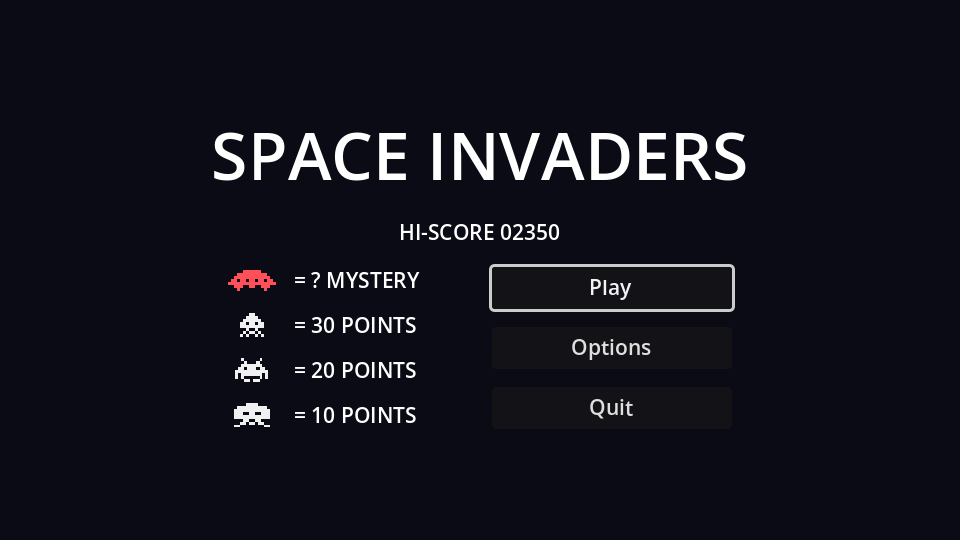

## Layout

Create a scene with a `Control` root named `MainMenu` and save it as `main_menu.tscn`. In the toolbar's **Anchor preset** menu, choose **Full Rect** so it covers the whole screen.

```text
MainMenu (Control, Full Rect)
└── CenterContainer (Full Rect)
    └── VBoxContainer                 # separation 12
        ├── Title (Label)             # "SPACE INVADERS", size 44
        ├── HighScoreLabel (Label, %)
        └── Columns (HBoxContainer)   # separation 48
            ├── ScoreTable (GridContainer)   # 2 columns
            │   ├── UfoIcon (TextureRect)
            │   ├── UfoPoints (Label)        # "= ? MYSTERY"
            │   ├── SquidIcon (TextureRect)
            │   ├── SquidPoints (Label)      # "= 30 POINTS"
            │   ├── CrabIcon (TextureRect)
            │   ├── CrabPoints (Label)       # "= 20 POINTS"
            │   ├── OctopusIcon (TextureRect)
            │   └── OctopusPoints (Label)    # "= 10 POINTS"
            └── Buttons (VBoxContainer)      # min width 160
                ├── PlayButton (Button, %)
                ├── OptionsButton (Button)
                └── QuitButton (Button, %)
```

- The **score table** is the arcade's attract screen in miniature. A `GridContainer` with 2 columns fills row by row, so add the children in icon, label, icon, label... order. Give each `TextureRect` the matching sprite, a **Custom Minimum Size** x of `32` and **Stretch Mode** `Keep Centered`, so the different-sized invaders line up.
- The title is wider than the two columns, so on `Columns` set **Container Sizing → Horizontal** to `Shrink Center`; otherwise the columns hug the left edge. On `ScoreTable` and `Buttons`, set **Container Sizing → Vertical** to `Shrink Center`, so the shorter column is centred next to the taller one.
- The `Buttons` box's minimum width makes all three buttons equally wide.

## A project theme

Default Godot UI text is large for a 640×360 screen. Rather than overriding the font size on every control, create a **Theme**: in the FileSystem dock, **New Resource → Theme**, save it as `theme.tres`, and set **Default Font Size** to `14`. Then make it the project-wide theme in **Project Settings → GUI → Theme → Custom**.

Every `Control` in the game now uses it, including the HUD. Individual nodes, like the title, can still override it.

## The script

Connect each button's `pressed` signal to `MainMenu`, then fill in the methods:

```gdscript title="main_menu.gd"
extends Control

@onready var high_score_label: Label = %HighScoreLabel
@onready var play_button: Button = %PlayButton
@onready var quit_button: Button = %QuitButton


func _ready() -> void:
	high_score_label.text = "HI-SCORE %05d" % HighScore.load_best()
	# Browsers can't close the tab for us, so hide Quit in web builds.
	quit_button.visible = not OS.has_feature("web")
	play_button.grab_focus()


func _on_play_button_pressed() -> void:
	get_tree().change_scene_to_file("res://game.tscn")


func _on_options_button_pressed() -> void:
	get_tree().change_scene_to_file("res://options_menu.tscn")


func _on_quit_button_pressed() -> void:
	get_tree().quit()
```

- `HighScore.load_best()` is the static helper from the previous chapter, used from a second place without any setup.
- `grab_focus()` makes the menu work from the keyboard: arrow keys move between buttons and <kbd>Enter</kbd> or <kbd>Space</kbd> presses them. Godot works out the focus order from the layout.
- `change_scene_to_file` frees the current scene and loads another. Everything in the old scene, timers and awaits included, is gone.

:::warning
`options_menu.tscn` doesn't exist yet. Clicking Options prints an error until the next chapter.
:::

## Make it the main scene

Open **Project Settings → Application → Run** and set **Main Scene** to `res://main_menu.tscn`. <kbd>F5</kbd> now starts at the menu, while <kbd>F6</kbd> still runs whatever scene is open, which is handy for jumping straight into the game.

```quiz
question: Why does every TextureRect in the score table get the same minimum width?
options:
  - TextureRects can't be smaller than 32 pixels
  - The invaders are different widths; equal boxes keep the "=" column lined up
  - GridContainer requires it
answer: 1
```
