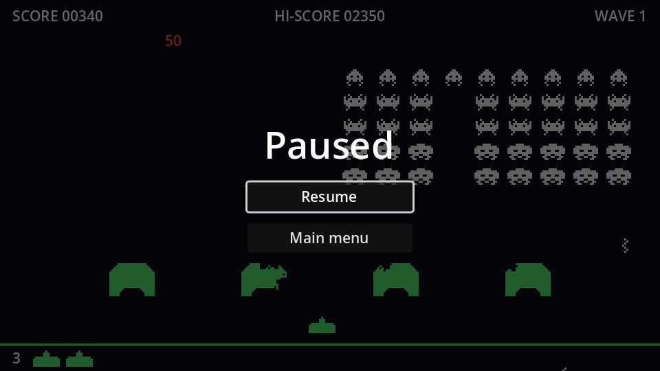

## How pausing works

`get_tree().paused = true` freezes every node's `_process` and `_physics_process`, physics, timers, tweens and sounds. Each node's **Process → Mode** decides how it reacts:

| Mode | While paused |
| --- | --- |
| Inherit (default) | Same as its parent; the root is *Pausable* |
| Pausable | Stops |
| When Paused | Runs *only* while paused |
| Always | Keeps running |
| Disabled | Never runs |

Everything in our game inherits *Pausable*, so pausing stops it all: the formation's timers, the shots, the UFO and its sound, and even the `await respawn_timer.timeout` in the middle of a respawn. The pause menu itself has to keep working, or you could never unpause.

## The scene

New scene, `CanvasLayer` root named `PauseMenu`, **Layer** `10` (above the HUD), **Process → Mode** `Always`. Save as `pause_menu.tscn`.

```text
PauseMenu (CanvasLayer, layer 10, process mode Always)
├── Dim (ColorRect, Full Rect, black at 60% alpha)
└── CenterContainer (Full Rect)
    └── VBoxContainer                  # min width 160, separation 12
        ├── Title (Label)              # "Paused", font size 36, centred
        ├── ResumeButton (Button, %)
        └── MainMenuButton (Button)
```

The `Dim` rect darkens the game behind the menu and swallows mouse clicks so they don't reach anything underneath.

```gdscript title="pause_menu.gd"
extends CanvasLayer

@onready var resume_button: Button = %ResumeButton


func _ready() -> void:
	hide()


func _unhandled_input(event: InputEvent) -> void:
	if event.is_action_pressed("pause"):
		set_paused(not get_tree().paused)
		get_viewport().set_input_as_handled()


func set_paused(paused: bool) -> void:
	get_tree().paused = paused
	visible = paused
	if paused:
		resume_button.grab_focus()


func _on_resume_button_pressed() -> void:
	set_paused(false)


func _on_main_menu_button_pressed() -> void:
	get_tree().paused = false # The pause state outlives the scene!
	get_tree().change_scene_to_file("res://main_menu.tscn")
```

- `_unhandled_input` only receives events that no UI control consumed, which is the right place for gameplay shortcuts.
- `set_input_as_handled()` stops the same <kbd>Esc</kbd> press from reaching anything else.

:::danger[Unpause before leaving]
`paused` belongs to the **SceneTree**, not to the scene. Forget to reset it and the main menu loads... frozen.
:::

Instance `pause_menu.tscn` in `game.tscn` and try it mid-wave: <kbd>Esc</kbd> or <kbd>P</kbd> freezes everything, and again resumes exactly where you left off, falling shots and all.

```quiz
question: Which process mode should the pause menu have?
options:
  - Pausable
  - When Paused
  - Always
  - Disabled
answer: 2
explain: '**When Paused** would keep the buttons working, but then `_unhandled_input` would not run while unpaused, so pressing Esc could never open the menu. **Always** covers both.'
```

```quiz
question: The player pauses one second into a two-second respawn wait. What happens to `await respawn_timer.timeout`?
options:
  - It fires immediately
  - The timer pauses, so the wait resumes when the game does and the respawn comes one second later
  - The respawn is cancelled
answer: 1
```
