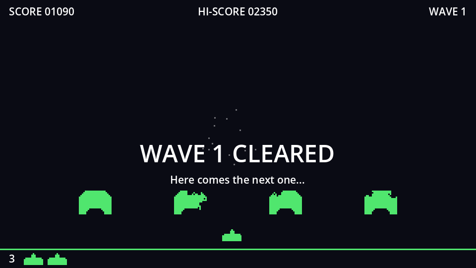
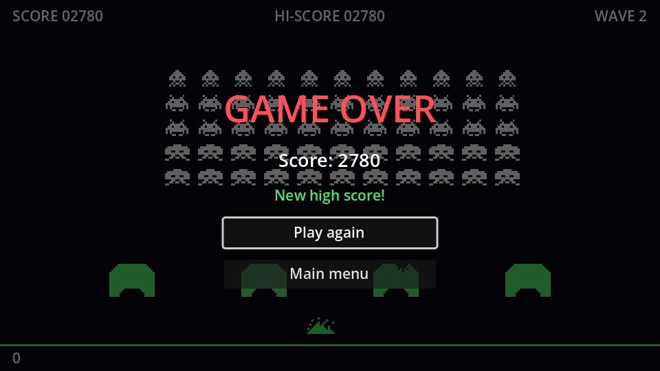

## The wave banner



Between waves the game should say what's going on. New scene, `CanvasLayer` root named `WaveBanner` with **Layer** `5`, saved as `wave_banner.tscn`:

```text
WaveBanner (CanvasLayer, layer 5)
└── CenterContainer (Full Rect, offset top 76, mouse filter Ignore)
    └── VBoxContainer            # separation 4
        ├── Title (Label, %)     # font size 32, centred
        └── Subtitle (Label, %)  # centred
```

A full-rect `CenterContainer` would centre the text on the screen, right on top of the formation's bottom rows. Setting its top offset to `76` shrinks it from above, which moves its centre down into the gap between the invaders and the bunkers. **Mouse Filter: Ignore** lets clicks pass through, since the banner has nothing to click.

```gdscript title="wave_banner.gd"
extends CanvasLayer
## Big centred text between waves: "WAVE 2", "WAVE 1 CLEARED".

@onready var title: Label = %Title
@onready var subtitle: Label = %Subtitle


func _ready() -> void:
	hide()


func show_message(text: String, detail: String) -> void:
	title.text = text
	subtitle.text = detail
	show()
```

Hiding it again is just `hide()`, which every CanvasLayer already has.

## The game over screen



Built just like the pause menu: a `CanvasLayer` on layer 10 named `GameOver`, with a dim background and a centred box. Its process mode stays *Inherit*, because the game isn't paused when it's over.

```text
GameOver (CanvasLayer, layer 10)
├── Dim (ColorRect, Full Rect, black at 60%)
└── CenterContainer (Full Rect)
    └── VBoxContainer                      # min width 160, separation 12
        ├── Title (Label)                  # "GAME OVER", font size 36, red
        ├── ScoreLabel (Label, %)          # font size 18, centred
        ├── NewHighScoreLabel (Label, %)   # "New high score!", green, centred
        ├── PlayAgainButton (Button, %)
        └── MainMenuButton (Button)
```

```gdscript title="game_over.gd"
extends CanvasLayer

@onready var score_label: Label = %ScoreLabel
@onready var new_high_score_label: Label = %NewHighScoreLabel
@onready var play_again_button: Button = %PlayAgainButton


func _ready() -> void:
	hide()


func show_result(score: int, new_high_score: bool) -> void:
	score_label.text = "Score: %d" % score
	new_high_score_label.visible = new_high_score
	show()
	play_again_button.grab_focus()


func _on_play_again_button_pressed() -> void:
	get_tree().reload_current_scene()


func _on_main_menu_button_pressed() -> void:
	get_tree().change_scene_to_file("res://main_menu.tscn")
```

`reload_current_scene()` throws the whole game scene away and loads a fresh one: score, lives, wave, formation, bunkers, timers, all reset for free. The high score survives, because it lives on disk.

## Wiring them in

Instance `wave_banner.tscn` and `game_over.tscn` in `game.tscn`, and add references:

```gdscript title="game.gd" ins={4-6}
@onready var player: Area2D = $Player
@onready var formation: Node2D = $Formation
@onready var hud: CanvasLayer = $HUD
@onready var wave_banner: CanvasLayer = $WaveBanner
@onready var pause_menu: CanvasLayer = $PauseMenu
@onready var game_over: CanvasLayer = $GameOver
@onready var wave_timer: Timer = $WaveTimer
@onready var respawn_timer: Timer = $RespawnTimer
@onready var ufo_timer: Timer = $UfoTimer
```

The two waits we already have are the perfect moments for the banner:

```gdscript title="game.gd" ins={5,8,16}
func _start_wave() -> void:
	formation.build(wave)
	get_tree().call_group("bunkers", "reset")
	hud.set_wave(wave)
	wave_banner.show_message("WAVE %d" % wave, "Get ready!")
	wave_timer.start()
	await wave_timer.timeout
	wave_banner.hide()
	formation.start()
	ufo_timer.start()


func _on_formation_cleared() -> void:
	ufo_timer.stop()
	_clear_shots()
	wave_banner.show_message("WAVE %d CLEARED" % wave, "Here comes the next one...")
	wave_timer.start()
	await wave_timer.timeout
	wave += 1
	_start_wave()
```

And the game finally ends properly:

```gdscript title="game.gd" ins={4,9-12} del={8}
func _end_game() -> void:
	formation.stop()
	ufo_timer.stop()
	pause_menu.set_process_unhandled_input(false)
	var new_high_score := score > HighScore.load_best()
	if new_high_score:
		HighScore.save_best(score)
	print("Game over! Score: ", score)
	# Same delay as a respawn, so the explosion plays out first.
	respawn_timer.start()
	await respawn_timer.timeout
	game_over.show_result(score, new_high_score)
```

- `set_process_unhandled_input(false)` switches off the pause menu's <kbd>Esc</kbd> handling: pausing on the game over screen would just stack two menus.
- Reusing `RespawnTimer` gives the explosion its two seconds before the result appears.

:::tip[Trigger-happy players]
<kbd>Space</kbd> is both *shoot* and, for a focused button, *press*. Someone hammering the fire button as they die could hit **Play again** by accident. The two-second delay mostly prevents it. For a stricter fix, disable the buttons in `show_result` and re-enable them with a short timer.
:::

Play a full game now: waves are announced, your last life brings up the result, and a new best score is celebrated and saved.

```quiz
question: Why don't the score and lives need resetting when the player clicks Play again?
options:
  - reload_current_scene creates a fresh instance of every node and script in the scene
  - Godot remembers the initial values of all variables
  - They do need resetting; that's a bug
answer: 0
```
