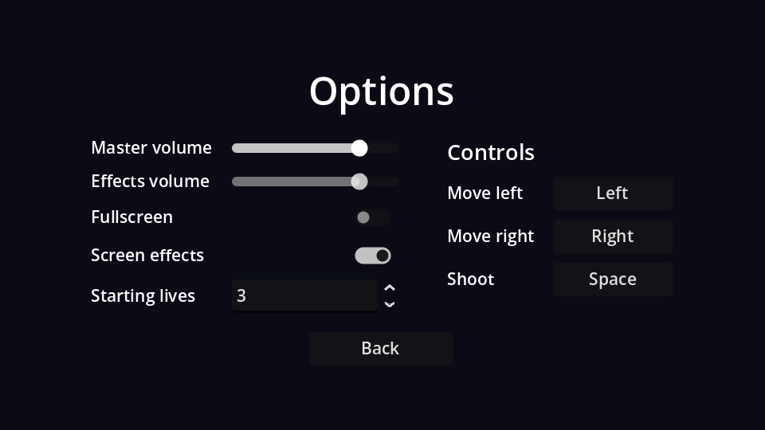

## Layout

New scene, `Control` root (Full Rect) named `OptionsMenu`, saved as `options_menu.tscn`. Settings go in a two-column `GridContainer` (labels left, controls right) and the key bindings in a second column next to it:

```text
OptionsMenu (Control, Full Rect)
├── CenterContainer (Full Rect)
│   └── VBoxContainer                          # separation 16
│       ├── Title (Label)                      # "Options", size 32
│       ├── Columns (HBoxContainer)            # separation 40
│       │   ├── SettingsGrid (GridContainer)   # columns 2
│       │   │   ├── Label "Master volume"   ├── MasterSlider (HSlider, %)
│       │   │   ├── Label "Effects volume"  ├── SfxSlider (HSlider, %)
│       │   │   ├── Label "Fullscreen"      ├── FullscreenCheck (CheckButton, %)
│       │   │   ├── Label "Screen effects"  ├── EffectsCheck (CheckButton, %)
│       │   │   └── Label "Starting lives"  └── LivesSpin (SpinBox, %)
│       │   └── Controls (VBoxContainer)
│       │       ├── ControlsTitle (Label)      # "Controls", size 18
│       │       └── ControlsGrid (GridContainer, %)   # columns 2, filled from code
│       └── BackButton (Button)                # min width 120, shrink centre
└── TestSound (AudioStreamPlayer)              # bus: SFX
```

| Node | Properties |
| --- | --- |
| `MasterSlider`, `SfxSlider` | Max Value `1`, Step `0.05`, Custom Minimum Size x `140` |
| `EffectsCheck` | Button Pressed on (the default) |
| `LivesSpin` | Min `1`, Max `5`, Value `3` |

## The script

Connect each control's change signal to `OptionsMenu`: `value_changed` for the sliders and the SpinBox, `toggled` for the CheckButtons, and `pressed` for Back.

```gdscript title="options_menu.gd"
extends Control

@onready var master_slider: HSlider = %MasterSlider
@onready var sfx_slider: HSlider = %SfxSlider
@onready var fullscreen_check: CheckButton = %FullscreenCheck
@onready var effects_check: CheckButton = %EffectsCheck
@onready var lives_spin: SpinBox = %LivesSpin


func _ready() -> void:
	# The *_no_signal setters avoid triggering our change handlers (and the test sound).
	master_slider.set_value_no_signal(Settings.master_volume)
	sfx_slider.set_value_no_signal(Settings.sfx_volume)
	fullscreen_check.set_pressed_no_signal(Settings.fullscreen)
	effects_check.set_pressed_no_signal(Settings.screen_effects)
	lives_spin.set_value_no_signal(Settings.starting_lives)
	master_slider.grab_focus()


func _on_master_slider_value_changed(value: float) -> void:
	Settings.master_volume = value
	Settings.apply()


func _on_sfx_slider_value_changed(value: float) -> void:
	Settings.sfx_volume = value
	Settings.apply()
	$TestSound.play() # Let the player hear the new volume.


func _on_fullscreen_check_toggled(toggled_on: bool) -> void:
	Settings.fullscreen = toggled_on
	Settings.apply()


func _on_effects_check_toggled(toggled_on: bool) -> void:
	Settings.screen_effects = toggled_on


func _on_lives_spin_value_changed(value: float) -> void:
	Settings.starting_lives = int(value)


func _on_back_button_pressed() -> void:
	Settings.save_settings()
	get_tree().change_scene_to_file("res://main_menu.tscn")
```

Changes apply **immediately** (you hear the volume change as you drag), and are **saved** when you leave the screen. Saving on every slider tick would write the file dozens of times per second.

:::warning[The `_no_signal` setters]
Setting `slider.value = x` emits `value_changed`, just like dragging does. In `_ready` that would run every handler and play the test sound as soon as the screen opens. `set_value_no_signal` and `set_pressed_no_signal` update the control quietly.
:::

`TestSound` needs a sound to play; we add sound files in the polish chapter. Until then it plays silence.

```quiz
question: The player drags the effects slider from 0.8 to 0.3 and quits the game from the main menu without visiting Options again. What's in settings.cfg?
options:
  - 0.8, because nothing saved it
  - 0.3, because Back saved it on the way out of the options screen
  - Nothing, the file is only written on quit
answer: 1
explain: The only way out of the options screen is Back, and Back saves.
```
