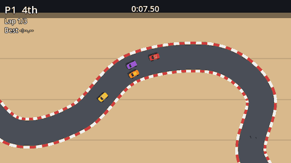

This tutorial builds **Tiny Racers**, a top-down racing game inspired by Micro Machines: tiny cars racing around a breakfast table, a desk and a pool table, drifting through corners and bouncing off cereal bowls.



By the end you'll have:

- An **arcade car** that accelerates, brakes, reverses and drifts, built on `CharacterBody2D`.
- **Tracks** drawn entirely from a curve: no art files, just a `Path2D`, a few `Line2D`s and some shapes.
- **Laps, checkpoints and lap times**, and a race finish.
- **CPU drivers** that follow the road, brake for corners and steer around each other.
- **Live race positions** and a results screen.
- A **shared camera**, and the signature **head-to-head** mode: fall off the leader's screen and you lose a point.
- **Slippery spills, sticky napkins, ramps and bumpers**.
- Three tracks, a **championship** with points, menus, an options screen with **key rebinding for two players**, saved **lap records**, engine sounds, skid marks and tyre smoke.

Every chapter ends with something you can run and drive.

## Before you start

This is an **intermediate** tutorial. It explains everything it uses, but it moves faster than a first-game tutorial. You'll be most comfortable if you've made a small Godot game before (the [Pong tutorial](../../godot-pong/tutorial.md) is a good one) and know your way around the editor: scenes, nodes, the Inspector and attaching scripts.

A little vector maths helps too. If `velocity.dot(forward)` doesn't mean anything to you yet, don't worry: the car chapter explains it with pictures in words.

## Get Godot

Download the **standard** (non-.NET) build of Godot 4 from the official site. It's a single executable, no installer needed. This tutorial was written and tested with Godot 4.7; anything from 4.3 up should work.

:::tip
On macOS, drag Godot into `/Applications` so Spotlight finds it. On Windows, put it somewhere permanent like `C:\Tools\Godot`, since Godot remembers its location for project shortcuts.
:::

```quiz
question: Which node type will the cars be built on?
options:
  - RigidBody2D
  - CharacterBody2D
  - Area2D
  - Sprite2D
answer: 1
explain: A `CharacterBody2D` moves only when your code tells it to, which gives full control over the arcade handling. The car chapter explains why that beats a `RigidBody2D` here.
```
