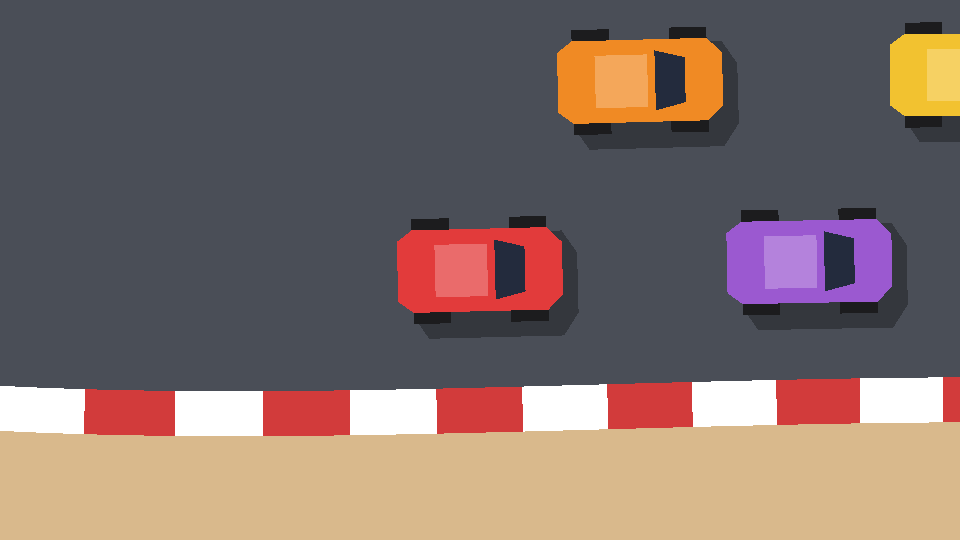

## CharacterBody2D or RigidBody2D?

Godot has two kinds of moving physics bodies, and the choice shapes everything else:

| | `RigidBody2D` | `CharacterBody2D` |
| --- | --- | --- |
| Who moves it | The physics engine, from forces you apply | Your code, by setting `velocity` |
| Collisions | Realistic: mass, friction, spin | Slides along what it hits; you decide the rest |
| Good for | Crates, balls, ragdolls, simulation racers | Player characters, arcade vehicles |

A rigid body car is tempting ("real physics!"), but arcade handling is exactly the bit you don't want the physics engine to decide. You'd fight friction, angular damping and mass to get a car that grips on the road, slides when you throw it into a corner, and never spins out on its own. You'd end up overriding most of the simulation in `_integrate_forces` anyway.

With a `CharacterBody2D`, the handling *is* our code: a few lines that split the velocity into "forwards" and "sideways" and treat them differently. It's deterministic, easy to tune, and `move_and_slide()` still handles the collisions. So that's what we use.

## Collision layers

Before building anything physical, name the layers. Open **Project Settings → Layer Names → 2D Physics**:

| Layer | Name | Used by |
| --- | --- | --- |
| 1 | `walls` | table edges and solid props (mugs, books) |
| 2 | `cars` | every car |
| 3 | `checkpoints` | invisible lap checkpoints |
| 4 | `surfaces` | spills, cloths and ramps |

A body's **layer** says what it *is*; its **mask** says what it *bumps into or detects*. Cars are on `cars` and their mask is `walls` + `cars`: they collide with the scenery and with each other.

## Nodes

Create a new scene with a `CharacterBody2D` root named `Car`:

```text
Car (CharacterBody2D)       # Motion Mode: Floating
├── CollisionShape2D        # RectangleShape2D, size 22×13
├── Shadow (Polygon2D)      # black at 30% alpha, position (2, 2)
└── Visuals (Node2D)
    ├── FrontWheels (Polygon2D)
    ├── RearWheels (Polygon2D)
    ├── Body (Polygon2D)
    ├── Roof (Polygon2D)    # white at 25% alpha
    └── Windscreen (Polygon2D)
```

Select `Car` and set **Motion Mode** to **Floating**. The default, *Grounded*, is for platformers with floors and gravity. A top-down car has no floor; everything around it is a "wall".

Set **Collision → Layer** to `cars` only and **Mask** to `walls` and `cars`.

### Drawing the car

The car points along **+x** (to the right). That's Godot's convention for rotation 0, and it means `transform.x` is always "the direction the nose points", which the driving code relies on.

A `Polygon2D` draws a filled shape from a list of points. You can click points in the editor, but it's quicker to type them into the Inspector's **Polygon** array, or paste them into the `.tscn` file:

| Node | Points | Colour |
| --- | --- | --- |
| `FrontWheels` | (4, -7) (9, -7) (9, 7) (4, 7) | `#1c1c1f` |
| `RearWheels` | (-9, -7) (-4, -7) (-4, 7) (-9, 7) | `#1c1c1f` |
| `Body` | (11, -3.5) (11, 3.5) (9, 5.5) (-9, 5.5) (-11, 4) (-11, -4) (-9, -5.5) (9, -5.5) | set from code |
| `Roof` | (-6, -3.5) (1, -3.5) (1, 3.5) (-6, 3.5) | white, 25% alpha |
| `Windscreen` | (2, -4) (6, -3) (6, 3) (2, 4) | `#242b3d` |
| `Shadow` | (11, -4) (11, 4) (9, 7) (-9, 7) (-11, 4) (-11, -4) (-9, -7) (9, -7) | black, 30% alpha |

Each wheel "polygon" is really one dark bar across the whole car. The body is narrower and drawn on top, so only the ends of the bars poke out at the sides: four wheels from two rectangles. Children draw in order, which is why the wheels come before the body in the tree.



The `Visuals` node groups everything that should move together. Later, cars jump off ramps: scaling `Visuals` up makes the car look closer to the camera, while the `Shadow` stays on the ground.

Save the scene as `car.tscn`.

```quiz
question: The car's nose points along +x. Which vector always points the way the car is facing, whatever its rotation?
options:
  - Vector2.RIGHT
  - transform.x
  - transform.y
  - velocity
answer: 1
explain: '`transform.x` is the node''s own x axis, rotated with it. `Vector2.RIGHT` never rotates, `transform.y` points out of the car''s right-hand side, and `velocity` points wherever the car is *moving*, which isn''t always where it''s facing (that''s what drifting is).'
```
