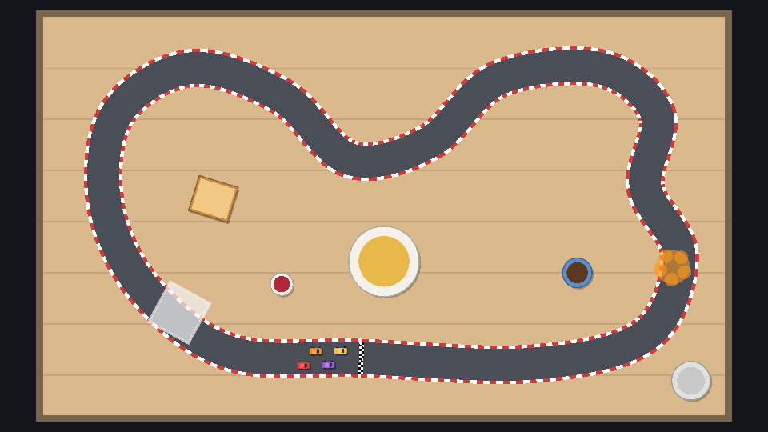

The curve is invisible in the running game. Let's draw three things:

1. The **tabletop**: a big rectangle with plank lines, drawn with `_draw()`.
2. The **road** and **kerbs**: two wide `Line2D`s following the curve.
3. The **finish line**: a short chequered `Line2D` across the road at offset 0.

## A tool script

We want to see the road in the editor too, while editing the curve. Adding `@tool` at the top of a script makes Godot run it *inside the editor* as well as in the game. That's powerful, so tool scripts have one rule: anything that should only happen in the game (spawning checkpoints, say) must check `Engine.is_editor_hint()` first.

:::warning
After adding `@tool`, close and reopen the scene (or **Scene → Reload Saved Scene**) so the editor picks it up. And save often: a tool script with a bug can misbehave in the editor itself.
:::

## The tabletop

Add these exports and a `_draw()` function to `track.gd`:

```gdscript title="track.gd" ins={1,5-6,8-20,23-24,29-37}
@tool
class_name Track
extends Node2D
## A race track built around a closed Path2D centre line.
## Draws the tabletop, road, kerbs and finish line. Keep the Track and its Path
## at (0, 0): the curve's coordinates are then world coordinates.

@export var table_size := Vector2(1200, 700):
	set(value):
		table_size = value
		queue_redraw()
@export var table_color := Color("d9b98c"):
	set(value):
		table_color = value
		queue_redraw()
## Distance between the plank lines on the table. 0 draws none (good for felt).
@export var plank_spacing := 90.0:
	set(value):
		plank_spacing = value
		queue_redraw()
@export var road_width := 60.0
@export var kerb_width := 6.0
@export var road_color := Color("4a4e57")
@export var kerb_color := Color("d23c3c")

# ...


func _draw() -> void:
	var table := Rect2(Vector2.ZERO, table_size)
	draw_rect(table.grow(12), table_color.darkened(0.45)) # The table's edge.
	draw_rect(table, table_color)
	if plank_spacing > 0.0:
		var y := plank_spacing
		while y < table_size.y:
			draw_line(Vector2(0, y), Vector2(table_size.x, y), table_color.darkened(0.1), 2.0)
			y += plank_spacing
```

- `_draw()` runs once, and again whenever you call `queue_redraw()`. Godot caches what you draw, so a static picture costs nothing per frame.
- The `set(value):` blocks are **setters**. Changing `table_color` in the Inspector calls the setter, which stores the value and asks for a redraw. Without them the editor wouldn't update until you reopen the scene.
- `darkened(0.45)` gives a darker version of the same colour: one table colour export gives you the rim and the plank lines too.

Set the track's **Table Size** to `1200 × 700` and its **Road Width** to `56` (a little narrower than the default, which suits this twisty track). A wooden table appears behind the curve.

## Road and kerbs

A `Line2D` draws a thick line through a list of points, with rounded joints if you ask for them. Fed with the curve's baked points, it draws the road. A second, wider line underneath, with a striped texture, peeks out on both sides as kerbs.

```gdscript title="track.gd"
var _road_nodes: Array[Node] = []


func _ready() -> void:
	curve = path.curve
	length = curve.get_baked_length()
	_build_road()
	if Engine.is_editor_hint():
		# Redraw while the curve is edited, so the editor shows the real road.
		curve.changed.connect(_build_road)
		return


func _build_road() -> void:
	for node in _road_nodes:
		node.queue_free()
	_road_nodes.clear()
	length = curve.get_baked_length()
	var points := curve.get_baked_points()
	if points.size() < 3:
		return
	points.remove_at(points.size() - 1) # Same as the first point; `closed` joins them.

	var kerb := _add_line(points, road_width + kerb_width * 2.0, Color.WHITE)
	kerb.texture = _stripe_texture(kerb.width)
	kerb.texture_mode = Line2D.LINE_TEXTURE_TILE
	_add_line(points, road_width, road_color)

	# A chequered line across the road at offset 0.
	var start := transform_at(0.0)
	var half := start.y * (road_width / 2.0)
	var finish := _add_line(PackedVector2Array([start.origin - half, start.origin + half]), 8.0, Color.WHITE)
	finish.closed = false
	finish.texture = _checker_texture()
	finish.texture_mode = Line2D.LINE_TEXTURE_TILE


func _add_line(points: PackedVector2Array, width: float, color: Color) -> Line2D:
	var line := Line2D.new()
	line.points = points
	line.closed = true
	line.width = width
	line.default_color = color
	line.joint_mode = Line2D.LINE_JOINT_ROUND
	line.texture_filter = CanvasItem.TEXTURE_FILTER_NEAREST
	line.texture_repeat = CanvasItem.TEXTURE_REPEAT_ENABLED
	add_child(line)
	# Children drawn first appear underneath: keep the road below props and surfaces.
	move_child(line, _road_nodes.size())
	_road_nodes.append(line)
	return line
```

A few details:

- The lines are created in code and never saved into the scene (they have no **owner**), so the `.tscn` file stays small and the road always matches the curve. `_build_road()` throws the old lines away first, because in the editor it runs again on every curve edit.
- `move_child(line, _road_nodes.size())` puts the kerb at index 0, the road at 1 and the finish line at 2. Godot draws children in order, so these end up *under* anything else in the scene, like the props we add soon.
- The finish line is two points: the start of the curve, plus and minus half a road width along `start.y` (the road's right-hand direction).

## Textures from code

The kerb stripes and the chequered flag are tiny images built in code:

```gdscript title="track.gd"
## Alternating kerb stripes. In tile mode a texture is stretched to the line's
## width, so the image height decides how long each stripe is.
func _stripe_texture(width: float) -> ImageTexture:
	var image := Image.create(2, maxi(1, roundi(width / 12.0)), false, Image.FORMAT_RGBA8)
	image.fill(Color.WHITE)
	for y in image.get_height():
		image.set_pixel(0, y, kerb_color)
	return ImageTexture.create_from_image(image)


func _checker_texture() -> ImageTexture:
	var image := Image.create(2, 2, false, Image.FORMAT_RGBA8)
	image.fill(Color.WHITE)
	image.set_pixel(0, 0, Color.BLACK)
	image.set_pixel(1, 1, Color.BLACK)
	return ImageTexture.create_from_image(image)
```

In `LINE_TEXTURE_TILE` mode, `Line2D` scales the texture so its **height** fills the line's width, then repeats it along the line. The stripe image is 2 pixels wide (one red column, one white) and `width / 12` pixels tall, so after scaling each column covers about 12 px of kerb. The `NEAREST` filter keeps the stripes crisp instead of blurring them together.

Reopen `breakfast.tscn` and the road appears around your curve. Drag a curve point and watch it follow.



```quiz
question: Why does `_build_road()` free the old lines before creating new ones?
options:
  - Line2D can only be used once
  - In the editor it runs on every curve change, and without cleanup the lines would pile up
  - queue_free makes the road draw faster
answer: 1
```

```quiz
question: Which annotation makes a script run inside the editor?
type: text
answer: ["@tool", "tool"]
```
