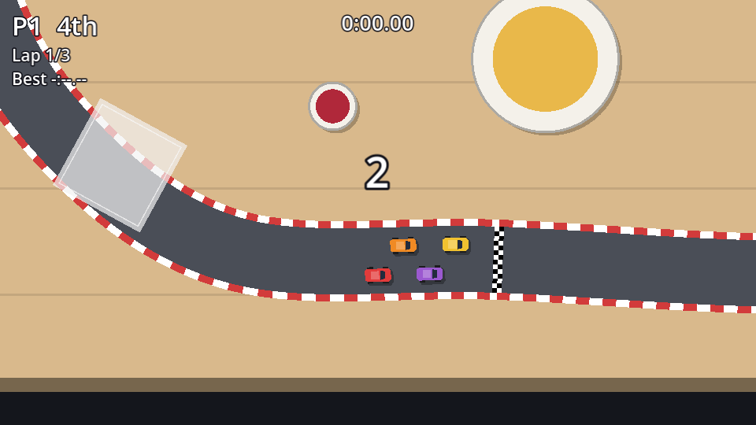

## A project theme

The HUD sits on top of a busy, bright tabletop, so its text needs an outline to stay readable. Rather than setting that on every label, make a **theme**: in the FileSystem dock, **New Resource → Theme**, save it as `theme.tres`, then in the theme editor:

- Set **Default Font Size** to `14`.
- Add the `Label` type, and set its **Font Outline Color** to near-black (`#0f0f17`) and its **Outline Size** constant to `4`.

Make it the project-wide theme in **Project Settings → GUI → Theme → Custom**. Every `Control` in the game now uses it, and individual nodes can still override it.

## The HUD scene

The HUD must stay put while the camera moves. A `CanvasLayer` draws its children in screen space, ignoring any camera. New scene, `CanvasLayer` root named `HUD`, saved as `hud.tscn`:

```text
HUD (CanvasLayer)
├── P1Panel (VBoxContainer, %)    # position (10, 6), size 140×70, separation 0
│   ├── Lap (Label)               # "Lap 1/3"
│   └── Best (Label)              # "Best -:--.--"
├── P2Panel (VBoxContainer, %)    # anchor preset Top Right, 10 px from the edge
│   ├── Lap (Label)               # Horizontal Alignment: Right
│   └── Best (Label)              # Horizontal Alignment: Right
├── TimeLabel (Label, %)          # anchor preset Center Top, font size 18, centred
├── Message (Label, %)            # anchor preset Center, 600×50, font size 36, outline 8
└── MessageTimer (Timer)          # One Shot on
```

The `%` marks **unique names** (right-click a node → **Access as Unique Name**): scripts can then find them with `%P1Panel` wherever they sit in the tree. Connect `MessageTimer`'s `timeout` signal to `HUD`.

```gdscript title="hud.gd"
class_name HUD
extends CanvasLayer
## Lap, position and time read-outs, the head-to-head lights, and big messages.

var _players: Array[Car] = []
var _laps := 0

@onready var panels: Array[VBoxContainer] = [%P1Panel, %P2Panel]
@onready var time_label: Label = %TimeLabel
@onready var message: Label = %Message
@onready var message_timer: Timer = $MessageTimer


func _ready() -> void:
	message.hide()


## One panel per player.
func setup(players: Array[Car], laps: int) -> void:
	_players = players
	_laps = laps
	for i in panels.size():
		panels[i].visible = i < players.size()


func update_race(race_time: float) -> void:
	time_label.text = Format.time(race_time)
	for i in _players.size():
		var car := _players[i]
		var panel := panels[i]
		if car.finished:
			panel.get_node("Lap").text = "Finished"
		else:
			panel.get_node("Lap").text = "Lap %d/%d" % [car.lap, _laps]
		panel.get_node("Best").text = "Best " + Format.time(car.best_lap)


func show_message(text: String, duration := 1.5) -> void:
	message.text = text
	message.show()
	message_timer.start(duration)


func _on_message_timer_timeout() -> void:
	message.hide()
```

The HUD is given what it shows (`setup`, `update_race`, `show_message`) and never goes looking for the race. It doesn't know what a checkpoint is, or where the lap count comes from. You could redesign it completely without touching `race.gd`.

`message_timer.start(duration)` restarts the timer with a new wait time, so a new message always gets its full time on screen even if the previous one hadn't timed out yet.

## The countdown

Cars shouldn't move before "GO". Give the car a switch that ignores its driver:

```gdscript title="car.gd" ins={1-2,6-10}
## When false the car ignores its driver, e.g. during the countdown.
var controls_enabled := true


func _physics_process(delta: float) -> void:
	if not controls_enabled:
		throttle = 0.0
		steer = 0.0
	else:
		_read_input()
	_drive(delta)
	# ...
```

The car still runs `_drive()` with zero throttle, so it would roll to a stop naturally if it were moving.

Instance `hud.tscn` in `race.tscn` and add a `Timer` named `CountdownTimer` with a **Wait Time** of `0.8` (not one-shot: it ticks repeatedly). Connect its `timeout` to `Race`. Then:

```gdscript title="race.gd" ins={4,9-10,13-14,20-21,27,33-34,36,39-55,59-60}
extends Node2D
## Runs one race on the track in this scene.

enum State { COUNTDOWN, RACING, FINISHED }

# ...

var race_time := 0.0
var state := State.COUNTDOWN
var _count := 0

# ...
@onready var hud: HUD = $HUD
@onready var countdown_timer: Timer = $CountdownTimer


func _ready() -> void:
	track.checkpoint_entered.connect(_on_checkpoint_entered)
	_spawn_cars()
	hud.setup(players, LAPS)
	_start_countdown()


func _spawn_cars() -> void:
	# ...
		car.transform = track.grid_transform(player)
		car.controls_enabled = false
		cars_node.add_child(car)
		cars.append(car)


func _physics_process(delta: float) -> void:
	if state == State.RACING:
		race_time += delta
	camera.global_position = players[0].global_position
	hud.update_race(race_time)


func _start_countdown() -> void:
	state = State.COUNTDOWN
	_count = 3
	hud.show_message(str(_count), 0.8)
	countdown_timer.start()


func _on_countdown_timer_timeout() -> void:
	_count -= 1
	if _count > 0:
		hud.show_message(str(_count), 0.8)
		return
	countdown_timer.stop()
	hud.show_message("GO!", 0.8)
	state = State.RACING
	for car in cars:
		car.controls_enabled = true


func _on_checkpoint_entered(car: Car, index: int) -> void:
	if state == State.COUNTDOWN:
		return
	# ...
```

An `enum` gives names to a handful of states. `state == State.RACING` reads far better than `state == 1`, and the editor autocompletes it.

The race clock only runs while `RACING`, so it starts at exactly 0:00.00 on "GO".



```quiz
question: Why is `CountdownTimer` not one-shot, while `MessageTimer` is?
options:
  - The countdown needs a tick every 0.8 s until "GO", and the message only needs to hide once
  - One-shot timers can't be restarted
  - It makes no difference
answer: 0
explain: A repeating timer fires again and again until you stop it, which is exactly a countdown. The code calls `countdown_timer.stop()` after "GO".
```
