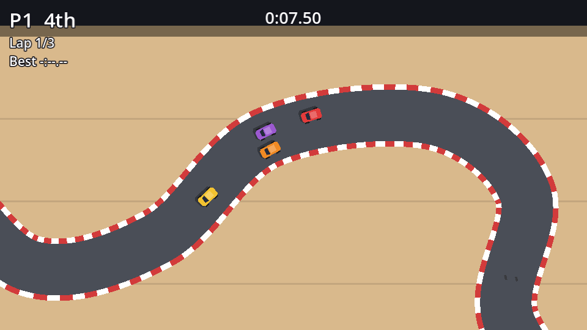

The HUD already shows laps and the best time. Add each player's **position** on top: big, because it's the number you glance at mid-corner.

In `hud.tscn`, add a `Label` named `Position` as the **first** child of `P1Panel` and of `P2Panel`, with a font size override of `22` (and **Horizontal Alignment: Right** in `P2Panel`).

```text
P1Panel (VBoxContainer, %)
├── Position (Label)   # "P1  1st", font size 22
├── Lap (Label)
└── Best (Label)
```

Pass the standings to the HUD:

```gdscript title="hud.gd" ins={2,7-8} del={1}
func update_race(race_time: float) -> void:
func update_race(race_time: float, standings: Array[Car]) -> void:
	time_label.text = Format.time(race_time)
	for i in _players.size():
		var car := _players[i]
		var panel := panels[i]
		var place := Format.ordinal(standings.find(car) + 1)
		panel.get_node("Position").text = "%s  %s" % [car.driver_name, place]
		if car.finished:
			# ...
```

```gdscript title="race.gd" ins={4} del={3}
func _physics_process(delta: float) -> void:
	# ...
	hud.update_race(race_time)
	hud.update_race(race_time, standings)
```

`standings.find(car)` returns the car's index in the sorted array: 0 for the leader. Adding 1 gives the place, and `Format.ordinal` turns it into "1st", "2nd"...

Run a race: the position flickers between 3rd and 4th as you jostle off the line, then settles as you pull away (or don't).



:::tip[Make it pop]
Positions change a lot in a tight race. A nice extra is to colour the label gold when you're leading: `panel.get_node("Position").modulate = Color.GOLD if place == "1st" else Color.WHITE`.
:::

```quiz
question: A car is at index 2 in `standings`. What does the HUD show?
options:
  - 2nd
  - 3rd
  - 2th
answer: 1
explain: Index 2 is the third car, so `Format.ordinal(2 + 1)` returns "3rd".
```
