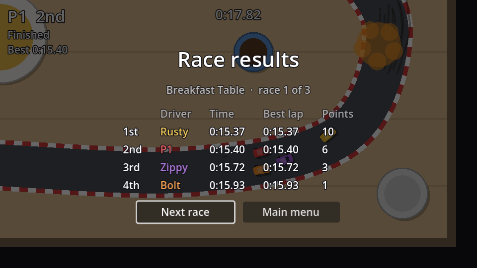

## The scene

The results screen is a `CanvasLayer` (layer 10, above the HUD) with a dim background and a centred column. The table itself is a `GridContainer`, filled from code because its size depends on the race.

```text
Results (CanvasLayer, layer 10)
├── Dim (ColorRect)                 # Full Rect, black at 60% alpha
└── CenterContainer (Full Rect)
    └── VBoxContainer               # separation 12
        ├── Title (Label, %)        # font size 28, centred
        ├── Table (GridContainer, %)  # columns 4, h separation 24, Shrink Center
        └── Buttons (HBoxContainer) # separation 12, alignment Center
            ├── AgainButton (Button, %)   # "Race again", min width 130
            └── MenuButton (Button, %)    # "Main menu", min width 130
```

A `GridContainer` fills row by row: with 4 columns, the first four children make the header row, the next four the first result, and so on. Connect both buttons' `pressed` signals to `Results`.

## The script

```gdscript title="results.gd"
class_name Results
extends CanvasLayer
## The end screen: race results, championship standings, or a head-to-head winner.

@onready var title: Label = %Title
@onready var table: GridContainer = %Table
@onready var again_button: Button = %AgainButton
@onready var menu_button: Button = %MenuButton


func _ready() -> void:
	hide()


func show_race(order: Array[Car]) -> void:
	title.text = "Race results"
	var headers := ["", "Driver", "Time", "Best lap"]
	_start_table(headers)
	for i in order.size():
		var car := order[i]
		var time := Format.time(car.finish_time) if car.finished else "-"
		var row := [Format.ordinal(i + 1), car.driver_name, time, Format.time(car.best_lap)]
		_add_row(row, car.color)
	again_button.text = "Race again"
	_open(again_button)


func _open(focus_button: Button) -> void:
	show()
	focus_button.grab_focus()


func _start_table(headers: Array) -> void:
	for child in table.get_children():
		table.remove_child(child) # Gone right away, not at the end of the frame.
		child.queue_free()
	table.visible = not headers.is_empty()
	table.columns = maxi(headers.size(), 1)
	for header in headers:
		var label := _add_cell(header)
		label.modulate = Color(1, 1, 1, 0.6)


func _add_row(cells: Array, color: Color) -> void:
	for i in cells.size():
		var label := _add_cell(cells[i])
		if i == 1:
			label.add_theme_color_override("font_color", color.lightened(0.2))


func _add_cell(text: String) -> Label:
	var label := Label.new()
	label.text = text
	table.add_child(label)
	return label


func _on_again_button_pressed() -> void:
	get_tree().reload_current_scene()


func _on_menu_button_pressed() -> void:
	get_tree().change_scene_to_file("res://main_menu.tscn")
```

- `_start_table` clears the old rows and sets the column count from the headers, so the same screen can show different tables later (championship standings have three columns).
- `queue_free()` only deletes a node at the end of the frame. Removing it from the grid first stops old and new rows sharing the grid for a frame.
- The driver's name is drawn in the car's colour (lightened a little to read well on the dark background). `add_theme_color_override` overrides one theme value on one control, like the Inspector's **Theme Overrides** section.
- `grab_focus()` on the first button makes the screen work from the keyboard straight away: <kbd>Enter</kbd> races again.
- Cars that haven't finished get a `-` instead of a time. They're still ranked by their progress, which is the fairest result we have.

:::warning
`main_menu.tscn` arrives in chapter 10, so **Main menu** prints an error until then. **Race again** works.
:::

## Show it

Instance `results.tscn` in `race.tscn` and show it when the end timer fires, instead of restarting:

```gdscript title="race.gd" ins={1,7} del={6}
@onready var results: Results = $Results

# ...

func _on_end_timer_timeout() -> void:
	get_tree().reload_current_scene()
	results.show_race(standings)
```

The race keeps running behind the dim background: the CPU cars finish their laps, and your car cruises round on autopilot. It makes a lively backdrop for the table.

That's a complete single race: grid, countdown, three laps against three CPU drivers, live positions, and results.

```quiz
question: A GridContainer has 4 columns and 20 Label children. How many rows does it show?
type: text
answer: ["5", "five"]
explain: Children fill the grid left to right, top to bottom, so 20 children in 4 columns make 5 rows (the header plus 4 cars).
```
