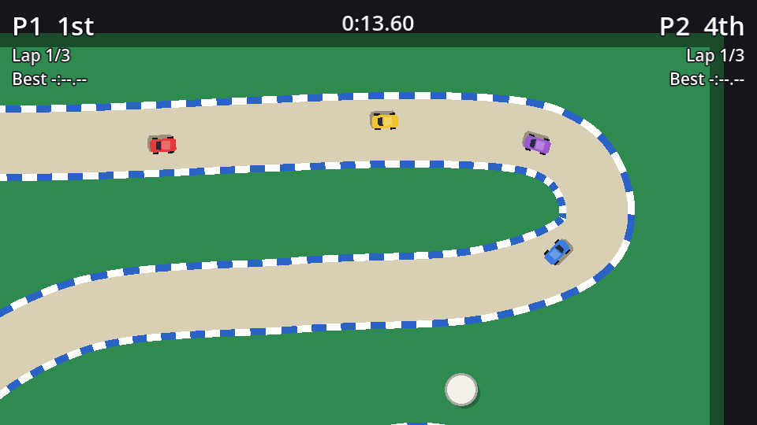

## What the camera should do

| Situation | Camera |
| --- | --- |
| One player | Follow them, looking a little ahead in the direction of travel |
| Two players racing | Frame both of them, zooming out (down to a limit) when they're far apart |
| Head-to-head (next page) | Follow the leader at a fixed zoom, so the trailing car *can* fall off |
| Always | Stay over the table: don't show the empty floor beyond its edges |

## The race camera

Create `race_camera.gd`:

```gdscript title="race_camera.gd"
class_name RaceCamera
extends Camera2D
## One shared camera for everybody. It follows `focus`, looks ahead in the direction
## of travel, and zooms out to keep every car in `keep_in_view` on screen.

## The car to follow.
var focus: Car
## Cars that must stay visible. Leave empty to keep a fixed zoom (head-to-head).
var keep_in_view: Array[Car] = []

## Seconds of the focus car's velocity to look ahead.
@export var look_ahead := 0.35
## Higher values follow more tightly.
@export var follow_speed := 4.0
@export var zoom_speed := 2.0
## The furthest the camera zooms out (0.5 shows twice as much in each direction).
@export var min_zoom := 0.5
## Screen space (px) kept free around the cars when zooming out to fit them.
@export var margin := Vector2(120, 90)

var _shake := 0.0


func _ready() -> void:
	# Move in step with the physics bodies we follow, which avoids jitter.
	process_callback = Camera2D.CAMERA2D_PROCESS_PHYSICS


## Stop the camera from leaving the table (plus a little border).
func set_bounds(rect: Rect2) -> void:
	limit_left = int(rect.position.x)
	limit_top = int(rect.position.y)
	limit_right = int(rect.end.x)
	limit_bottom = int(rect.end.y)


func _physics_process(delta: float) -> void:
	if focus == null:
		return
	var target := _target_position()
	var weight := 1.0 - exp(-follow_speed * delta)
	global_position = global_position.lerp(target, weight)
	var zoom_weight := 1.0 - exp(-zoom_speed * delta)
	zoom = zoom.lerp(Vector2.ONE * _target_zoom(), zoom_weight)

	_shake = move_toward(_shake, 0.0, 30.0 * delta)
	offset = Vector2(randf_range(-1, 1), randf_range(-1, 1)) * _shake


func _target_position() -> Vector2:
	var target := focus.global_position + focus.velocity * look_ahead
	if keep_in_view.size() > 1:
		target = _cars_rect().get_center()
	return target


func _target_zoom() -> float:
	if keep_in_view.size() < 2:
		return 1.0
	var rect := _cars_rect()
	var room := get_viewport_rect().size - margin * 2.0
	var fit := minf(room.x / maxf(rect.size.x, 1.0), room.y / maxf(rect.size.y, 1.0))
	return clampf(fit, min_zoom, 1.0)


## The smallest rectangle containing every car we must keep in view.
func _cars_rect() -> Rect2:
	var rect := Rect2(keep_in_view[0].global_position, Vector2.ZERO)
	for car in keep_in_view:
		rect = rect.expand(car.global_position)
	return rect


## Jump straight to the target, skipping the smooth follow.
func snap() -> void:
	if focus:
		global_position = _target_position()
		zoom = Vector2.ONE * _target_zoom()
	reset_smoothing()


func shake(amount: float) -> void:
	_shake = maxf(_shake, amount)


## The part of the world currently on screen.
func visible_rect() -> Rect2:
	var size := get_viewport_rect().size / zoom
	return Rect2(get_screen_center_position() - size / 2.0, size)
```

### Smooth following

`a.lerp(b, weight)` moves `a` part of the way towards `b`. Doing that every tick with a fixed weight like 0.1 gives a lovely smooth follow, but just like grip in the car chapter, a fixed weight per tick depends on the tick rate. `1.0 - exp(-follow_speed * delta)` is the frame-rate independent version: at `follow_speed = 4`, the camera closes about 98% of the gap in one second, at any tick rate.

### Looking ahead

Aiming at `focus.velocity * look_ahead` ahead of the car (0.35 s of travel, about 90 px at top speed) shows more of the road you're driving *into* than the road behind you. On a 640×360 screen with fast cars, it's the difference between seeing a corner and hitting it.

### Zooming to fit

`Rect2.expand()` grows a rectangle to include a point, so `_cars_rect()` is the smallest box around every car in `keep_in_view`. The zoom that fits it is the screen size (minus a margin) divided by the box size. In Godot, `zoom` above 1 zooms **in**, so a box twice as wide as the room needs zoom 0.5. We clamp between `min_zoom` and 1: never zoom in past normal, and never out so far the cars become specks.

### Bounds

Camera2D's `limit_*` properties stop the view at the table's edge (plus a 40 px border, so you can see where the table ends). `get_screen_center_position()` returns where the camera is *really* looking after limits and smoothing, which matters for `visible_rect()` on the next page.

`offset` moves the view without moving the camera node. The shake uses it; we'll call `shake()` from collisions in the polish chapter.

## Using it

In `race.tscn`, replace the old `Camera2D` with a new `Camera2D` named `RaceCamera` with `race_camera.gd` attached, and mark it **Access as Unique Name**. Then in `race.gd`:

```gdscript title="race.gd" ins={2,9-14,24,28-33} del={1,23}
@onready var camera: Camera2D = $Camera2D
@onready var camera: RaceCamera = %RaceCamera


func _ready() -> void:
	track.checkpoint_entered.connect(_on_checkpoint_entered)
	_spawn_cars()
	_update_standings()

	camera.set_bounds(Rect2(Vector2.ZERO, track.table_size).grow(40))
	camera.focus = players[0]
	camera.keep_in_view = players # Zoom out so every player stays on screen.
	camera.snap()

	hud.setup(players, LAPS)
	_start_countdown()


func _physics_process(delta: float) -> void:
	if state == State.RACING or state == State.FINISHED:
		race_time += delta
	_update_standings()
	camera.global_position = players[0].global_position
	camera.focus = _camera_focus()
	hud.update_race(race_time, standings)


## A race follows the leading player.
func _camera_focus() -> Car:
	for car in standings:
		if car in players:
			return car
	return players[0]
```

`snap()` matters at the start: without it the camera would glide in from (0, 0) during the countdown.

Try a two-player race (**Player Count** 2): the camera frames both of you and zooms out as you split up. At `min_zoom` 0.5 the camera sees 1280×720 pixels, which is nearly the whole breakfast table, so you'll rarely lose each other.



```quiz
question: Two players are 1000 px apart horizontally and level vertically. The room left after margins is 400 px wide. What zoom does `_target_zoom()` return, with `min_zoom` 0.5?
options:
  - "0.4"
  - "0.5"
  - "2.5"
answer: 1
explain: The fit is 400 / 1000 = 0.4, but it's clamped to `min_zoom`, so 0.5. (The height check gives a huge value, since the box has almost no height, and `minf` picks the smaller.)
```

```quiz
question: Why use `1.0 - exp(-follow_speed * delta)` as the lerp weight instead of a constant like 0.07?
options:
  - It's faster to compute
  - The camera then follows at the same speed regardless of the physics tick rate
  - Constants aren't allowed in lerp
answer: 1
```
