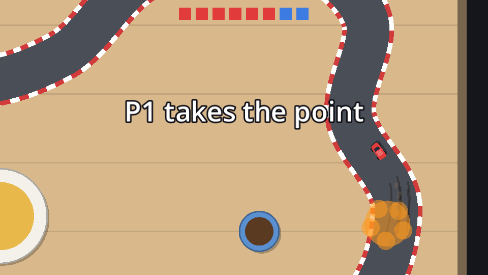

## The rules

Head-to-head is two cars and one screen. The camera follows whoever's **leading**, at normal zoom. Fall far enough behind that you drop off the edge of the screen, and the leader takes a point from you. Both cars are then put back side by side where the leader was, and the next round starts.

Each player starts with **4 points**, shown as 8 lights in the two cars' colours. Every round moves one light from the loser to the winner. Take all 8 and you win the match. With two players it's a pure duel; with one player, you take on a single CPU car.

## A Session autoload

The race now needs to know which **mode** it's running, and later the menus will choose it. Data that has to outlive a scene change belongs in an **autoload**: a node Godot creates at startup and keeps alive across scenes, reachable by name from any script.

Create `session.gd`:

```gdscript title="session.gd"
extends Node
## What the players picked in the menus, plus the running championship.
## Registered as the "Session" autoload. Unlike Settings, nothing here is saved.

enum Mode { RACE, CHAMPIONSHIP, HEAD_TO_HEAD }

var mode := Mode.RACE
var players := 1
```

Register it in **Project Settings → Globals → Autoload**: pick `session.gd`, name it `Session`, click **Add**. Now `Session.mode` works everywhere. (`CHAMPIONSHIP` is for chapter 9.)

In `race.gd`, replace `player_count` with `Session.players`, and work out the mode:

```gdscript title="race.gd" ins={3-4,10-12,16,24-25,29-32,38,41} del={6-8,23,28,37,40}
## Cars in a race, players included.
const RACE_CARS := 4
## Head-to-head: both cars start with this many points. Take all of them to win.
const START_POINTS := 4

## How many players race. Each gets a car and the matching input actions.
@export_range(1, 2) var player_count := 1

# ...
var head_to_head := false
## Head-to-head points, one entry per car.
var points: Array[int] = []


func _ready() -> void:
	head_to_head = Session.mode == Session.Mode.HEAD_TO_HEAD
	track.checkpoint_entered.connect(_on_checkpoint_entered)
	_spawn_cars()
	_update_standings()

	camera.set_bounds(Rect2(Vector2.ZERO, track.table_size).grow(40))
	camera.focus = players[0]
	camera.keep_in_view = players # Zoom out so every player stays on screen.
	if not head_to_head:
		camera.keep_in_view = players # Zoom out so every player stays on screen.
	camera.snap()

	hud.setup(players, LAPS)
	hud.setup(players, LAPS, head_to_head)
	if head_to_head:
		points = [START_POINTS, START_POINTS]
		hud.update_points(cars, points)
	_start_countdown()


func _spawn_cars() -> void:
	var cpu_count := RACE_CARS - player_count
	var cpu_count := (2 if head_to_head else RACE_CARS) - Session.players
	# CPU cars line up at the front of the grid, players behind them.
	for slot in cpu_count + player_count:
	for slot in cpu_count + Session.players:
	# ...
```

- With two players, head-to-head has `2 - 2 = 0` CPU cars; with one player, one CPU car. In a normal race it's still four cars in total.
- In head-to-head, `keep_in_view` stays empty, so the camera keeps a fixed zoom. If it zoomed out to fit both cars, nobody could ever fall off the screen.

Temporarily change `var mode := Mode.RACE` to `Mode.HEAD_TO_HEAD` in `session.gd` to test, until the menus can choose the mode.

## The leader takes the camera

In head-to-head the camera follows the **leader**, CPU or not:

```gdscript title="race.gd" ins={2,6} del={1,5}
## A race follows the leading player.
## Head-to-head follows the leader. A race follows the leading player.
func _camera_focus() -> Car:
	for car in standings:
		if car in players:
		if head_to_head or car in players:
			return car
	return players[0]
```

## Falling off the screen

`RaceCamera.visible_rect()` is the part of the world on screen. A car whose centre is outside it, plus a 12 px grace margin so it's properly gone, has fallen off:

```gdscript title="race.gd" ins={6-7,11-18}
func _physics_process(delta: float) -> void:
	if state == State.RACING or state == State.FINISHED:
		race_time += delta
	_update_standings()
	camera.focus = _camera_focus()
	if head_to_head and state == State.RACING:
		_check_off_screen()
	hud.update_race(race_time, standings)


## Head-to-head: whoever falls off the leader's screen loses the round.
func _check_off_screen() -> void:
	var view := camera.visible_rect().grow(12.0)
	var leader := standings[0]
	for car in cars:
		if car != leader and not view.has_point(car.global_position):
			_end_round(leader)
			return
```

The visible rectangle comes from `get_screen_center_position()`, where the camera is actually looking, smoothing and look-ahead included. The camera chases the leader with a little lag, so a car right on the leader's tail is always safe. You lose a round by falling about half a screen behind.

Laps keep counting in head-to-head (progress needs them), but nobody should ever *finish*: the match is decided only by points. So skip the finish check:

```gdscript title="race.gd" ins={4} del={3}
func _complete_lap(car: Car) -> void:
	# ...
	if car.lap > LAPS:
	if not head_to_head and car.lap > LAPS:
		_finish(car)
```

`_end_round` comes on the next page.

## The lights

Add an `HBoxContainer` named `Lights` (unique name, anchor preset **Center Top**, 200×16 at y 10, separation 6, alignment **Center**) to `hud.tscn`. The HUD fills it with eight little squares:

```gdscript title="hud.gd" ins={3,7,12-13,18-20,23-32} del={10-11,17}
var _players: Array[Car] = []
var _laps := 0
var _lights: Array[ColorRect] = []

@onready var panels: Array[VBoxContainer] = [%P1Panel, %P2Panel]
@onready var time_label: Label = %TimeLabel
@onready var lights: HBoxContainer = %Lights
# ...

## One panel per player.
func setup(players: Array[Car], laps: int) -> void:
## One panel per player. Head-to-head shows the points lights instead of laps and time.
func setup(players: Array[Car], laps: int, head_to_head: bool) -> void:
	_players = players
	_laps = laps
	for i in panels.size():
		panels[i].visible = i < players.size()
		panels[i].visible = i < players.size() and not head_to_head
	time_label.visible = not head_to_head
	lights.visible = head_to_head


## Head-to-head: show `points[i]` lights in the colour of `cars[i]`.
func update_points(cars: Array[Car], points: Array[int]) -> void:
	if _lights.is_empty():
		for i in points[0] + points[1]:
			var light := ColorRect.new()
			light.custom_minimum_size = Vector2(16, 16)
			lights.add_child(light)
			_lights.append(light)
	for i in _lights.size():
		_lights[i].color = cars[0].color if i < points[0] else cars[1].color
```

The lights are created the first time, since the total never changes, and recoloured after every round: the first `points[0]` lights in the first car's colour, the rest in the second car's.



```quiz
question: Why doesn't the head-to-head camera zoom out to fit both cars?
options:
  - It would be too slow
  - Then the trailing car could never fall off the screen, and that's how rounds are won
  - Camera2D can't zoom while following
answer: 1
```

```quiz
question: One player starts a head-to-head match. How many CPU cars does `_spawn_cars()` create?
type: text
answer: ["1", "one"]
explain: '`(2 if head_to_head else RACE_CARS) - Session.players` is 2 - 1 = 1: a single CPU rival.'
```
