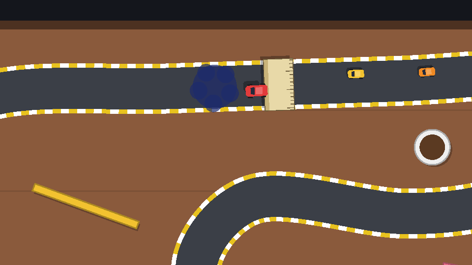

## Faking the air

The game is flat 2D, so a "jump" is an illusion made of three things:

1. **The car grows**: scaling `Visuals` up to 1.4× and back down makes it look closer to the camera.
2. **The shadow drops away**: moving `Shadow` from (2, 2) to (8, 8) and back makes the car look higher off the table.
3. **Physics changes**: while airborne, there's no grip, no steering and no throttle. The car flies straight on with whatever speed it had, and it ignores puddles and off-road.

That third point is what makes ramps useful: on the desk track, a ruler ramp sits just before a pool of ink, and a car that takes it fast enough sails clean over the ink.

## The car's side

```gdscript title="car.gd" ins={2,4-5,10-13,18-31}
var _surfaces: Array[Surface] = []
var _air_time := 0.0

@onready var visuals: Node2D = $Visuals
@onready var shadow: Polygon2D = $Shadow

# ...

func _drive(delta: float) -> void:
	if _air_time > 0.0:
		_air_time -= delta
		return # In the air: no grip, no steering, the car keeps its momentum.

	var surface := _surface_factors()
	# ...


## Launch the car into the air for `duration` seconds. Called by ramps.
func jump(duration: float) -> void:
	if _air_time > 0.0:
		return
	_air_time = duration
	var tween := create_tween().set_trans(Tween.TRANS_SINE)
	tween.tween_property(visuals, "scale", Vector2(1.4, 1.4), duration / 2).set_ease(Tween.EASE_OUT)
	tween.parallel().tween_property(shadow, "position", Vector2(8, 8), duration / 2)
	tween.tween_property(visuals, "scale", Vector2.ONE, duration / 2).set_ease(Tween.EASE_IN)
	tween.parallel().tween_property(shadow, "position", Vector2(2, 2), duration / 2)


func is_airborne() -> bool:
	return _air_time > 0.0
```

A **tween** animates properties over time from code. Steps added to a tween run one after another; `parallel()` makes the next step run *alongside* the previous one. So the car grows while the shadow drops, then shrinks while the shadow comes back. `TRANS_SINE` with `EASE_OUT` on the way up and `EASE_IN` on the way down gives a natural arc: fast off the ramp, slow at the top, fast into the landing.

Returning early from `_drive()` skips everything, so the velocity simply stays as it is: that's the "keeps its momentum" part. `move_and_slide()` still runs, so you can still crash into a mug mid-air.

Lining the cars up between head-to-head rounds must also bring a car back down to earth:

```gdscript title="car.gd" ins={5-7}
func place(new_transform: Transform2D) -> void:
	transform = new_transform
	velocity = Vector2.ZERO
	forward_speed = 0.0
	_air_time = 0.0
	visuals.scale = Vector2.ONE
	shadow.position = Vector2(2, 2)
```

## The ramp

A ramp is another self-drawing `Area2D`. Create `ramp.gd`:

```gdscript title="ramp.gd"
@tool
class_name Ramp
extends Area2D
## A ruler propped up on an eraser. Cars that hit it fast enough take off.
## Lay it across the road with its x axis pointing in the racing direction.

@export var air_time := 0.6
## Cars slower than this (px/s) just roll over it.
@export var min_speed := 120.0

@onready var collision: CollisionShape2D = $CollisionShape2D


func _ready() -> void:
	if collision.shape:
		collision.shape.changed.connect(queue_redraw)
	if not Engine.is_editor_hint():
		body_entered.connect(_on_body_entered)


func _on_body_entered(body: Node2D) -> void:
	if body is Car and body.forward_speed > min_speed:
		body.jump(air_time)


func _draw() -> void:
	var shape := collision.shape as RectangleShape2D
	if shape == null:
		return
	draw_set_transform_matrix(collision.transform)
	var rect := Rect2(-shape.size / 2.0, shape.size)
	draw_rect(Rect2(rect.position + Vector2(4, 4), rect.size), Color(0, 0, 0, 0.3))
	draw_rect(rect, Color("e8d9a8"))
	# The raised far edge (cars drive along +x) is darker, so it reads as a slope.
	draw_rect(Rect2(rect.end.x - 6.0, rect.position.y, 6.0, rect.size.y), Color("c9b47a"))
	# Ruler markings every 5 px along the long side, longer every fifth one.
	var y := rect.position.y + 3.0
	var i := 0
	while y < rect.end.y:
		var mark := 10.0 if i % 5 == 0 else 5.0
		draw_line(Vector2(rect.position.x, y), Vector2(rect.position.x + mark, y), Color("6b5a3a"), 1.0)
		y += 5.0
		i += 1
	draw_rect(rect, Color("6b5a3a"), false, 1.0)
```

`as RectangleShape2D` is a safe cast: it gives `null` instead of an error if the shape is something else, so a ramp with the wrong shape just doesn't draw.

The speed check stops a car that creeps onto the ramp from doing a slow-motion moonshot. 120 px/s at 0.6 s of air time flies about 70 px; at top speed, about 150 px.

## Bumpers

The last hazard is the simplest: props that push back. Pool balls on the pool table will act like pinball bumpers. Add one export to `prop.gd`:

```gdscript title="prop.gd" ins={6-7}
## Optional second colour drawn inside the shape, like the coffee in a mug.
@export var inner_color := Color.TRANSPARENT:
	set(value):
		inner_color = value
		queue_redraw()
## Extra speed (px/s) pushed into cars that hit it. Bumpers use this.
@export var bounce := 0.0
```

and use it in the car's collision handling:

```gdscript title="car.gd" ins={3-4}
		else:
			velocity += normal * impact * 0.3 # A small bounce off walls and props.
			if other is Prop:
				velocity += normal * other.bounce
```

The normal points away from the prop, so adding `normal * bounce` fires the car straight back out, however gently it hit. With `bounce = 180`, a pool ball sends you skidding. The next chapter builds the desk and pool tracks that use the ramps and bumpers. To try them now, drop a `Ramp` (an `Area2D` with `ramp.gd` and a 40×70 rectangle, on the `surfaces` layer with mask `cars`) across the breakfast table's bottom straight, and give the teapot a `bounce` of 200.

```quiz
question: Which of these still happen while a car is airborne? Select all that apply.
type: multiple
options:
  - Steering
  - Collisions with props
  - The off-road slowdown
  - Moving at its current velocity
answer: [1, 3]
explain: '`_drive()` returns early, so steering, throttle, grip and surfaces all stop. `move_and_slide()` still runs: the car keeps flying at its current velocity and can still hit things.'
```

```quiz
question: In a tween, what does `parallel()` do?
options:
  - Runs the next tweener at the same time as the previous one
  - Runs the whole tween on another thread
  - Repeats the tween forever
answer: 0
```
