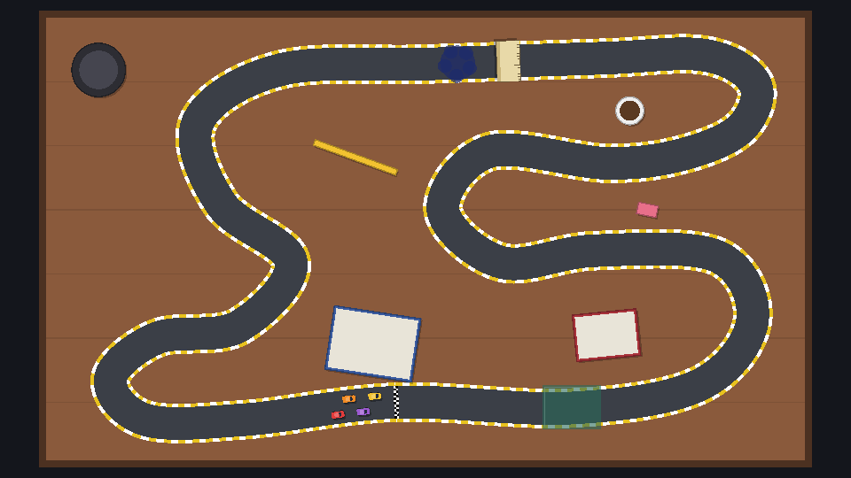
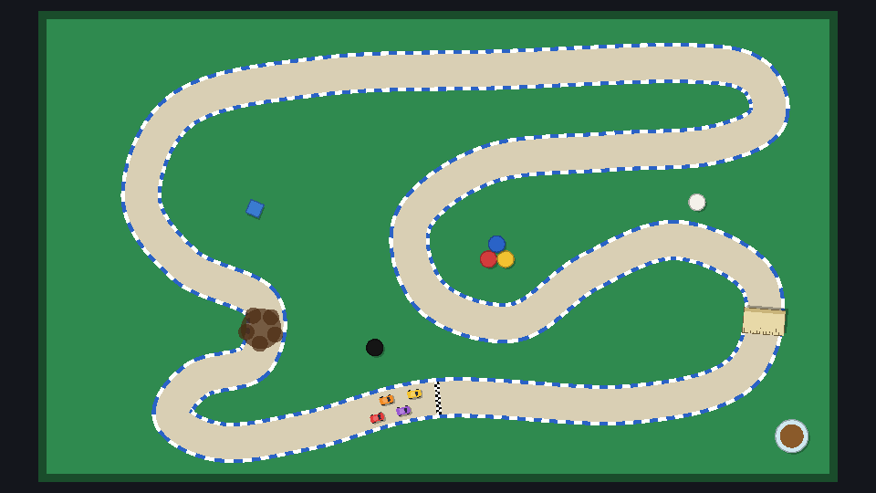

Every track is the same recipe: a `Track` root with `track.gd`, a closed `Path`, a `Surfaces` node and a `Props` node. The quickest start is to duplicate `breakfast.tscn` (right-click → **Duplicate**), then rename the root, redraw the curve and swap the props.

## What makes a good tabletop track

- **Vary the corners.** A fast sweeper, a hairpin and an S-bend each ask for something different. A track of identical corners is a track of one corner.
- **Put hazards on the racing line.** A puddle in the infield is decoration. A puddle on the apex of a fast bend is a decision: take it flat and slide, or lift and lose time.
- **Keep runs of road apart.** At least 120 px between parallel stretches, or cars (and the closest-point maths) jump between them.
- **Leave room around the table's edge.** 60 px or more, so the kerbs don't touch the invisible wall.

## Study Desk

A long, twisty desk with books to avoid and a ruler jump over a pool of ink. Save as `tracks/desk.tscn` with root `StudyDesk`:

| Track setting | Value |
| --- | --- |
| Table Size | 1300 × 760 |
| Table Color / Plank Spacing | `#8a5a3c` (dark walnut) / 110 |
| Road Width / Road Color / Kerb Color | 56 / `#3b3f47` / `#e8c21e` (yellow) |

Curve points, in order:

```text
(600, 660)  (900, 670)  (1120, 630) (1210, 520) (1150, 410)
(940, 400)  (780, 420)  (680, 330)  (760, 230)  (960, 250)
(1090, 235) (1190, 190) (1215, 115) (1130, 65)  (950, 70)
(650, 80)   (400, 90)   (260, 180)  (300, 320)  (420, 420)
(330, 530)  (190, 550)  (110, 620)  (170, 690)  (340, 690)
```

| Node | Kind | Shape | Position | Rotation | Settings |
| --- | --- | --- | --- | --- | --- |
| `BlueBook` | Prop | rect 150×110 | (560, 560) | 0.15 | `#3a5ba0`, inner `#e8e4d8` |
| `RedBook` | Prop | rect 110×80 | (960, 545) | -0.1 | `#a8323a`, inner `#e8e4d8` |
| `Pencil` | Prop | rect 150×10 | (530, 240) | 0.35 | `#f2c230` |
| `Eraser` | Prop | rect 34×20 | (1030, 330) | 0.2 | `#e86f8a` |
| `Mug` | Prop | circle r 24 | (1000, 160) | | `#efefef`, inner `#5b3a22` |
| `LampBase` | Prop | circle r 46 | (90, 90) | | `#2d2d33`, inner `#45454f` |
| `InkSpill` | Surface | circle r 30 | (705, 78) | | `#1d2a6b` at 70%, grip 0.2 |
| `MouseMat` | Surface | rect 100×76 | (900, 668) | | `#2a6b5a` at 60%, top speed 0.6 |
| `Ruler` | Ramp | rect 40×70 | (792, 75) | 3.108 | defaults |

The ruler's rotation of 3.108 radians (178°) points its x axis **left**, because that's the racing direction along the top straight. Its darker, raised edge then faces the way you're going, and the ink waits just after the landing. Take the ruler slowly and you'll roll straight into the ink.



Then make its resource, `tracks/desk.tres`: id `desk`, title `Study Desk`, description `Hairpins between the homework. Jump the ruler to clear the ink.`

## Pool Table

Green felt, a pale road, blue kerbs, and the pool balls as bumpers. Save as `tracks/pool.tscn` with root `PoolTable`:

| Track setting | Value |
| --- | --- |
| Table Size | 1240 × 720 |
| Table Color / Plank Spacing | `#2f8a4f` (felt) / 0 (no planks) |
| Road Width / Road Color / Kerb Color | 52 / `#d9cfb4` / `#2a63c7` (blue) |

```text
(620, 600)  (920, 610)  (1100, 560) (1130, 420) (1000, 350)
(860, 400)  (740, 480)  (610, 440)  (580, 320)  (700, 230)
(890, 210)  (1050, 200) (1140, 160) (1120, 90)  (1010, 70)
(720, 80)   (440, 90)   (220, 140)  (150, 280)  (220, 390)
(340, 450)  (330, 540)  (240, 570)  (200, 630)  (280, 670)
(420, 650)
```

| Node | Kind | Shape | Position | Rotation | Settings |
| --- | --- | --- | --- | --- | --- |
| `RedBall` | Prop | circle r 13 | (700, 380) | | `#d23c3c`, bounce 180 |
| `YellowBall` | Prop | circle r 13 | (727, 380) | | `#f2c230`, bounce 180 |
| `BlueBall` | Prop | circle r 13 | (713, 356) | | `#2a63c7`, bounce 180 |
| `BlackBall` | Prop | circle r 13 | (520, 520) | | `#151515`, bounce 180 |
| `WhiteBall` | Prop | circle r 13 | (1030, 290) | | `#f4f1ea`, bounce 180 |
| `Chalk` | Prop | rect 22×22 | (330, 300) | 0.4 | `#3a7bd0` |
| `Glass` | Prop | circle r 26 | (1180, 660) | | `#cfe8f0`, inner `#8a5a2a` |
| `ColaSpill` | Surface | circle r 32 | (340, 490) | | `#4a2a12` at 70%, grip 0.25 |
| `Ramp` | Ramp | rect 40×66 | (1136, 479) | -1.489 | defaults |

With plank spacing 0, `_draw()` skips the planks entirely, and the darker table edge doubles as the cushions. The cola sits in the tight S-bend on the left: slow in, or slide out.



Its resource is `tracks/pool.tres`: id `pool`, title `Pool Table`, description `Tight turns on the felt, and pool balls that bounce you back.`

Uncomment the two lines in `Session.TRACKS`, set `Session.track_index` to 1 or 2, and race.

:::tip[Your own tracks]
Adding a fourth track is now three steps: build the scene, make a `TrackInfo`, add one line to `TRACKS`. The menus in the next chapter pick it up automatically.
:::

```quiz
question: The road runs right-to-left where you want a ramp. What rotation should the Ramp node have?
options:
  - 0
  - About PI (180°), so its x axis points left, in the racing direction
  - PI / 2
answer: 1
```

```quiz
question: Where does a slippery puddle make the most interesting hazard?
options:
  - Far into the infield, where nobody drives
  - On the apex of a fast bend, where taking it flat out means sliding wide
  - Just outside the table's edge
answer: 1
explain: A hazard is interesting when it forces a choice. On the racing line of a fast bend, you either slow down or accept the slide.
```
