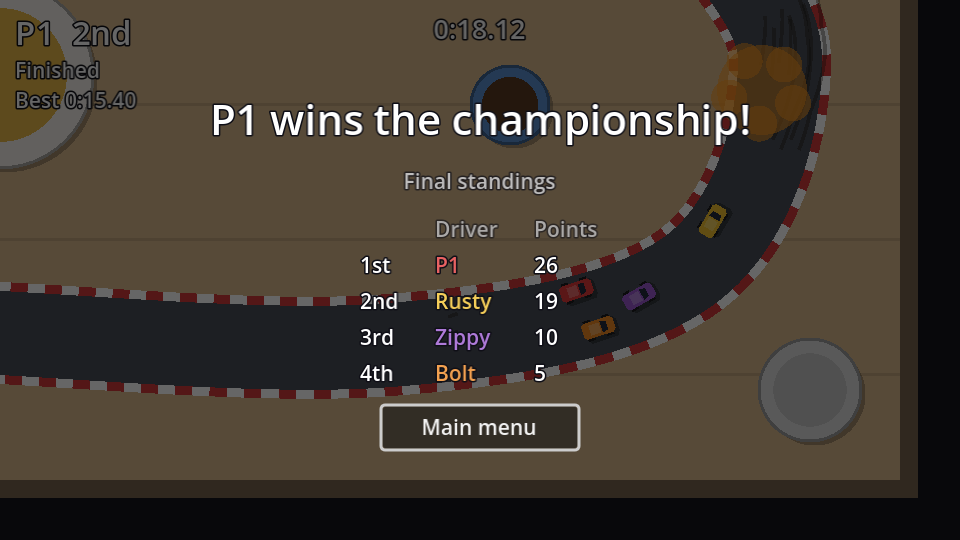

A championship is every track in a row, with points for each finish: **10, 6, 3 and 1** for first to fourth. The scene reloads between races, so the points can't live in the race scene. They go in the `Session` autoload, which survives scene changes.

## Session keeps score

```gdscript title="session.gd" ins={1-2,7-10,17-45}
## Championship points for 1st, 2nd, 3rd and 4th place.
const POINTS: Array[int] = [10, 6, 3, 1]

var mode := Mode.RACE
var players := 1
var track_index := 0
## Championship points per driver name.
var standings := {}
## Car colour per driver name, for the standings table.
var driver_colors := {}


func track() -> TrackInfo:
	return TRACKS[track_index]


func start_championship() -> void:
	mode = Mode.CHAMPIONSHIP
	track_index = 0
	standings.clear()
	driver_colors.clear()


## Give out points for a finished race. `order` is the result, winner first.
func award_points(order: Array[Car]) -> void:
	for place in order.size():
		var driver := order[place].driver_name
		var earned := POINTS[place] if place < POINTS.size() else 0
		standings[driver] = standings.get(driver, 0) + earned
		driver_colors[driver] = order[place].color


## Driver names sorted by championship points, leader first.
func standings_order() -> Array:
	var drivers := standings.keys()
	drivers.sort_custom(func(a, b): return standings[a] > standings[b])
	return drivers


func is_last_race() -> bool:
	return track_index >= TRACKS.size() - 1


func next_race() -> void:
	track_index += 1
```

- `standings` is a **Dictionary** from driver name to points, like `{"P1": 16, "Rusty": 13}`. Names are stable across races (the CPU drivers are always Rusty, Zippy and Bolt), while the car nodes are recreated each race, so names make good keys.
- `standings.get(driver, 0)` returns 0 for a driver who has no points yet, so the first race needs no special case.
- We only store the car's colour for the final table: the cars themselves are long gone by then.

## Award points at the end of each race

```gdscript title="race.gd" ins={5-6}
func _on_end_timer_timeout() -> void:
	if head_to_head:
		results.show_match_winner(standings[0])
		return
	if Session.mode == Session.Mode.CHAMPIONSHIP:
		Session.award_points(standings)
	results.show_race(standings)
```

Points go to the standings at the moment the results appear. Cars that haven't finished yet are placed by their progress, the same order the results table shows.

## Results: next race and final standings

Add a `NextButton` (unique name, minimum width 130, text "Next race") as the **first** child of the results screen's `Buttons` row, and connect its `pressed` signal. Then update `results.gd`:

```gdscript title="results.gd" ins={1,8,12-14,20-21,23-25,28,31-41,48-49,55-60} del={27}
@onready var next_button: Button = %NextButton
@onready var again_button: Button = %AgainButton
@onready var menu_button: Button = %MenuButton

# ...

func show_race(order: Array[Car]) -> void:
	var championship := Session.mode == Session.Mode.CHAMPIONSHIP
	title.text = "Race results"
	subtitle.text = Session.track().title
	var headers := ["", "Driver", "Time", "Best lap"]
	if championship:
		subtitle.text += "  ·  race %d of %d" % [Session.track_index + 1, Session.TRACKS.size()]
		headers.append("Points")
	_start_table(headers)
	for i in order.size():
		var car := order[i]
		var time := Format.time(car.finish_time) if car.finished else "-"
		var row := [Format.ordinal(i + 1), car.driver_name, time, Format.time(car.best_lap)]
		if championship:
			row.append(str(Session.standings[car.driver_name]))
		_add_row(row, car.color)
	next_button.visible = championship
	next_button.text = "Final standings" if Session.is_last_race() else "Next race"
	again_button.visible = not championship
	again_button.text = "Race again"
	_open(again_button)
	_open(next_button if championship else again_button)


func show_standings() -> void:
	var drivers := Session.standings_order()
	title.text = "%s wins the championship!" % drivers[0]
	subtitle.text = "Final standings"
	_start_table(["", "Driver", "Points"])
	for i in drivers.size():
		var driver: String = drivers[i]
		_add_row([Format.ordinal(i + 1), driver, str(Session.standings[driver])], Session.driver_colors[driver])
	next_button.hide()
	again_button.hide()
	_open(menu_button)


func show_match_winner(winner: Car) -> void:
	title.text = "%s wins the match!" % winner.driver_name
	subtitle.text = "Head-to-head  ·  " + Session.track().title
	_start_table([])
	next_button.hide()
	again_button.show()
	again_button.text = "Rematch"
	_open(again_button)

# ...

func _on_next_button_pressed() -> void:
	if Session.is_last_race():
		show_standings()
	else:
		Session.next_race()
		get_tree().reload_current_scene()
```

- The **Points** column shows each driver's championship *total* after this race, which is what you care about mid-championship.
- **Race again** is hidden during a championship: re-running a race would award its points twice.
- After the last race, the same button reads **Final standings** and switches the screen to the championship table in place. There's no new scene: `show_standings()` just rebuilds the table.



To try it before the menus exist, call `Session.start_championship()` from the race's `_ready()` once (or set `var mode := Mode.CHAMPIONSHIP` in `session.gd`) and press <kbd>F5</kbd>. Set `LAPS` to 1 for a quick test.

```quiz
question: Three races. Rusty finishes 1st, 3rd and 2nd. How many championship points does Rusty have?
type: text
answer: ["19", "nineteen"]
explain: 10 + 3 + 6 = 19.
```

```quiz
question: Why is the championship standings data in the Session autoload rather than in race.gd?
options:
  - Autoloads run faster
  - The race scene is thrown away and reloaded for every race, and the standings must survive that
  - Dictionaries can't be stored in scenes
answer: 1
```
