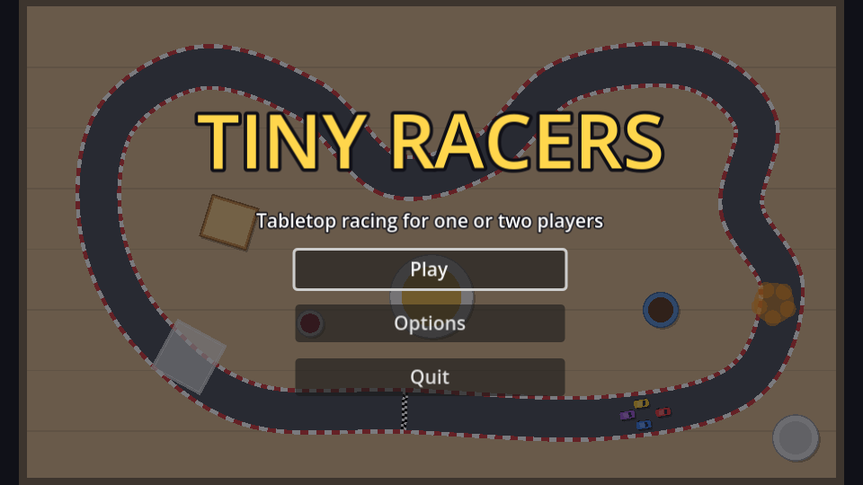

## Layout

New scene, `Control` root named `MainMenu`, saved as `main_menu.tscn`. In the toolbar's **Anchor preset** menu choose **Full Rect** so it covers the screen:

```text
MainMenu (Control, Full Rect)
├── Backdrop (CanvasLayer)          # layer -1, offset (20, 5), scale (0.5, 0.5)
├── Dim (ColorRect, Full Rect)      # #0d0d14 at 55% alpha
└── CenterContainer (Full Rect)
    └── VBoxContainer               # min width 200, separation 12
        ├── Title (Label)           # "TINY RACERS", size 56, colour #ffd64d, outline 10
        ├── Tagline (Label)         # "Tabletop racing for one or two players"
        ├── PlayButton (Button, %)  # min width 200, Shrink Center
        ├── OptionsButton (Button)
        └── QuitButton (Button, %)
```

## A race in the background

The backdrop is a real race: the first track and four CPU cars, lapping forever. It costs almost nothing to build, because everything it needs already exists.

The trick is the `Backdrop` **CanvasLayer**. A canvas layer can be scaled and offset as a whole, and layer -1 draws behind the menu (layer 0). At scale 0.5 the 1200×700 breakfast table shrinks to 600×350 and fits the 640×360 screen, offset 20 px from the left. Physics doesn't care about the layer's transform: the cars still drive in normal track coordinates, they're just *drawn* at half size. No camera needed.

## The script

Connect the three buttons' `pressed` signals to `MainMenu`:

```gdscript title="main_menu.gd"
extends Control

const CAR_SCENE := preload("res://car.tscn")
const DEMO_COLORS: Array[Color] = [Color("e23b3b"), Color("3b7be2"), Color("f2c230"), Color("9b59d0")]

@onready var play_button: Button = %PlayButton
@onready var quit_button: Button = %QuitButton
@onready var backdrop: CanvasLayer = $Backdrop


func _ready() -> void:
	# Browsers can't close the tab for us, so hide Quit in web builds.
	quit_button.visible = not OS.has_feature("web")
	play_button.grab_focus()
	_start_demo_race()


## A few CPU cars lapping the first track behind the menu.
func _start_demo_race() -> void:
	var track: Track = Session.TRACKS[0].scene.instantiate()
	backdrop.add_child(track)
	for slot in DEMO_COLORS.size():
		var car: Car = CAR_SCENE.instantiate()
		car.input_prefix = ""
		car.color = DEMO_COLORS[slot]
		car.track = track
		car.transform = track.grid_transform(slot)
		car.ai = AIDriver.new(car, track, 0.8)
		backdrop.add_child(car)


func _on_play_button_pressed() -> void:
	get_tree().change_scene_to_file("res://mode_select.tscn")


func _on_options_button_pressed() -> void:
	get_tree().change_scene_to_file("res://options_menu.tscn")


func _on_quit_button_pressed() -> void:
	get_tree().quit()
```

There's no race script here: no checkpoints connected, no laps, no HUD. The track still creates its checkpoints and emits `checkpoint_entered`, but nobody's listening, so nothing happens. That's the decoupling from the laps chapter paying off: the track and cars work without a race.

`grab_focus()` makes the menu keyboard-friendly: the arrow keys move between buttons and <kbd>Enter</kbd> or <kbd>Space</kbd> presses them. Godot works out the focus order from the layout.

:::warning
`options_menu.tscn` arrives in the next chapter, so **Options** prints an error until then.
:::

## Make it the main scene

**Project Settings → Application → Run → Main Scene**: `res://main_menu.tscn`. <kbd>F5</kbd> now starts at the menu; <kbd>F6</kbd> still runs whatever scene is open, which is handy for jumping straight into a race.

```quiz
question: Why do the demo cars drive correctly even though the Backdrop layer is scaled to 0.5?
options:
  - A CanvasLayer's transform only changes how its children are drawn; their positions and physics stay in normal track coordinates
  - Godot scales the car speeds down automatically
  - Physics is disabled in menus
answer: 0
```

```quiz
question: Which method makes a button respond to the keyboard as soon as the menu opens?
type: text
answer: [grab_focus, grab_focus()]
```
