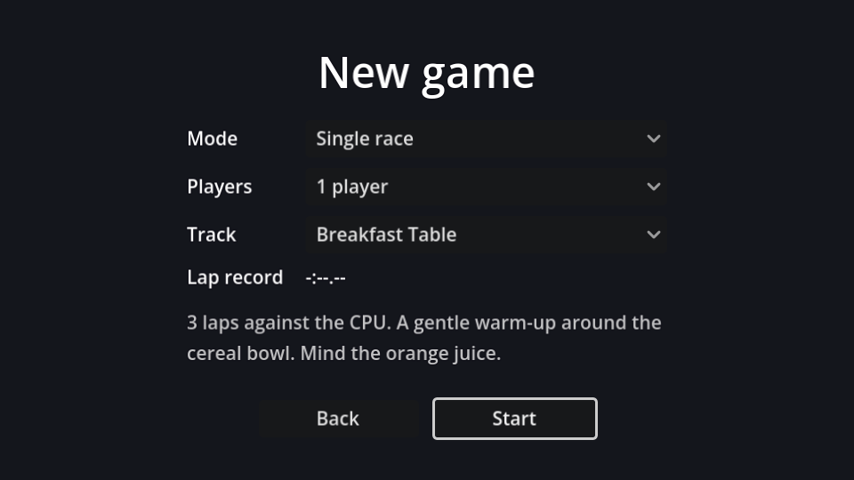

## Layout

New scene, `Control` root named `ModeSelect` (Full Rect), saved as `mode_select.tscn`:

```text
ModeSelect (Control, Full Rect)
└── CenterContainer (Full Rect)
    └── VBoxContainer                      # min width 360, separation 14
        ├── Title (Label)                  # "New game", size 32
        ├── Grid (GridContainer)           # columns 2
        │   ├── Label "Mode"     ├── ModeOption (OptionButton, %)
        │   ├── Label "Players"  ├── PlayersOption (OptionButton, %)
        │   └── Label "Track"    └── TrackOption (OptionButton, %)
        ├── DescriptionLabel (Label, %)    # min size 360×54, Autowrap: Word (Smart), 75% opacity
        └── Buttons (HBoxContainer)        # alignment Center
            ├── BackButton (Button)        # min width 120
            └── StartButton (Button, %)    # min width 120
```

Give `ModeOption` three items in the Inspector's **Items** list, in this order: "Single race", "Championship", "Head-to-head". The order matches `Session.Mode` (`RACE`, `CHAMPIONSHIP`, `HEAD_TO_HEAD`), so an item's index *is* the mode. `PlayersOption` gets "1 player" and "2 players". `TrackOption` stays empty: it's filled from `Session.TRACKS`.

Set `ModeOption` to **Expand** horizontally so the right column is wide enough for the track names. Connect all three OptionButtons' `item_selected` to **one** method, `_on_option_item_selected`, and the two buttons' `pressed`.

## The script

```gdscript title="mode_select.gd"
extends Control

@onready var mode_option: OptionButton = %ModeOption
@onready var players_option: OptionButton = %PlayersOption
@onready var track_option: OptionButton = %TrackOption
@onready var description_label: Label = %DescriptionLabel
@onready var start_button: Button = %StartButton


func _ready() -> void:
	for info in Session.TRACKS:
		track_option.add_item(info.title)
	# Start from whatever was picked last time.
	mode_option.selected = Session.mode
	players_option.selected = Session.players - 1
	track_option.selected = Session.track_index
	_refresh()
	start_button.grab_focus()


func _refresh() -> void:
	var mode := mode_option.selected as Session.Mode
	var info := Session.TRACKS[track_option.selected]
	# A championship always runs every track, in order.
	track_option.disabled = mode == Session.Mode.CHAMPIONSHIP
	var opponent := "the CPU" if players_option.selected == 0 else "each other"
	match mode:
		Session.Mode.RACE:
			description_label.text = "Three laps against %s. %s" % [opponent, info.description]
		Session.Mode.CHAMPIONSHIP:
			description_label.text = "Every track in a row, against %s. Points for each race: 10, 6, 3 and 1." % opponent
		Session.Mode.HEAD_TO_HEAD:
			description_label.text = "Two cars, one screen. Fall off the leader's screen and you lose a point. Take all eight to win."


func _on_option_item_selected(_index: int) -> void:
	_refresh()


func _on_start_button_pressed() -> void:
	Session.players = players_option.selected + 1
	Session.track_index = track_option.selected
	var mode := mode_option.selected as Session.Mode
	if mode == Session.Mode.CHAMPIONSHIP:
		Session.start_championship()
	else:
		Session.mode = mode
	get_tree().change_scene_to_file("res://race.tscn")


func _on_back_button_pressed() -> void:
	get_tree().change_scene_to_file("res://main_menu.tscn")
```

- The menu reads its starting values **from** `Session`, so coming back after a race shows what you picked last time.
- `as Session.Mode` converts the item index into the enum type. Without the cast, Godot warns about assigning a plain `int` to an enum variable.
- `start_championship()` sets the mode and also resets the track and the points; the other modes just set the mode. The track choice is ignored in a championship, which is why the dropdown is disabled.

Remove any testing values you put in `session.gd` (`mode` should default to `Mode.RACE`) and play through: menu → new game → race → results → main menu.

```quiz
question: Why do the ModeOption items have to be in the same order as `Session.Mode`?
options:
  - OptionButtons sort themselves alphabetically otherwise
  - The script converts the selected index straight into a mode with `as Session.Mode`
  - The order only matters for keyboard focus
answer: 1
```
