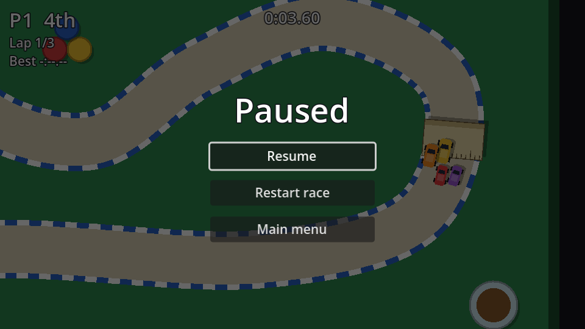

## How pausing works

`get_tree().paused = true` freezes `_process` and `_physics_process`, physics, timers and tweens for every node, depending on its **Process → Mode**:

| Mode | While paused |
| --- | --- |
| Inherit (default) | Same as its parent; the root is *Pausable* |
| Pausable | Stops |
| When Paused | Runs *only* while paused |
| Always | Keeps running |
| Disabled | Never runs |

The pause menu itself must keep working while everything else is frozen, otherwise you could never unpause.

## The scene

New scene, `CanvasLayer` root named `PauseMenu`, **Layer** `10`, **Process → Mode** `Always`, saved as `pause_menu.tscn`:

```text
PauseMenu (CanvasLayer, layer 10, process mode Always)
├── Dim (ColorRect, Full Rect)        # black at 60% alpha
└── CenterContainer (Full Rect)
    └── VBoxContainer                 # min width 180, separation 12
        ├── Title (Label)             # "Paused", size 36
        ├── ResumeButton (Button, %)
        ├── RestartButton (Button)    # "Restart race"
        └── MainMenuButton (Button)
```

```gdscript title="pause_menu.gd"
extends CanvasLayer

@onready var resume_button: Button = %ResumeButton


func _ready() -> void:
	hide()


func _unhandled_input(event: InputEvent) -> void:
	if event.is_action_pressed("pause"):
		set_paused(not get_tree().paused)
		get_viewport().set_input_as_handled()


func set_paused(paused: bool) -> void:
	get_tree().paused = paused
	visible = paused
	if paused:
		resume_button.grab_focus()


func _on_resume_button_pressed() -> void:
	set_paused(false)


func _on_restart_button_pressed() -> void:
	get_tree().paused = false
	get_tree().reload_current_scene()


func _on_main_menu_button_pressed() -> void:
	get_tree().paused = false # The pause state outlives the scene!
	get_tree().change_scene_to_file("res://main_menu.tscn")
```

- `_unhandled_input` only gets events that no UI control used, the right place for gameplay keys like pause.
- `set_input_as_handled()` stops the same <kbd>Esc</kbd> press reaching anything else.
- **Restart race** reloads the scene. In a championship that re-runs the current race. That's fair, because points are only awarded when the results appear.

:::danger[Unpause before leaving]
`paused` belongs to the **SceneTree**, not to the scene. Change scene without resetting it and the next scene loads frozen.
:::

Instance `pause_menu.tscn` in `race.tscn`. Everything in the race is *Pausable*: the cars, the camera, and the countdown, round and end timers all freeze and resume exactly where they were.

One last detail: once the results are up, pausing would just stack a second menu on top. Switch the pause key off at that point:

```gdscript title="race.gd" ins={1,6}
@onready var pause_menu: CanvasLayer = $PauseMenu

# ...

func _on_end_timer_timeout() -> void:
	pause_menu.set_process_unhandled_input(false)
	if head_to_head:
		# ...
```

```quiz
question: Which process mode should the pause menu have?
options:
  - Pausable
  - When Paused
  - Always
  - Disabled
answer: 2
explain: '**When Paused** would keep the buttons working, but then `_unhandled_input` wouldn''t run during the race, so pressing Esc could never open the menu. **Always** covers both.'
```
