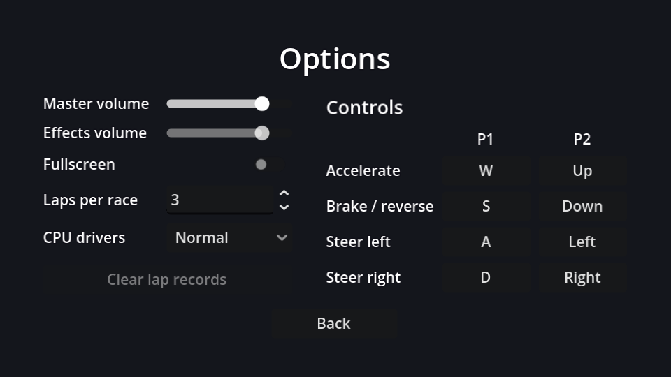

## Layout

New scene, `Control` root (Full Rect) named `OptionsMenu`, saved as `options_menu.tscn`. This page builds the left column; the next one adds the controls on the right.

```text
OptionsMenu (Control, Full Rect)
├── CenterContainer (Full Rect)
│   └── VBoxContainer                          # separation 14
│       ├── Title (Label)                      # "Options", size 28
│       ├── Columns (HBoxContainer)            # separation 32
│       │   └── SettingsColumn (VBoxContainer) # separation 12
│       │       └── SettingsGrid (GridContainer)    # columns 2
│       │           ├── Label "Master volume"   ├── MasterSlider (HSlider, %)
│       │           ├── Label "Effects volume"  ├── SfxSlider (HSlider, %)
│       │           ├── Label "Fullscreen"      ├── FullscreenCheck (CheckButton, %)
│       │           ├── Label "Laps per race"   ├── LapsSpin (SpinBox, %)
│       │           └── Label "CPU drivers"     └── DifficultyOption (OptionButton, %)
│       └── BackButton (Button)                # min width 120, Shrink Center
└── TestSound (AudioStreamPlayer)              # bus: SFX
```

| Node | Properties |
| --- | --- |
| `MasterSlider`, `SfxSlider` | Max Value `1`, Step `0.05`, Custom Minimum Size x `120`, Size Flags vertical **Shrink Center** |
| `LapsSpin` | Min `1`, Max `9` |
| `DifficultyOption` | Items: "Easy", "Normal", "Hard" (the same order as `Settings.CPU_SKILL`) |

A `GridContainer` fills row by row, so add the children in label, control, label, control... order. Sliders are thin, so **Shrink Center** stops them sticking to the top of their row.

## The script

Connect each control's change signal to `OptionsMenu`: `value_changed` for the sliders and the SpinBox, `toggled` for the CheckButton, `item_selected` for the OptionButton, and `pressed` for Back.

```gdscript title="options_menu.gd"
extends Control

@onready var master_slider: HSlider = %MasterSlider
@onready var sfx_slider: HSlider = %SfxSlider
@onready var fullscreen_check: CheckButton = %FullscreenCheck
@onready var laps_spin: SpinBox = %LapsSpin
@onready var difficulty_option: OptionButton = %DifficultyOption


func _ready() -> void:
	# The *_no_signal setters avoid triggering our change handlers (and the test sound).
	master_slider.set_value_no_signal(Settings.master_volume)
	sfx_slider.set_value_no_signal(Settings.sfx_volume)
	fullscreen_check.set_pressed_no_signal(Settings.fullscreen)
	laps_spin.set_value_no_signal(Settings.laps)
	difficulty_option.selected = Settings.cpu_difficulty
	master_slider.grab_focus()


func _on_master_slider_value_changed(value: float) -> void:
	Settings.master_volume = value
	Settings.apply()


func _on_sfx_slider_value_changed(value: float) -> void:
	Settings.sfx_volume = value
	Settings.apply()
	$TestSound.play() # Let the player hear the new volume.


func _on_fullscreen_check_toggled(toggled_on: bool) -> void:
	Settings.fullscreen = toggled_on
	Settings.apply()


func _on_laps_spin_value_changed(value: float) -> void:
	Settings.laps = int(value)


func _on_difficulty_option_item_selected(index: int) -> void:
	Settings.cpu_difficulty = index


func _on_back_button_pressed() -> void:
	Settings.save_settings()
	get_tree().change_scene_to_file("res://main_menu.tscn")
```

Changes apply **immediately** (you hear the volume change while dragging) and are **saved** when you leave the screen. Saving on every slider tick would write the file dozens of times a second.

:::warning[The `_no_signal` setters]
Setting `slider.value = x` emits `value_changed` exactly as dragging does. In `_ready` that would run every handler and play the test sound as soon as the screen opens. `set_value_no_signal` and `set_pressed_no_signal` update the control quietly. (Setting an OptionButton's `selected` never emits `item_selected`, so it needs no special treatment.)
:::

`TestSound` has nothing to play yet; it gets the bump sound in the polish chapter.

```quiz
question: In `_ready`, why use `set_value_no_signal` instead of assigning `value`?
options:
  - Assigning value is deprecated
  - Assigning value emits value_changed, which would run the handlers and play the test sound
  - set_value_no_signal is faster
answer: 1
```
