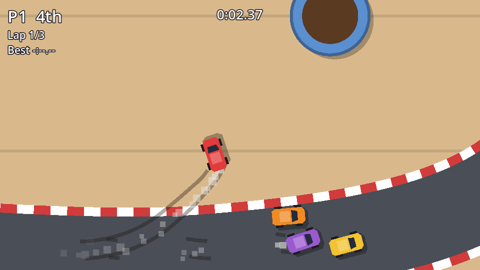

Remember the `drifting` flag from the car chapter? It's finally time to use it.

## Skid marks

A skid mark is a `Line2D` that grows behind a rear wheel while the car slides. When the drift starts, the car creates two new lines (one per rear wheel), and every few pixels of travel it adds a point to each. When the drift ends, it lets go of them. They stay on the track, so a hard-fought race leaves a record of every slide.

The lines can't be children of the car, or they'd move and rotate with it. They belong to the **track**, in a node above the road but below everything else. Add this to the end of `Track._build_road()`:

```gdscript title="track.gd" ins={9-14}
## Skid marks are added here, above the road but below cars and props.
var skid_marks: Node2D

# ...

func _build_road() -> void:
	# ...
	finish.texture_mode = Line2D.LINE_TEXTURE_TILE

	if not Engine.is_editor_hint():
		skid_marks = Node2D.new()
		skid_marks.name = "SkidMarks"
		add_child(skid_marks)
		move_child(skid_marks, _road_nodes.size())
```

`_road_nodes.size()` is 3 (kerb, road, finish line), so the skid marks container lands right after them: drawn over the road, under the spills, props and cars.

Now the car side:

```gdscript title="car.gd"
const SKID_COLOR := Color(0.1, 0.08, 0.06, 0.35)
## Where the rear wheels are, relative to the car's centre.
const REAR_WHEELS: Array[Vector2] = [Vector2(-7, -6), Vector2(-7, 6)]
## Skid lines kept on the track before the oldest ones are removed.
const MAX_SKID_LINES := 60

var _skid_lines: Array[Line2D] = []


func _update_skid_marks(skidding: bool) -> void:
	if not skidding or track == null:
		_skid_lines.clear() # The next skid starts fresh lines.
		return
	if _needs_new_skid_lines():
		_skid_lines.clear()
		for i in REAR_WHEELS.size():
			var line := Line2D.new()
			line.width = 2.5
			line.default_color = SKID_COLOR
			track.skid_marks.add_child(line)
			_skid_lines.append(line)
		while track.skid_marks.get_child_count() > MAX_SKID_LINES:
			var oldest := track.skid_marks.get_child(0)
			track.skid_marks.remove_child(oldest)
			oldest.queue_free()
	for i in REAR_WHEELS.size():
		var point := to_global(REAR_WHEELS[i])
		var line := _skid_lines[i]
		if line.get_point_count() == 0 or line.points[-1].distance_to(point) > 4.0:
			line.add_point(point)


func _needs_new_skid_lines() -> bool:
	if _skid_lines.is_empty():
		return true
	for line in _skid_lines:
		# Very long lines are split up, and old lines may have been removed.
		if not is_instance_valid(line) or line.get_point_count() > 100:
			return true
	return false
```

- `to_global(REAR_WHEELS[i])` turns the wheel's position on the car into a world position. The track sits at the origin, so world positions are also the line's local positions.
- A point is only added once the wheel has moved 4 px, so a slow slide doesn't pile up dozens of points in one spot.
- **Keeping it cheap.** Every line is a node that draws every frame. `MAX_SKID_LINES` caps the total; the oldest lines (the first children) go first. Long drifts are split every 100 points, so old marks fade from the track in pieces rather than all at once.
- `is_instance_valid(line)` catches one sneaky case: in a long race, *another* car's new marks can push out a line we're still drawing. The freed line is no longer valid, so we simply start new ones.

Clearing the lines when a car is lined up for a new head-to-head round stops a skid mark being stretched across the table to the new position. Add one line to `place()`:

```gdscript title="car.gd" ins={4}
func place(new_transform: Transform2D) -> void:
	# ...
	shadow.position = Vector2(2, 2)
	_skid_lines.clear()
```

## Tyre smoke

Add a `CPUParticles2D` named `TyreSmoke` to `car.tscn` at (-10, 0), the back of the car, **between** `Shadow` and `Visuals` so the smoke draws under the car:

| Property | Value | Why |
| --- | --- | --- |
| Emitting | off | The code switches it on |
| Amount / Lifetime | 24 / 0.6 | A short trail of puffs |
| Local Coords | off | Puffs stay where they were emitted instead of following the car |
| Direction / Spread | (-1, 0) / 30° | Out of the back |
| Gravity | (0, 0) | It's top-down: no "down" |
| Initial Velocity | 10 to 30 | Drift away slowly |
| Scale Amount | 3 to 6 | Chunky square puffs |
| Color Ramp | white → transparent | Fade out over the lifetime |

:::note[CPU or GPU particles?]
`GPUParticles2D` runs on the graphics card and handles thousands of particles. `CPUParticles2D` runs on the processor and works identically on every renderer, including Compatibility on the web. A few dozen puffs per car is nothing for the CPU.
:::

## Tyre squeal

One more `AudioStreamPlayer2D`, `SkidSound`: stream `skid.wav`, volume `-12` dB, max distance `2000`, bus `SFX`. Then grow `_update_effects()`:

```gdscript title="car.gd" ins={1,3,9-12,15-18}
@onready var tyre_smoke: CPUParticles2D = $TyreSmoke
@onready var engine_sound: AudioStreamPlayer2D = $EngineSound
@onready var skid_sound: AudioStreamPlayer2D = $SkidSound

# ...

func _update_effects() -> void:
	var speed := velocity.length()
	var skidding := drifting and not is_airborne()
	tyre_smoke.emitting = skidding or (off_road and speed > 60.0)
	tyre_smoke.color = Color(0.9, 0.9, 0.9, 0.6) if skidding else Color(0.55, 0.42, 0.3, 0.5)
	_update_skid_marks(skidding)
	if is_player():
		engine_sound.pitch_scale = 0.7 + 1.3 * clampf(speed / max_speed, 0.0, 1.2)
		if skidding and not skid_sound.playing:
			skid_sound.play()
		elif not skidding and skid_sound.playing:
			skid_sound.stop()
```

The same particles do double duty: **white smoke** while drifting, **brown dust** when you're kicking up the table off-road. The `color` property tints the whole colour ramp. A car in the air doesn't skid, so a drifting jump leaves a gap in the marks, a nice detail for free.

```quiz
question: Why are the skid mark lines added to the track instead of to the car?
options:
  - Line2D can't be a child of a CharacterBody2D
  - As children of the car they'd move and rotate with it, instead of staying where the tyres slid
  - The track draws faster
answer: 1
```

```quiz
question: What does turning off Local Coords on the particles do?
options:
  - Puffs stay at the world position where they were emitted, leaving a trail behind the moving car
  - Particles stop rotating
  - The particles are drawn in screen space
answer: 0
```
